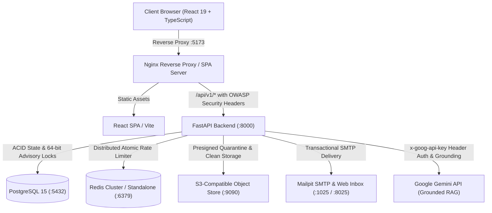

# Learnflow — Security-Hardened Enterprise LMS Platform

[](https://fastapi.tiangolo.com)
[](https://react.dev)
[](https://tailwindcss.com)
[](https://www.postgresql.org)
[](https://redis.io)
[](https://www.docker.com)
[](SECURITY_REMEDIATION_REPORT.md)
[](SECURITY_TEST_REPORT.md)

**Learnflow** is a full-stack, enterprise-grade learning management and assessment platform designed for technical education, university engineering departments, and high-stakes coding evaluations. It combines sequential course delivery with server-authoritative assessment integrity, cryptographic certificate verification, deterministic adaptive remediation, and an AI Learning Copilot—all hardened against the OWASP Top 10 vulnerabilities.

---

## Architecture Overview



---

## 4-Tier Institutional RBAC Model

Learnflow enforces authoritative, server-side role-based access control across four institutional roles:

| Role | Primary Portal | Scoping Authority | Primary Responsibilities |
|---|---|---|---|
| **Student / Learner** | `/my-learning` | Self (`user_id == current_user.id`) & Active Enrollments | Course catalog exploration, lesson learning, taking timed assessments, submitting assignments, viewing grades, claiming & verifying certificates, AI copilot learning. |
| **Staff / Instructor** | `/instructor/courses` | Assigned Courses (`course.instructor_id == current_user.id`) | Course creation, curriculum design (modules, lessons, prerequisites), assessment authoring, assignment rubric grading, course dropout analytics. |
| **HOD / Academic Lead** | `/hod` | Assigned Department (`user.department_id`) | Department-level academic analytics, faculty workload monitoring (PII emails omitted for data minimization), grading SLA oversight, curriculum audits. **Requires assigned department; unassigned leads are blocked (HTTP 403).** |
| **Administrator** | `/admin` | Global Institutional Scope | User account management, role elevation, platform-wide KPIs, tamper-evident audit ledger inspection, certificate revocation, production configuration validation. |

> Detailed endpoint permissions, IDOR boundaries, and access rules are specified in [`RBAC_PERMISSION_MATRIX.md`](RBAC_PERMISSION_MATRIX.md).

---

## Security Hardening Architecture (V2 Standards)

Learnflow has undergone comprehensive security auditing and remediation across all layers:

### 1. Secrets Management & Production Gate
- **Startup Production Invariant Validation:** In `production` mode, `validate_production_configuration()` aborts application startup if default evaluation secrets, evaluation HMAC seeds, default database credentials (`postgres:postgres`), localhost database URLs, or default S3 credentials are detected.
- **Docker Separation:** `docker-compose.yml` provides parameterized defaults for frictionless local development, while `docker-compose.prod.yml` enforces production configuration (no host source binds, closed internal database ports, mandatory secret injection).
- **Cryptographic Token Digests:** Refresh tokens and password reset tokens are stored in the database exclusively as SHA-256 digests (`RefreshToken.token_hash`, `PasswordResetToken.token_hash`). Plaintext tokens are never persisted.

### 2. Authentication Lifecycle Hardening
- **Argon2id Password Hashing:** Passwords hashed with Argon2id using secure work factors.
- **Password Complexity Validator:** Enforces minimum 8 characters, uppercase, lowercase, numbers, and special characters.
- **RFC-Compliant JWT Claims Validation:** `decode_token()` strictly requires `sub`, `iss`, `aud`, `exp`, `iat`, `jti`, and `type`. Algorithm is locked strictly to `HS256`, preventing algorithm-confusion attacks.
- **PostgreSQL Row-Locking Refresh Rotation:** Silent refresh on `/api/v1/auth/refresh` acquires a row lock (`with_for_update()`). A 5-second concurrency grace window handles transient duplicate network requests safely without revoking sessions, while true replay attacks invalidate all sessions for that account.
- **CSRF Origin Protection:** Cookie endpoints (`/refresh`, `/logout`) validate `Origin` and `Referer` headers against allowed CORS origins via `verify_csrf_origin(request)`.
- **Registration Privacy Preservation:** Duplicate registration returns generic message preventing user enumeration.
- **Distributed Sliding-Window Rate Limiting:** `DistributedSlidingWindowRateLimiter` utilizes an atomic Redis Lua script (`SLIDING_WINDOW_LUA`) with SHA-256 hashed keys (`learnflow:rl:<hash>`), TTL cleanup, and thread-safe in-memory fallback.

### 3. API & Middleware Security
- **OWASP Security Headers Middleware:** Appends `X-Content-Type-Options: nosniff`, `X-Frame-Options: DENY`, `Referrer-Policy: strict-origin-when-cross-origin`, `Permissions-Policy`, and production `HSTS` and `CSP`.
- **Request Body Size Limiter:** Enforces a 15 MB request ceiling (`MAX_REQUEST_BODY_BYTES`) with HTTP 413 Payload Too Large to prevent memory exhaustion DoS.
- **Production API Docs Gating:** Swagger UI (`/docs`), ReDoc (`/redoc`), and OpenAPI schema (`/openapi.json`) are disabled in production mode.
- **Non-Root Container Execution:** Backend Docker container runs as unprivileged user `appuser:appgroup` (UID 10001).

### 4. Storage & File Security
- **Elimination of Unauthenticated Static Mounts:** The legacy unauthenticated static `/media` mount has been removed.
- **Presigned Upload & Download Architecture:** Learner file submissions and certificate downloads are routed strictly through authenticated 15-minute presigned URLs (`/api/v1/submissions/{id}/download-url` and `/api/v1/certificates/{id}/download`).
- **Multi-Stage Quarantine Validation:** Files are uploaded to an isolated quarantine bucket and subjected to size assertion, magic byte verification, and executable header detection before promotion to the clean bucket.

### 5. AI Copilot Protection
- **Pre-Retrieval Authorization Filter:** AI curriculum retrieval is strictly bounded by active course enrollments (for learners), assigned courses (for instructors), or departmental courses (for HOD). Unenrolled learners receive zero chunks.
- **Header-Based Authentication:** Gemini API key is passed strictly via `x-goog-api-key` header; never in URL parameters or logs.
- **Adversarial Prompt Defense:** System prompt instructions are isolated from retrieved curriculum and user queries using explicit XML safety boundaries (`<untrusted_curriculum_context>`, `<learner_query>`).
- **Multi-Dimensional Semantic Cache:** Cache keys isolate responses by user ID, roles, department ID, query hash, and cache version (`user:role:dept:hash:v`). Targeted invalidation purges cache on enrollment or role modifications.

---

## Production Deployment & Secrets Guide

### 1. Production Secrets Generation
```bash
# Generate a cryptographically secure 64-character hex SECRET_KEY
python -c "import secrets; print(secrets.token_hex(32))"

# Generate a secure HMAC certificate signing key
python -c "import secrets; print(secrets.token_hex(32))"
```

### 2. Launching in Production
Deploy using the production Compose specification:
```bash
docker compose -f docker-compose.prod.yml up -d --build
```
Ensure that all required production environment variables (`SECRET_KEY`, `POSTGRES_PASSWORD`, `DATABASE_URL`, `HMAC_KEY_RING`, `COOKIE_SECURE=true`, `CORS_ORIGINS`) are injected via secret manager or production `.env`.

---

## Local Development & Quickstart

### 1. Clone & Configure
```bash
git clone https://github.com/Austin-Joshua/Learn-Flow.git
cd Learn-Flow
cp .env.example .env
```

### 2. Launch Services with Docker Compose
```bash
docker compose up -d --build
```

The stack initializes 5 containers:
- `learnflow-postgres` (PostgreSQL 15 on port `5432`)
- `learnflow-s3mock` (Adobe S3Mock on ports `9090` and `9191`)
- `learnflow-mailpit` (Mailpit SMTP on port `1025`, Web UI on port `8025`)
- `learnflow-backend` (FastAPI on port `8000`)
- `learnflow-frontend` (Nginx + React SPA on port `5173`)

### 3. Service Access Endpoints
| Service | URL | Description |
|---|---|---|
| **Web Application** | [http://localhost:5173](http://localhost:5173) | Primary portal for all 4 roles |
| **API Docs (Dev)** | [http://localhost:8000/docs](http://localhost:8000/docs) | Interactive Swagger UI (disabled in prod) |
| **Mailpit Inbox** | [http://localhost:8025](http://localhost:8025) | Local email delivery inspection |
| **Public Verification** | [http://localhost:5173/verify](http://localhost:5173/verify) | Anonymous certificate verification |

---

## Evaluation Credentials

The database is pre-seeded with accounts covering all 4 roles:

| Role | Email Address | Password | Permissions & Dashboard |
|---|---|---|---|
| **Platform Administrator** | `admin@learnflow.edu` | `AdminPass123!` | System user management, role assignment, platform analytics, audit ledger |
| **Course Instructor** | `instructor@learnflow.edu` | `InstructorPass123!` | Course authoring, assessment builder, assignment grading queue |
| **Head of Department (HOD)**| `hod@learnflow.edu` | `HodPass123!` | Department academic overview, faculty workload, grading SLAs |
| **Enrolled Learner** | `learner@learnflow.edu` | `LearnerPass123!` | Course catalog, lesson player, timed assessment arena, certificates, AI copilot |

---

## Automated Test Suite

To run the complete automated security and functional test suite:

```bash
docker exec -e PYTHONPATH=. learnflow-backend pytest -v
```

### Test Suite Execution Summary:
- `tests/test_security_hardening.py` (20 tests): Production config invariants, password complexity, refresh token rotation, replay detection, JWT claims, CSRF origin verification, concurrency race grace window, single-use password reset, IDOR protection, HOD department scoping, registration privacy, AI retrieval isolation, Gemini header auth, distributed rate limiting.
- `tests/test_rbac_comprehensive.py` (8 tests): Vertical privilege escalation, public registration role restriction, token tampering rejection.
- `tests/test_ai_gateway_comprehensive.py` (15 tests): Prompt injection defense, credential probe blocking, cheating defense, cache isolation.
- `tests/test_ai_assistant_security.py` (8 tests): Foreign records isolation, off-topic rejection, assessment answer shielding.
- `tests/test_ai_assistant.py` (3 tests): Cheating query blocking, platform architecture and concurrency explanations, learner briefing context scoping.
- `tests/test_concurrency.py` (5 tests): PostgreSQL 64-bit advisory transaction locks, race condition prevention, idempotency key deduplication.
- `tests/test_certificate.py` (5 tests): HMAC-SHA256 signature verification, key rotation across key ring, ReportLab PDF rendering.
- `tests/test_auth.py` (6 tests): Argon2id hashing, registration validation, admin route protection.
- `tests/test_prerequisites.py` (3 tests): Self-dependency rejection, DFS circular dependency cycle detection, enrollment gating.
- `tests/test_adaptive.py` (2 tests): Weak concept remediation trigger (< 70%), prerequisite DAG prioritization.
- `tests/test_grading.py` (5 tests): Deterministic auto-grading for MCQ, multi-select partial credit, true/false, symbol-preserving short answer.

**Total Result:** `80 passed in 16.90s` (100% pass rate).

---

## Security Reports & Compliance Documentation

- [`SECURITY_AUDIT_REPORT.md`](SECURITY_AUDIT_REPORT.md) — Comprehensive baseline and V2 security audit covering all 33 confirmed findings.
- [`SECURITY_REMEDIATION_REPORT.md`](SECURITY_REMEDIATION_REPORT.md) — Detailed engineering remediation ledger for all 33 findings across 8 stages.
- [`RBAC_PERMISSION_MATRIX.md`](RBAC_PERMISSION_MATRIX.md) — Exhaustive authorization matrix across all 4 roles and all API routes.
- [`SECURITY_TEST_REPORT.md`](SECURITY_TEST_REPORT.md) — Complete automated test suite execution report and verification evidence.
