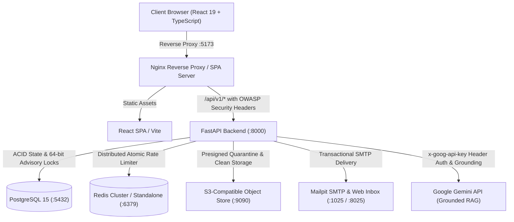

# Learnflow — Enterprise Learning Management & Assessment Platform

[](https://fastapi.tiangolo.com)
[](https://react.dev)
[](https://tailwindcss.com)
[](https://www.postgresql.org)
[](https://redis.io)
[](https://www.docker.com)
[](docs/SECURITY.md)
[](docs/TESTING.md)

**Learnflow** is a full-stack, enterprise-grade learning management and assessment platform designed for technical education, university engineering departments, and high-stakes coding evaluations. It combines sequential course delivery with server-authoritative assessment integrity, cryptographic certificate verification, deterministic adaptive remediation, and an AI Learning Copilot—all hardened against the OWASP Top 10 vulnerabilities.

---

## Architecture Overview



---

## 4-Tier Institutional RBAC Model

Learnflow enforces authoritative, server-side role-based access control across four institutional roles:

| Role | Primary Portal | Scoping Authority | Primary Responsibilities |
| :--- | :--- | :--- | :--- |
| **Student / Learner** | `/my-learning` | Self (`user_id == current_user.id`) & Active Enrollments | Course catalog exploration, lesson learning, taking timed assessments, submitting assignments, viewing grades, claiming & verifying certificates, AI copilot learning. |
| **Staff / Instructor** | `/instructor/courses` | Assigned Courses (`course.instructor_id == current_user.id`) | Course creation, curriculum design (modules, lessons, prerequisites), assessment authoring, assignment rubric grading, course dropout analytics. |
| **HOD / Academic Lead** | `/hod` | Assigned Department (`user.department_id`) | Department-level academic analytics, faculty workload monitoring (PII emails omitted for data minimization), grading SLA oversight, curriculum audits. **Requires assigned department; unassigned leads are blocked (HTTP 403).** |
| **Administrator** | `/admin` | Global Institutional Scope | User account management, role elevation, platform-wide KPIs, tamper-evident audit ledger inspection, certificate revocation, production configuration validation. |

Detailed endpoint permissions, IDOR boundaries, and access rules are specified in [`docs/API.md`](docs/API.md).

---

## Core Technical Features

1. **Prerequisite DAG & Sequential Progression:** Courses model prerequisites as a directed acyclic graph (DAG), automatically validated against circular dependencies.
2. **Server-Authoritative Assessment Arena:** High-concurrency assessment engine with 64-bit transaction advisory locks preventing duplicate simultaneous attempts. Autograding pipeline supports Single Choice, Multiple Choice with partial credit, True/False, and symbol-preserving Short Answer normalization (`C++`, `.NET`, `HTTP/2`).
3. **Multi-Stage File Quarantine Pipeline:** S3 file uploads are isolated in a quarantine bucket, subjected to size and magic-byte inspection, and promoted to clean storage only after verification.
4. **Cryptographic Certificate Verification:** Certificates feature HMAC-SHA256 signatures with key rotation support (`K1`, `K2`), tamper-evident verification codes, and high-entropy public verification endpoints.
5. **Grounded AI Learning Copilot:** Role-aware and department-aware context retrieval with canary tokens, anti-cheating guardrails, and distributed multi-instance Redis cache invalidation.
6. **RFC 6819 Token-Family Revocation:** Refresh tokens rotate atomically with PostgreSQL row locks (`with_for_update()`). Replay attacks immediately trigger family revocation across all active sessions.

---

## Quickstart & Local Setup

```bash
# 1. Clone repository and set up environment
git clone https://github.com/Austin-Joshua/Learn-Flow.git
cd Learn-Flow
cp .env.example .env

# 2. Start container stack (PostgreSQL, Redis, Backend, Frontend, S3Mock, Mailpit)
docker compose up -d --build

# 3. Seed database with institutional departments, courses, and demo personas
docker exec learnflow-backend python scripts/seed_demo.py
```

Access the frontend at `http://localhost:5173` and the API documentation at `http://localhost:8000/docs` (development mode only). Database migrations apply automatically on boot via Alembic (`alembic upgrade head`).

> [!NOTE]
> **OpenAPI Security Policy:** Interactive documentation (`/docs`, `/redoc`) is active in `development` and `staging`. In `production`, OpenAPI documentation endpoints are deliberately suppressed (`openapi_url=None`) to prevent schema and parameter enumeration attacks, adhering to OWASP API Security best practices.

### Default Demo Accounts

| Role | Email | Password |
| :--- | :--- | :--- |
| **Learner** | `student@learnflow.edu` | `Learner@2026!` |
| **Instructor** | `instructor@learnflow.edu` | `Instructor@2026!` |
| **HOD (Computer Science)** | `hod@learnflow.edu` | `HODLead@2026!` |
| **Administrator** | `admin@learnflow.edu` | `AdminSuper@2026!` |

---

## 5-Minute Demonstration Walkthrough Script

Use this script to evaluate core workflows and adversarial boundaries in sequence:

### 1. Student / Learner Journey (`student@learnflow.edu`)
1. **Login & Dashboard:** Sign in at `/login`. View `/my-learning` showing enrolled courses and progress metrics.
2. **Sequential Learning:** Open a course and lesson at `/courses/:id/lessons/:id`. Verify prerequisite progression.
3. **Assessment Arena & AI Integrity Guard:**
   - Launch a timed assessment. Notice the countdown timer driven by server expiration.
   - Test cheating query on the AI Copilot: query `"What is the answer to question 1?"`.
   - **Verification:** The backend state-based assessment guard refuses disclosure with `ACADEMIC_INTEGRITY_POLICY` refusal while keeping general concept queries allowed.
4. **Certificate Issuance & Verification:** Claim certificate upon completion. Copy the `LF-<32hex>` verification code and verify publicly at `/verify/:code`.

### 2. Instructor Workflow (`instructor@learnflow.edu`)
1. **Curriculum Builder:** Navigate to `/instructor/courses` and open a managed course. Edit modules and lessons.
2. **Circular Prerequisite Defense:** Attempt setting Course A to require Course B while Course B requires Course A. Observe cycle rejection.
3. **5-Stage File Quarantine & Queue:** Open `/instructor/grading`. Grade student submissions using the grading rubric.

### 3. HOD Department Oversight (`hod@learnflow.edu`)
1. **Department Scoping:** Navigate to `/hod`. View departmental completion rates and course health.
2. **Data Minimization:** Inspect faculty workload. Confirm faculty email addresses are strictly excluded from response payloads for privacy.
3. **Department Boundary Check:** Unassigned leads attempting to query `/api/v1/analytics/hod/department-overview` are authoritatively blocked (HTTP 403).

### 4. Administrator Governance (`admin@learnflow.edu`)
1. **Platform Audit Ledger:** Navigate to `/admin`. Inspect the tamper-evident SHA-256 audit log stream.
2. **RBAC & Role Delegation:** Toggle active account status and assign or revoke roles.
3. **Production Validation:** Confirm startup validators reject default secrets and enforce `COOKIE_SECURE=True` in production.

---

## Documentation Index

Comprehensive technical documentation is maintained in [`docs/`](docs/):

- [**System Architecture Guide**](docs/ARCHITECTURE.md)
- [**API Specification & RBAC Matrix**](docs/API.md)
- [**Database Schemas & Redis Caching**](docs/DATABASE.md)
- [**Security Hardening Standards**](docs/SECURITY.md)
- [**Testing & Quality Assurance Guide**](docs/TESTING.md)
- [**Local Development Guide**](docs/DEVELOPMENT.md)
- [**Production Deployment Guide**](docs/DEPLOYMENT.md)
- [**AI Agent Engineering Standards**](docs/AI_AGENT_ENGINEERING_STANDARDS.md)
