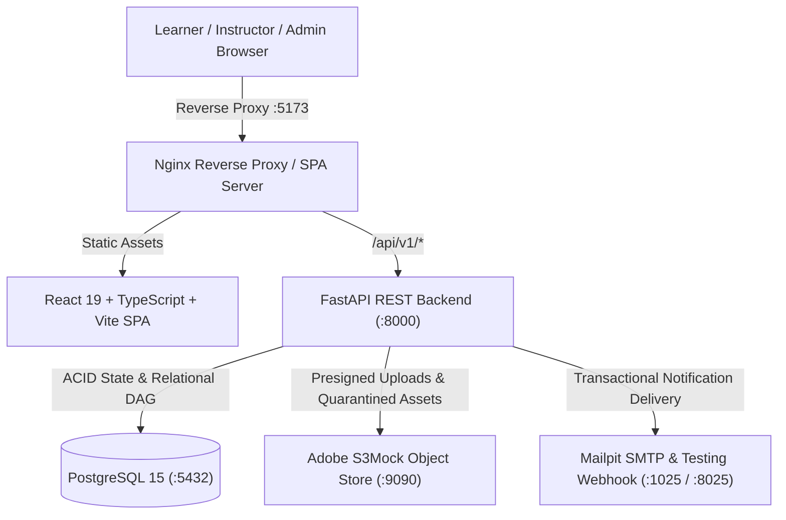

# Learnflow — Online Learning Management & Assessment Platform (LMS)

[](https://fastapi.tiangolo.com)
[](https://react.dev)
[](https://tailwindcss.com)
[](https://www.postgresql.org)
[](https://www.docker.com)
[](https://docs.pytest.org)

**Learnflow** is a full-stack, enterprise-grade learning management and assessment platform designed for technical education, university engineering departments, and high-stakes coding evaluations. It balances rich, sequential course delivery with server-authoritative assessment integrity, cryptographic certificate verification, and deterministic, explainable adaptive remediation.

---

## Architecture Overview



---

## Core Pillars & Mandatory USPs

### 1. Mandatory USP 1: Deterministic Adaptive Learning Path Engine
Unlike black-box, probabilistic, or hallucination-prone LLM tutors, Learnflow features a **fully deterministic, rule-based diagnostic engine** embedded directly into the grading lifecycle:
- **Concept Taxonomy Mapping:** Instructors tag curriculum lessons and assessment questions with diagnostic concepts (e.g., *Database Internals*, *Concurrency*, *Index Structures*).
- **Threshold Diagnostic Trigger:** Upon submission, attempts are analyzed concept-by-concept. Any concept scoring below **70%** triggers an automated remediation obligation.
- **Prerequisite-Aware DAG Traversal:** The engine interrogates the course curriculum graph. If a learner struggled with an advanced topic, the engine prioritizes uncompleted foundational prerequisite lessons before directing the learner to downstream materials.
- **Transparent Human Rationale:** Generates human-readable, auditable diagnostic explanations for each recommendation (e.g., *"Prerequisite requirement for 'LSM Compaction': You scored 0.0% on 'Database Internals' (1 missed questions). Reviewing 'LSM Trees Intro' will reinforce core understanding before proceeding."*).
- **Zero External Dependencies:** 100% deterministic, immediate computation within the ACID transaction boundary—no OpenAI, Anthropic, or external API latency.

### 2. Mandatory USP 2: Assessment Integrity Subsystem
Built for high-stakes evaluations where test security and tamper-resistance are paramount:
- **Server-Authoritative Timekeeping:** Countdown timers operate against the server's immutable `expires_at` timestamp with a strict 30-second network latency grace period.
- **Dual-Level CSPRNG Randomization:** Question sequence and answer option orders are shuffled using cryptographically secure pseudorandom numbers (`secrets.SystemRandom`) and permanently locked into the attempt's JSONB metadata.
- **Zero Solution Leakage:** Answer keys (`is_correct`) and short-answer accepted variations are strictly stripped from learner DTOs prior to submission and grading.
- **Advisory Concurrency Locks:** PostgreSQL 64-bit transaction-level advisory locks (`pg_advisory_xact_lock(hashtext(...))`) prevent race conditions, double submissions, and attempt-limit bypasses under high concurrent load.
- **Persistent Idempotency:** The `Idempotency-Key` HTTP header guarantees safe network retries without double-scoring or corrupting historical attempt tallies.

### 3. Four Question Types with Deterministic Auto-Grading
1. **Single-Choice MCQ:** Exact-match validation against the single designated option.
2. **Multiple-Select:** Weighted partial credit algorithm rewarding correct selections while proportionally penalizing incorrect selections (floored at 0.0 to prevent negative scores).
3. **True / False:** Binary boolean verification.
4. **Symbol-Preserving Short-Answer:** Proprietary normalization preserving technical symbols (`C++`, `.NET`, `HTTP/2`, `C#`, `/etc/passwd`) while stripping non-semantic casing, decorative quotes, and surrounding whitespace.

### 4. Cryptographically Verifiable Certificates
- **128-Bit CSPRNG Verification Token:** Formatted as `LF-` followed by 32 uppercase hexadecimal characters (`LF-B6EA23C6C5A412B8988124961D743D2D`).
- **HMAC-SHA256 Canonical Signature:** Signed against an authoritative, immutable payload covering learner ID, recipient name, course ID, course title, verification token, issue timestamp, and completion criteria version hash.
- **Key Ring Rotation:** Supports active and retiring signing keys (`ACTIVE_KEY_ID=v1`, `KEY_RING={"v1": "...", "v2": "..."}`).
- **Branded ReportLab PDF:** Dynamically compiles a publication-ready PDF certificate featuring the official seal, signatures, and embedded verification QR code.
- **Anonymous Public Verification Portal:** Accessible to employers and third parties at `/verify/:code`, confirming certificate authenticity and issue details without exposing learner PII.

### 5. Multi-Stage Quarantine Assignment Workflow
- Five-stage upload lifecycle: `pending` → `quarantined` → `validated` → `permanent` (or `rejected`).
- Magic byte inspection and MIME verification preventing malicious executable uploads.
- Structured rubric scoring (0–100) and qualitative feedback release with transactional email and in-app notifications.

### 6. Append-Only Tamper-Evident Audit Logging
- Dedicated audit ledger recording administrative promotions, attempt resets, grading events, certificate minting, and authentication milestones.
- SHA-256 hash chaining linking each audit record to its predecessor.
- Sensitive credentials, authorization tokens, and assessment answer keys are recursively redacted prior to persistence.

---

## Technology Stack

| Layer | Technologies |
| :--- | :--- |
| **Frontend** | React 19, TypeScript, Tailwind CSS, Vite, Lucide React, Zustand, Axios |
| **Backend** | Python 3.11, FastAPI, SQLAlchemy 2.0, Pydantic v2, Passlib (Argon2id), PyJWT, ReportLab |
| **Database** | PostgreSQL 15 (Composite Foreign Keys, Advisory Locks, Check Constraints) |
| **Object Storage** | Adobe S3Mock (S3-Compatible Storage API) |
| **Email Delivery** | Mailpit (Development SMTP & In-Memory Inspection Webhook) |
| **Reverse Proxy** | Nginx Alpine (HTML5 pushState Routing, `/api/` & `/media/` Upstream Proxy) |
| **Orchestration** | Docker & Docker Compose |

---

## Quickstart & Local Deployment

### 1. Prerequisites
- [Docker Desktop](https://www.docker.com/products/docker-desktop/) (v24+) with Docker Compose.

### 2. Launch the Platform
From the project root directory, run:

```bash
docker compose up -d --build
```

The stack initializes five coordinated containers:
1. `learnflow-postgres` (PostgreSQL 15 on port `5432`)
2. `learnflow-s3mock` (Adobe S3Mock on ports `9090` and `9191`)
3. `learnflow-mailpit` (Mailpit SMTP on port `1025` and Web UI on port `8025`)
4. `learnflow-backend` (FastAPI backend on port `8000`)
5. `learnflow-frontend` (Nginx + React SPA on port `5173`)

### 3. Service Access Endpoints

| Service | URL | Description |
| :--- | :--- | :--- |
| **Web Application** | [http://localhost:5173](http://localhost:5173) | Primary user interface for all roles |
| **API Documentation** | [http://localhost:8000/docs](http://localhost:8000/docs) | Interactive Swagger UI API documentation |
| **Alternative Docs** | [http://localhost:8000/redoc](http://localhost:8000/redoc) | ReDoc API specifications |
| **Mailpit Inbox** | [http://localhost:8025](http://localhost:8025) | Web inbox inspecting outgoing transactional emails |
| **Public Verification** | [http://localhost:5173/verify](http://localhost:5173/verify) | Anonymous public certificate verification portal |

---

## Evaluation Credentials

The database is seeded with accounts covering all three platform roles:

| Role | Email Address | Password | Permissions & Dashboard |
| :--- | :--- | :--- | :--- |
| **Platform Admin** | `admin@learnflow.edu` | `AdminPass123!` | User role elevation, platform KPIs, append-only audit ledger |
| **Course Instructor** | `instructor@learnflow.edu` | `InstructorPass123!` | Course authoring, module/lesson builder, assignment grading queue |
| **Enrolled Learner** | `learner@learnflow.edu` | `LearnerPass123!` | Course catalog, lesson player, timed assessment arena, adaptive path, certificates |

> **Convenience Feature:** The Sign In screen at `/login` provides one-click quick-fill buttons for each of the three evaluation personas.

---

## Step-by-Step Verification Walkthrough

### 1. Learner Experience & Timed Assessment Arena
1. Navigate to `http://localhost:5173/login` and click **Learner** (or log in with `learner@learnflow.edu` / `LearnerPass123!`).
2. Visit **Course Catalog** to inspect published courses and prerequisites.
3. Access **My Learning** to view active enrollments and progress bars.
4. Launch an assessment to enter the **Assessment Arena**:
   - Observe the server-authoritative countdown clock.
   - Answer Single-Choice, Multi-Select, True/False, and Short-Answer questions (e.g., typing `C++` or `.NET`).
   - Click **Submit Assessment** to trigger deterministic auto-grading.
   - Review your instant score breakdown and passing status on `/attempts/:id/result`.

### 2. Adaptive Learning Path (USP 1)
1. On the assessment result page or via the **Adaptive Path** navigation tab, observe the generated recommendations.
2. Note the deterministic rationale explaining why a specific lesson was assigned based on concepts scoring `< 70%`.
3. Click **Start Remedial Lesson** to navigate directly to the target module.

### 3. Certificate Issuance & Public Verification Portal
1. Complete a course's lessons and assessments to meet configured criteria.
2. On the Course Detail page, click **Claim Certificate**.
3. View earned credentials on the **Certificates** page.
4. Click **Download Official PDF** to stream the branded ReportLab PDF (`%PDF-1.4`).
5. Copy the 128-bit verification code (e.g., `LF-B6EA23C6C5A412B8988124961D743D2D`).
6. Open an incognito browser window, navigate to `http://localhost:5173/verify`, enter the code, and click **Verify Authenticity**:
   - The verified badge, student name (`Ada Lovelace`), course title, instructor, and timestamp are displayed without revealing learner emails.

### 4. Instructor Course Studio & Grading Queue
1. Log out and click **Instructor** on the login page (`instructor@learnflow.edu`).
2. Access the **Instructor Studio** to view managed courses and dropout funnel analytics.
3. Open the **Course Builder** to manage modules, lessons, concept taxonomy entries, and course prerequisites.
4. Open the **Grading Queue** to inspect student submissions and release rubric scores and qualitative feedback.

### 5. Administrator Governance & Tamper-Evident Audit Ledger
1. Log in as **Admin** (`admin@learnflow.edu`).
2. View platform-wide metrics: total users, enrollments, completion rates, and certificate issuance velocity.
3. In **User Administration**, promote learners to instructors or toggle account active statuses.
4. Inspect the **Append-Only Audit Ledger** to view timestamped, IP-tagged records of administrative and security events.

---

## Automated Test Suite

The backend includes a comprehensive automated test suite verifying all critical business rules, security boundaries, and grading mathematics:

```bash
cd backend
python -m pytest -v
```

### Test Coverage Highlights:
- `tests/test_adaptive.py`: Weak concept remediation trigger (< 70%), DAG prerequisite prioritization.
- `tests/test_auth.py`: Public registration learner-only enforcement, duplicate email rejection, Argon2id authentication, RBAC 403 authorization guards.
- `tests/test_certificate.py`: 128-bit CSPRNG token entropy, HMAC-SHA256 signature verification & key rotation, ReportLab binary PDF headers, completion criteria enforcement, anonymous verification endpoint.
- `tests/test_grading.py`: Symbol-preserving short-answer normalization (`C++`, `.NET`, `HTTP/2`), single-choice evaluation, weighted multi-select partial credit, true/false logic.
- `tests/test_prerequisites.py`: Self-dependency rejection, DFS graph circular dependency cycle detection, uncompleted prerequisite enrollment blocking.

**Result:** `21 passed in 2.11s` (100% pass rate).

---

## License & Evaluation Notice
Developed exclusively for the Full-Stack Developer Internship Technical Evaluation. All rights reserved.
