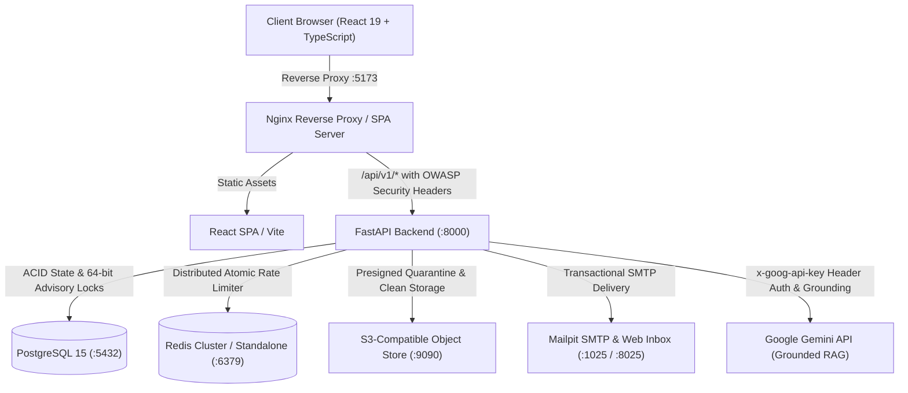

# Learnflow — Full-Stack Learning Management & Assessment Platform

[](https://fastapi.tiangolo.com)
[](https://react.dev)
[](https://tailwindcss.com)
[](https://www.postgresql.org)
[](https://redis.io)
[](https://www.docker.com)
[](docs/SECURITY.md)
[](docs/TESTING.md)

**Learnflow** is a full-stack learning management and assessment platform designed for technical education, university engineering departments, and high-stakes coding evaluations. It combines sequential course delivery with server-authoritative assessment integrity, cryptographic certificate verification, deterministic adaptive remediation, and an AI Learning Copilot—all hardened against the OWASP Top 10 vulnerabilities.

---

## Architecture Overview



---

## 4-Tier Institutional RBAC Model

Learnflow enforces authoritative, server-side role-based access control across four institutional roles:

| Role | Primary Portal | Scoping Authority | Primary Responsibilities |
| :--- | :--- | :--- | :--- |
| **Student / Learner** | `/my-learning` | Self (`user_id == current_user.id`) & Active Enrollments | Course catalog exploration, lesson learning, taking timed assessments, submitting assignments, viewing grades, claiming & verifying certificates, AI copilot learning. |
| **Staff / Instructor** | `/instructor/courses` | Assigned Courses (`course.instructor_id == current_user.id`) | Course creation, curriculum design (modules, lessons, prerequisites), assessment authoring, assignment rubric grading, course dropout analytics. |
| **HOD / Academic Lead** | `/hod` | Assigned Department (`user.department_id`) | Department-level academic analytics, faculty workload monitoring (PII emails omitted for data minimization), grading SLA oversight, curriculum audits. **Requires assigned department; unassigned leads are blocked (HTTP 403).** |
| **Administrator** | `/admin` | Global Institutional Scope | User account management, role elevation, platform-wide KPIs, append-only audit ledger inspection, certificate revocation, production configuration validation. |

Detailed endpoint permissions, IDOR boundaries, and access rules are specified in [`docs/API.md`](docs/API.md).

---

## Core Technical Features

1. **Prerequisite DAG & Sequential Progression:** Courses model prerequisites as a directed acyclic graph (DAG), automatically validated against circular dependencies.
2. **Server-Authoritative Assessment Arena:** High-concurrency assessment engine with 64-bit transaction advisory locks preventing duplicate simultaneous attempts. Autograding pipeline supports Single Choice, Multiple Choice with partial credit, True/False, and symbol-preserving Short Answer normalization (`C++`, `.NET`, `HTTP/2`).
3. **Multi-Stage File Quarantine Pipeline:** S3 file uploads are isolated in a quarantine bucket, subjected to size and magic-byte inspection, and promoted to clean storage only after verification.
4. **HMAC-SHA256 Certificate Verification:** Certificates feature HMAC-SHA256 signatures with key rotation support (`K1`, `K2`), 128-bit verification codes, and public verification endpoints validated against server-side revocation records.
5. **Grounded AI Learning Copilot:** Role-aware and department-aware context retrieval with canary tokens, timed assessments with attempt limits and audit logs, and distributed multi-instance Redis cache invalidation.
6. **RFC 6819 Token-Family Revocation:** Refresh tokens rotate atomically with PostgreSQL row locks (`with_for_update()`). Replay attacks immediately trigger family revocation across all active sessions.

---

## Quickstart & Local Setup

```bash
# 1. Clone repository and set up environment
git clone https://github.com/Austin-Joshua/Learn-Flow.git
cd Learn-Flow
cp .env.example .env

# 2. Start container stack (PostgreSQL, Redis, Backend, Frontend, S3Mock, Mailpit)
docker compose up -d --build

# 3. Seed database with institutional departments, courses, and demo personas
docker exec learnflow-backend python scripts/seed_demo.py
```

Access the frontend at `http://localhost:5173` and the API documentation at `http://localhost:8000/docs` (development mode only). Database migrations apply automatically on boot via Alembic (`alembic upgrade head`).

> [!NOTE]
> **OpenAPI Security Policy:** Interactive documentation (`/docs`, `/redoc`) is active in `development` and `staging`. In `production`, OpenAPI documentation endpoints are deliberately suppressed (`openapi_url=None`) to prevent schema and parameter enumeration attacks, adhering to OWASP API Security best practices.

### Demo Data & Test Database Isolation
- **Idempotent Demo Seeding:** `docker exec learnflow-backend python scripts/seed_demo.py` seeds four realistic, production-quality computer science courses, complete modules, autograded assessments across all four question types, rubric-graded assignments, and pre-configured role personas. Re-running the script is strictly idempotent.
- **Strict Test Database Isolation:** The automated test suite (`pytest`) runs exclusively against an isolated database (`learnflow_test`). A hard runtime safety guard in `backend/tests/conftest.py` inspects the active database connection and aborts execution if the database name does not end in `_test`, ensuring pytest fixtures never pollute or drop demo catalog data.

### Local Development & Evaluator Demo Accounts (Disabled in Production)

> [!NOTE]
> **Sample Data:** All demo accounts, personas, and seeded courses are fictional sample data created exclusively for local testing, evaluation, and demonstration.
> These accounts are provisioned exclusively in development environments via `scripts/seed_demo.py`. In production (`ENVIRONMENT=production`), demo account creation is strictly suppressed, and the initial administrator account must be provisioned using `BOOTSTRAP_ADMIN_EMAIL` and `BOOTSTRAP_ADMIN_PASSWORD`.

| Role | Email | Password | Environment |
| :--- | :--- | :--- | :--- |
| **Learner** | `learner@learnflow.edu` | `LearnerPass123!` | Development / Demo Only |
| **Instructor** | `instructor@learnflow.edu` | `InstructorPass123!` | Development / Demo Only |
| **HOD (Computer Science)** | `hod@learnflow.edu` | `HodPass123!` | Development / Demo Only |
| **Administrator** | `admin@learnflow.edu` | `AdminPass123!` | Development / Demo Only |

#### Additional Seeded Students & Faculty Personas
| Role | Persona Name | Email | Password |
| :--- | :--- | :--- | :--- |
| **Learner** | Claude Shannon | `shannon@learnflow.edu` | `LearnerPass123!` |
| **Learner** | Margaret Hamilton | `hamilton@learnflow.edu` | `LearnerPass123!` |
| **Learner** | John von Neumann | `vonneumann@learnflow.edu` | `LearnerPass123!` |
| **Learner** | Katherine Johnson | `johnson@learnflow.edu` | `LearnerPass123!` |
| **Learner** | Linus Torvalds | `torvalds@learnflow.edu` | `LearnerPass123!` |
| **Instructor** | Barbara Liskov | `liskov@learnflow.edu` | `InstructorPass123!` |
| **Instructor** | Edsger Dijkstra | `dijkstra@learnflow.edu` | `InstructorPass123!` |
| **Instructor** | Donald Knuth | `knuth@learnflow.edu` | `InstructorPass123!` |
| **HOD (Systems)** | Dennis Ritchie | `ritchie@learnflow.edu` | `HodPass123!` |

---

## Codebase Exploration & Architecture Learning

This repository integrates the official [Understand Anything](https://github.com/Egonex-AI/Understand-Anything) skill suite in `.agents/skills/` to help developers and AI agents quickly understand the Learnflow architecture:

- `/understand`: Scans the repository and builds a visual knowledge graph of all files, models, routers, and dependencies in `.ua/`.
- `/understand-chat <query>`: Ask natural-language questions about how Learnflow features, services, or APIs work (e.g., `/understand-chat How does the assignment quarantine pipeline work?`).
- `/understand-dashboard`: Launches the interactive web graph dashboard for visual architecture exploration.
- `/understand-explain <target>`: Deep-dive explanation into any file or function (e.g., `/understand-explain backend/app/services/ai_gateway.py`).
- `/understand-onboard`: Step-by-step guided architectural onboarding walkthrough of the entire LMS codebase.
- `/understand-diff`: Assesses ripple effects and architectural blast radius before committing changes.
- `/understand-domain`: Maps codebase modules to academic LMS domain workflows.

---

## 5-Minute Demonstration Walkthrough Script

Use this script to evaluate core workflows and adversarial boundaries in sequence:

### 1. Student / Learner Journey (`learner@learnflow.edu`)
1. **Login & Dashboard:** Sign in at `/login` using the 1-click **Learner** button. View `/my-learning` showing active and completed courses.
2. **Interactive Mountain Trail:** Navigate to `/my-journey`. Inspect Course 1 (completed 100%), Course 2 (active 50% with Module 2 unlocked), and Course 4 (enrolled at basecamp). Note waypoint action buttons (Take Assessment / Resume / View Result).
3. **Sequential Learning & Downloadable Resources:** Open `/courses/system-design-distributed-architecture/lessons/:id`. In the Lesson Player, download instructor-attached reference files via authorized presigned URLs.
4. **Timed Assessment Arena:** Launch the midterm assessment. Autograding evaluates all 4 question types (Single Choice, Multiple Choice with partial credit, True/False, and symbol-preserving Short Answer like `TCP` or `HTTP/2`). Instant concept mastery diagnostics display on completion. Answer keys remain strictly server-side.
5. **Assignment Submission via Quarantine:** On CourseDetailPage, submit a solution file to the assignment. File streams to the presigned S3 quarantine bucket and undergoes magic-byte inspection before promotion.
6. **Certificate Evaluation & Public Verification:** Claim certificate once eligible based on live completion criteria. Copy the verification code and verify at `/verify`. Test revoked certificate `LF-REVOKED9999DEMO` to observe clear revocation notice.

### 2. Instructor Workflow (`instructor@learnflow.edu`)
1. **Course & Curriculum Builder:** Open `/instructor/courses` and manage a course. Create assessments, questions across all 4 types, assignments, downloadable lesson resources, and completion criteria thresholds.
2. **Guarded Deletions:** Attempt deleting content with active student attempts; verify the system rejects destructive edits with clear explanation.
3. **Rubric Grading Queue:** Open `/instructor/grading`. Grade student submissions with numeric points and qualitative commentary.
4. **Explainable At-Risk Analytics:** Open `/instructor/courses/:id/analytics`. Inspect the **Learners Needing Academic Support** panel highlighting students (e.g. Charles Babbage) with transparent factors: pace delay, low attempt scores, and missed assignment due dates.

### 3. HOD Department Oversight (`hod@learnflow.edu`)
1. **Department Scoping:** Navigate to `/hod`. View departmental course health, student completion velocity, and grading SLAs.
2. **Data Minimization:** Inspect faculty workload and the summary count of at-risk students. Confirm personal student and faculty email addresses are strictly excluded from response payloads for privacy.
3. **Department Boundary Check:** Unassigned leads attempting to query `/api/v1/analytics/hod/department-overview` are authoritatively blocked (HTTP 403).

### 4. Administrator Governance (`admin@learnflow.edu`)
1. **Platform Audit Ledger:** Navigate to `/admin`. Inspect the append-only SHA-256 hash-chained audit log stream.
2. **RBAC & Role Delegation:** Toggle active account status and assign or revoke roles.
3. **Production Validation:** Confirm startup validators reject default secrets and enforce `COOKIE_SECURE=True` in production.

---

## Assessment Integrity: What It Does and Does Not Do

Learnflow enforces transparent, backend-authoritative assessment controls designed for academic coursework while maintaining clear, honest boundaries regarding the limits of web-based testing.

### What Assessment Integrity DOES Do
- **Server-Side Timing:** Assessment initiation records an authoritative start timestamp in PostgreSQL. Duration is validated on the backend upon submission against `time_limit_minutes`. Client-side clock manipulation or paused browser timers cannot extend the testing window.
- **Per-Attempt Randomization:** Questions and multiple-choice answer options are shuffled per attempt at generation time, mitigating pattern copying and shoulder surfing.
- **Strict Attempt Limits:** Maximum attempt thresholds (`max_attempts`) are enforced with database transaction locks (`pg_advisory_xact_lock`), preventing race conditions or replay attempts.
- **Append-Only Audit Logging:** Assessment starts, submission timestamps, and autograding outcomes are committed to the SHA-256 hash-chained audit stream with IP addresses and user identifiers.
- **Strict Role & Enrollment Scoping:** Only learners with active course enrollments may initialize attempts. Answer keys are strictly kept server-side and never returned to the browser during active attempts.

### What Assessment Integrity DOES NOT Do
- **No Webcam Surveillance or Eye Tracking:** Learnflow does not capture video, track head movement, monitor eye gaze, or process biometric data.
- **No Lockdown Browser Sandbox:** The application runs inside standard modern web browsers; it does not freeze operating system tasks, restrict dual-monitor configurations, or disable background desktop applications.
- **No Out-of-Band Collusion Prevention:** Learnflow cannot detect or prevent out-of-band collaboration, communication via secondary devices (smartphones, separate laptops), or consulting physical textbooks.
- **No Decentralized Ledger or Public-Key PKI:** Course certificates use HMAC-SHA256 signatures with secret key rotation (`HMAC_KEY_RING`) checked against a central PostgreSQL record with an administrative revocation flag. They do not use a public blockchain, distributed ledger, or asymmetric X.509 PKI certificates.

---

## Documentation Index

Comprehensive technical documentation is maintained in [`docs/`](docs/):

- [**Comprehensive Project Report**](docs/PROJECT_REPORT.md) — Problem statement, architecture, tech choices, 10 security invariants, and test counts.
- [**Evaluator Demo Script (7.5 min)**](docs/DEMO_SCRIPT.md) — Step-by-step evaluator walkthrough across all 4 personas, sequential journey, and security checks.
- [**System Architecture Guide**](docs/ARCHITECTURE.md)
- [**API Specification & RBAC Matrix**](docs/API.md)
- [**Database Schemas & Redis Caching**](docs/DATABASE.md)
- [**Security Hardening Standards**](docs/SECURITY.md)
- [**Testing & Quality Assurance Guide**](docs/TESTING.md)
- [**Local Development Guide**](docs/DEVELOPMENT.md)
- [**Production Deployment Guide**](docs/DEPLOYMENT.md)
- [**AI Agent Engineering Standards**](docs/AI_AGENT_ENGINEERING_STANDARDS.md)
