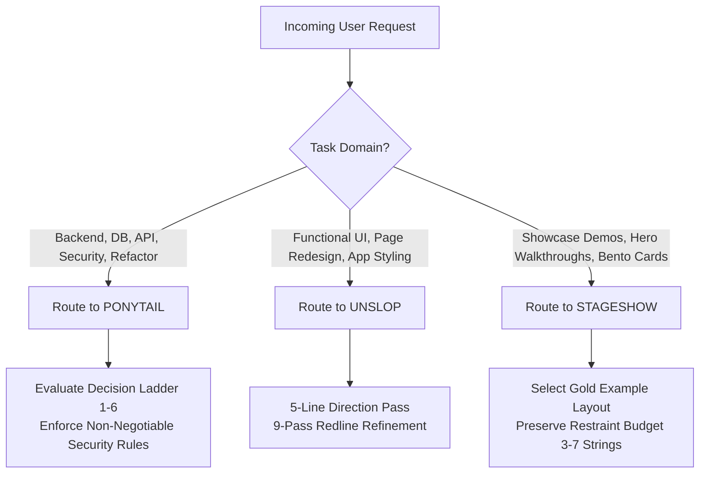

# Learnflow LMS — Multi-Skill AI Agent Engineering Standards

This document establishes the official AI Agent Engineering Standards for Learnflow LMS across all supported development harnesses, specifically **Google Antigravity (AGY)** and multi-agent IDE integrations.

Three official specialized skills are integrated to work harmoniously across the codebase:
1. **Ponytail** (`DietrichGebert/ponytail`): Engineering efficiency, minimal complete changes, and code quality.
2. **Unslop** (`heydamir/unslop`): Actual application UI/UX craftsmanship, deliberate typography, and removing AI-generated visual slop.
3. **Stageshow** (`benjitaylor/skills/stageshow`): Believable product demonstrations, marketing bento cards, and interactive showcase visuals.

---

## 1. Official Skill Sources & Provenance

| Skill | Repository | Path in Learnflow | License / Attribution |
| :--- | :--- | :--- | :--- |
| **Ponytail** (and 5 sub-skills) | [DietrichGebert/ponytail](https://github.com/DietrichGebert/ponytail) | `.agents/skills/ponytail*` | MIT |
| **Unslop** | [heydamir/unslop](https://github.com/heydamir/unslop) | `.agents/skills/unslop` | CC BY 4.0 (Damir Sokolovsky) |
| **Stageshow** | [benjitaylor/skills](https://github.com/benjitaylor/skills) | `.agents/skills/stageshow` | MIT (Benji Taylor) |

---

## 2. Skill Purposes & Domain Scopes

### 2.1 Ponytail — Engineering Standard
* **Core Philosophy:** The best code is the code never written. Solve the whole problem with the least new code.
* **Scope:** Backend implementation (FastAPI), database schemas & queries (SQLAlchemy 2.0 / Alembic), authorization & security hardening, Redis rate limiting & caching, concurrency control, refactoring, code reviews (`/ponytail-review`), and technical debt tracking (`/ponytail-debt`).
* **Default Mode:** `FULL` (`PONYTAIL_DEFAULT_MODE=full`).

### 2.2 Unslop — Actual Application UI/UX
* **Core Philosophy:** Turn vibecoded, generic AI-looking UI into a designed interface with authentic educational character.
* **Scope:** Functional React 19 pages (`frontend/src/pages/`), UI components (`frontend/src/components/`), theme styling (`tailwind.config.js`), responsive layout refinement, WCAG 2.1 AA accessibility, and stripping away generic SaaS tropes (purple gradients, glowing cards, emoji headers, "New ✨" badges).
* **Execution:** Follows the 5-line direction pass and 9-pass refinement workflow (Spacing -> Color -> Icons -> Copy -> Type -> Layout -> Details -> Visuals -> Motion).

### 2.3 Stageshow — Product Demonstrations & Showcase Visuals
* **Core Philosophy:** Realistic, framed miniature product UI illustrations where every motion has a deliberate cause.
* **Scope:** Landing page feature cards, animated workflow walkthroughs, interactive bento grids, and cursor demonstration videos (`Act` API).
* **Boundary:** Demonstrations are isolated to marketing, documentation, and showcase components. Stageshow illustrations must never replace actual functional application components.

---

## 3. Installation & Verification Status in Antigravity

| Skill / Component | Installed Location | Discoverable in AGY | Invocable / Verified | Status |
| :--- | :--- | :--- | :--- | :--- |
| **Ponytail** (`ponytail`) | `.agents/skills/ponytail/` | Yes | Yes (Tested via Decision Ladder check) | **VERIFIED** |
| **Ponytail Review** (`ponytail-review`) | `.agents/skills/ponytail-review/` | Yes | Yes (Supported via slash command) | **VERIFIED** |
| **Ponytail Audit** (`ponytail-audit`) | `.agents/skills/ponytail-audit/` | Yes | Yes (Supported via slash command) | **VERIFIED** |
| **Ponytail Debt** (`ponytail-debt`) | `.agents/skills/ponytail-debt/` | Yes | Yes (Tested clean ledger: 0 markers) | **VERIFIED** |
| **Ponytail Gain** (`ponytail-gain`) | `.agents/skills/ponytail-gain/` | Yes | Yes (Supported via slash command) | **VERIFIED** |
| **Ponytail Help** (`ponytail-help`) | `.agents/skills/ponytail-help/` | Yes | Yes (Supported via slash command) | **VERIFIED** |
| **Unslop** (`unslop`) | `.agents/skills/unslop/` | Yes | Yes (Tested via 5-line direction audit) | **VERIFIED** |
| **Stageshow** (`stageshow`) | `.agents/skills/stageshow/` | Yes | Yes (Tested via feature demo design) | **VERIFIED** |
| **Root Workspace Rules** | `AGENTS.md` | Yes | Yes (Loaded in Antigravity `<user_rules>`) | **VERIFIED** |
| **Secondary IDE Parity** | `.cursor/skills/*`, `.cursor/rules/` | N/A | Parity files mirrored | **VERIFIED** |

---

## 4. Task-Routing Matrix

Agents must route incoming tasks according to the following decision table:

- **Backend / Security Tasks:** Route to **Ponytail**.
- **Real Application Frontend Tasks:** Route to **Unslop**.
- **Visual Product Demonstrations:** Route to **Stageshow**.
- **Full-Stack Features:** Ponytail handles schema, services, endpoints, and minimal frontend API integration; Unslop refines the visual hierarchy, typography, and spacing of the resulting pages.

---

## 5. Conflict Resolution & Priority Hierarchy

When skills or requirements overlap or disagree, agents MUST adhere to this strict hierarchy:

1. **Security, Privacy, & Data Integrity (Highest Priority):**
   Authentication (JWT + refresh token rotation), authorization (RBAC + department scoping), CSRF protection, SQL injection prevention, rate limiting, and output sanitization can NEVER be weakened or removed.
2. **Architecture & Functional Correctness:**
   Existing database schemas, FastAPI service layers, and functional React components must operate correctly.
3. **Accessibility & Usability:**
   WCAG 2.1 AA keyboard accessibility, contrast ratios, and responsive viewport behavior must be preserved.
4. **User-Requested Specifications:**
   Deliver the specific capabilities requested by the user.
5. **Ponytail Engineering Efficiency:**
   Implement the smallest complete change that satisfies steps 1–4.
6. **Unslop Visual Quality:**
   Craftsmanship, typography, and slop removal on functional screens.
7. **Stageshow Showcase Presentation:**
   Demonstration framing, motion fidelity, and illustration polish.

---

## 6. Learnflow Educational Design Direction

Learnflow is an **academic learning management system**, not a generic B2B SaaS dashboard or Web3 marketing page. Both Unslop and Stageshow must reflect this authentic character:

- **Character:** Focused, scholarly, clear, dependable, and dignified.
- **World:** Structured curriculum, lecture halls, textbooks, notebooks, clean ink, and high-contrast data tables.
- **Chrome:** Calm, neutral, and quiet. Navigation, sidebars, borders, and buttons use tinted neutrals and a single purposeful accent color.
- **Forbidden Slop:**
  - No purple or rainbow gradient headlines (`bg-gradient-to-r from-purple-500 to-indigo-500`).
  - No decorative blurred background blobs (`backdrop-blur-3xl filter blur-3xl`).
  - No emoji iconography in navigation or card headers (`✨ New Feature`, `🚀 Explore Courses`).
  - No floating cards with excessive padding and zero information density.
- **Authentic Moments:** Real student mastery visualizations, interactive assessment grading matrices, assignment quarantine state indicators, and authenticated course certificates.

---

## 7. Antigravity Activation & Command Usage

In Google Antigravity (AGY):

1. **Automatic Workspace Discovery:**
   Antigravity automatically discovers all skills in `.agents/skills/*` at startup and injects the root `AGENTS.md` as persistent workspace rules into every turn and subagent.
2. **Slash Commands:**
   Antigravity automatically exposes installed skills as slash commands in the chat interface:
   - `/ponytail`: Activates FULL mode decision ladder.
   - `/ponytail-review`: Conducts a senior developer diff/PR review.
   - `/ponytail-audit`: Audits repository for dead code, bloat, and duplicates.
   - `/ponytail-debt`: Compiles a tracked debt ledger of all `shortcut:` comments.
   - `/ponytail-gain`: Displays published benchmark metrics.
   - `/ponytail-help`: Displays quick reference card.
3. **Direct Skill Invocation:**
   - Unslop is invoked automatically for UI design and polish tasks, or explicitly by mentioning "unslop", "polish UI", or "redesign screen".
   - Stageshow is invoked automatically for product demos and showcase illustrations, or explicitly by mentioning "stageshow", "product demo", or "bento showcase".

---

## 8. Known Limitations & Operating Guidance

1. **Antigravity CLI Lifecycle Hooks:**
   Unlike Claude Code or Cursor hook daemons (`scripts/cursor-hooks.js`), Antigravity does not execute arbitrary shell lifecycle hooks on session launch. Session level switches (e.g. `/ponytail ultra`) are active for the current conversation context. Permanent default behavior is enforced project-wide via root `AGENTS.md` (`PONYTAIL_DEFAULT_MODE=full`).
2. **External Playwright / Video Rendering:**
   Stageshow scripts (`scripts/film.mjs`) and Unslop snapshot scripts (`scripts/snapshot.mjs`) require a local headless browser (Puppeteer/Playwright) and Node.js. In headless container environments where Chrome is absent, code components and CSS are developed directly, and visual validation is performed using available image viewing tools or browser sidecars.
3. **No Application Source Code Tampering:**
   Skill configuration files are strictly isolated in `.agents/skills/`, `.cursor/skills/`, `AGENTS.md`, and `docs/`. Application source code (`backend/app`, `frontend/src`) remains intact and unmodified during skill maintenance.
