# Learnflow LMS — Application Flow Documentation

> **Source of truth:** Derived from `frontend/src/App.tsx`, `frontend/src/store/authStore.ts`, `frontend/src/services/api.ts`, `frontend/src/config/navigation.ts`, and all 22 page components in `frontend/src/pages/`.

---

## 1. Application Entry Point

```
Browser → / (root)
         │
         ▼
   RootRedirect (App.tsx:59-65)
         │
   isAuthenticated?
   ├── YES → getDefaultDashboardPath() → role-based redirect
   └── NO  → LandingPage (eagerly loaded, no code split)
```

**Key behavior:** `App.tsx` calls `loadFromStorage()` on mount to hydrate auth state from `localStorage`/`sessionStorage` before the router resolves. This prevents a flash of unauthenticated state on cold browser launch.

---

## 2. Overall Navigation Map

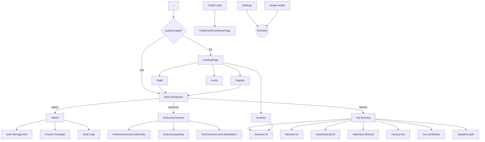

---

## 3. Authentication Flow

### 3.1 Login Flow

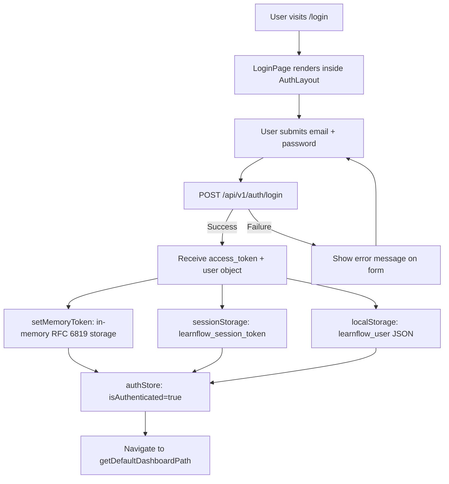

### 3.2 Registration Flow

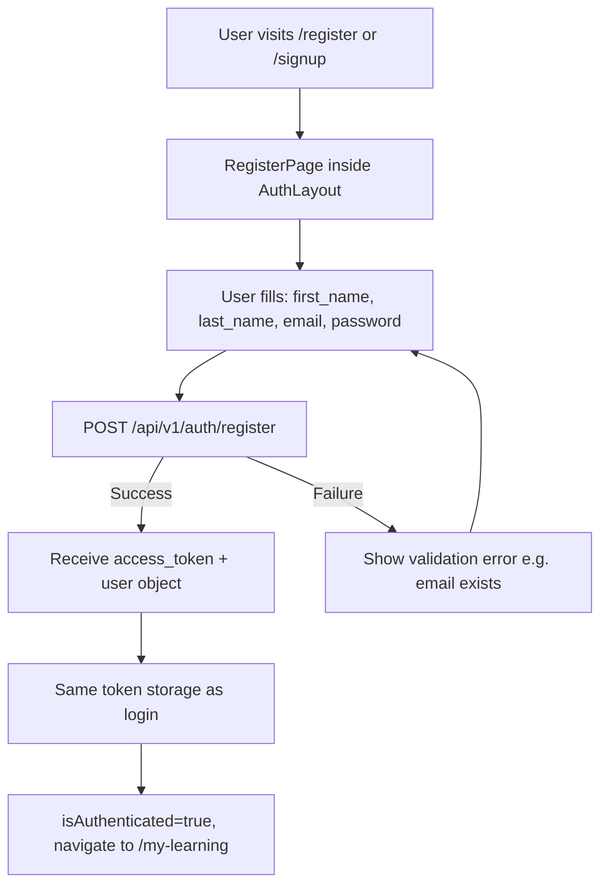

### 3.3 Session Restoration on Cold Start

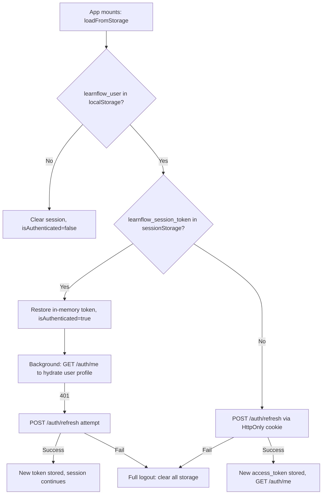

### 3.4 Automatic Token Refresh (Silent)

The `api.ts` Axios response interceptor handles 401 errors automatically:

1. **Cross-tab check:** If another tab already refreshed the token (detected via `BroadcastChannel learnflow_auth_sync`), replay the failed request with the current in-memory token.
2. **Single-flight refresh:** Only one tab at a time issues `POST /auth/refresh`. Other tabs await the same `refreshPromise`.
3. **Failure path:** On refresh failure → `localStorage` cleared → `window.location.href = '/login?expired=1'`.

### 3.5 Cross-Tab Synchronization

- Uses `BroadcastChannel('learnflow_auth_sync')`.
- `TOKEN_REFRESHED` message: other tabs update their `memoryToken`.
- `AUTH_REVOKED` message: other tabs clear their auth state.
- `subscribeAuthSync` in `authStore.ts` syncs Zustand state accordingly.

### 3.6 Logout Flow

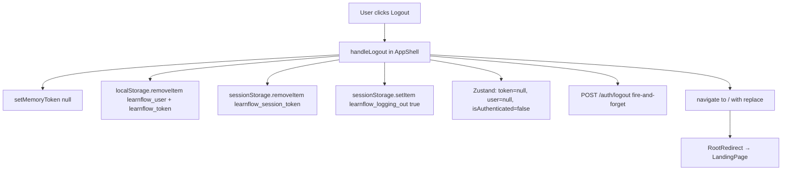

---

## 4. Role-Based Access Control & Routing

### 4.1 Role Hierarchy (Auth Priority)

| Priority | Role | Default Dashboard | Route Guard |
|---|---|---|---|
| 1 | `admin` | `/admin` | `requiredRole="admin"` |
| 2 | `instructor` / `staff` | `/instructor/courses` | `requiredRole={['instructor','admin']}` |
| 3 | `learner` | `/my-learning` | `requiredRole="learner"` |
| 4 | (unauthenticated) | `/` (LandingPage) | Public |

`getDefaultDashboardPath()` in `authStore.ts` checks roles in priority order.

### 4.2 ProtectedRoute Component

Wraps every authenticated page via the `Workspace` component:

```tsx
<Workspace requiredRole="learner">
  <MyLearningPage />
</Workspace>
```

`ProtectedRoute` redirects unauthenticated users to `/login`. Role-mismatched users are redirected to their own dashboard.

### 4.3 Route Aliases (Zero 404s)

| Alias | Resolves To |
|---|---|
| `/home`, `/dashboard` | `RootRedirect` |
| `/learning` | `/my-learning` |
| `/journey` | `/my-journey` |
| `/catalog` | `/courses` |
| `/certificates`, `/diplomas` | `/my-certificates` |
| `/studio`, `/instructor` | `/instructor/courses` |
| `/admin/courses` | `/instructor/courses` |
| `/avatar` | `/avatar-studio` |
| `/hod` | `/courses` (legacy redirect) |

---

## 5. Admin Journey

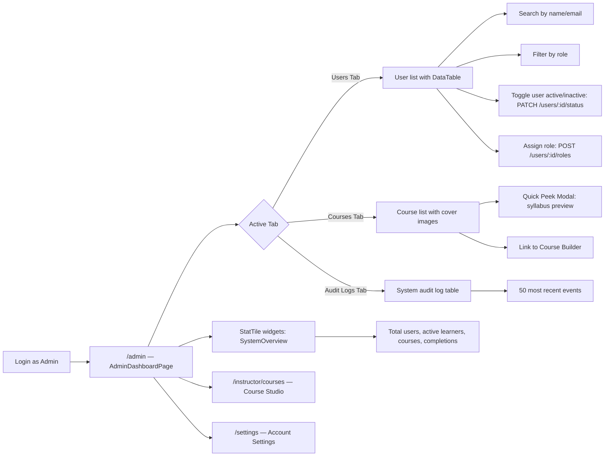

**Data sources:** `GET /users`, `GET /system/audit-logs?limit=50`, `GET /analytics/overview`, `GET /courses` — all parallelized via `Promise.all`.

---

## 6. Instructor Journey

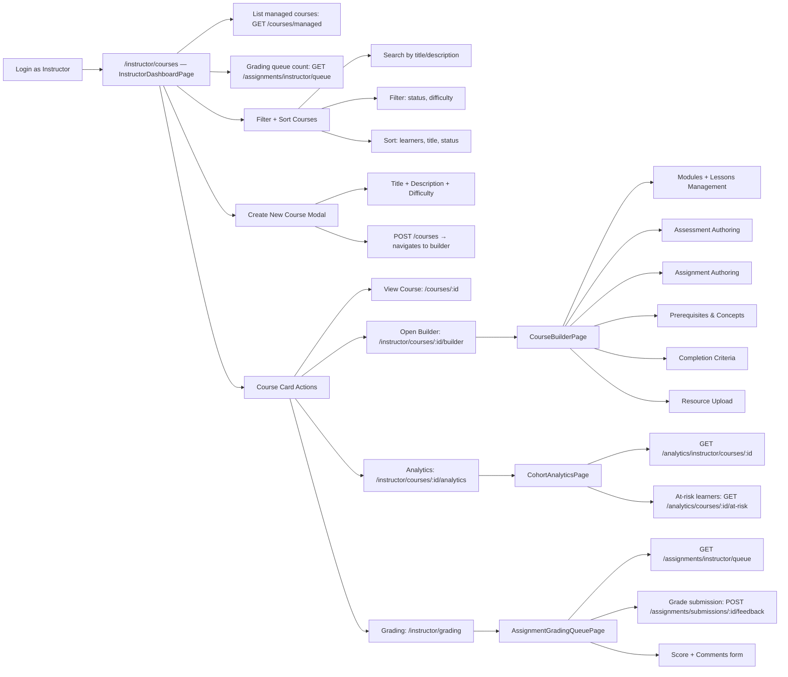

---

## 7. Learner Journey

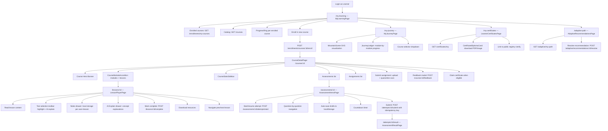

---

## 8. Course Creation & Publishing Flow

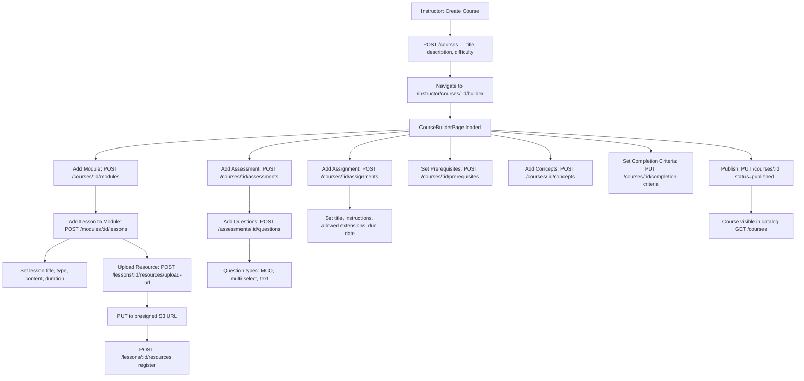

---

## 9. Enrollment Flow

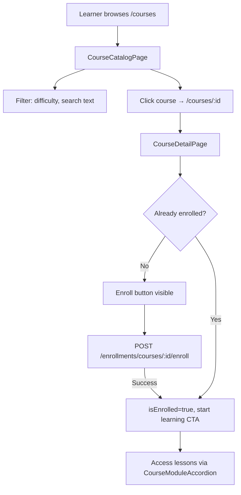

---

## 10. Quiz & Assessment Flow

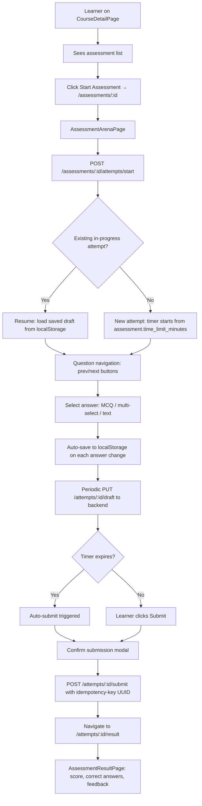

---

## 11. Assignment Submission & Evaluation Flow

```mermaid
flowchart TD
    A[Learner on CourseDetailPage] --> B[Assignment section]
    B --> C[Click Upload Submission]
    C --> D[File picker modal]
    D --> E[Client validation: file size ≤ 15MB, extension check]
    E --> F[POST /assignments/:id/upload-url — presigned ticket]
    F --> G["PUT file bytes → presigned S3 URL (quarantine bucket)"]
    G --> H[POST /assignments/:id/submit — file_id + notes]
    H --> I[Backend: quarantine scan pipeline]
    I -->|Pass| J[Submission registered: status=pending_review]
    I -->|Fail| K[Error returned to learner]

    J --> L[Instructor sees in grading queue]
    L --> M[/instructor/grading — AssignmentGradingQueuePage]
    M --> N[GET /assignments/instructor/queue]
    N --> O[Review submission]
    O --> P[POST /assignments/submissions/:id/feedback]
    P --> Q[score + comments persisted]
    Q --> R[Learner can see grade on CourseDetailPage]
```

---

## 12. Certificate Generation Flow

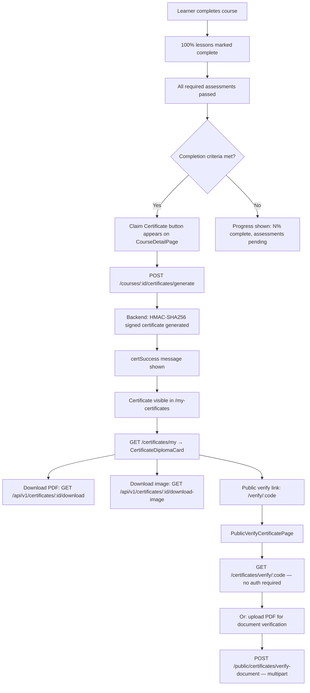

---

## 13. Profile & Avatar Customization Flow

```mermaid
flowchart TD
    A[User clicks avatar in topbar] --> B[User dropdown menu]
    B --> C[Click Avatar & Atmosphere Studio]
    C --> D[/avatar-studio — AvatarStudioPage]

    D --> E[GET /users/me/avatar — load current config]
    E --> F[Studio Categories]
    F --> F1[Face & Skin: shape, complexion, markings]
    F --> F2[Eyes & Brows: shape, color, thickness]
    F --> F3[Nose, Mouth & Ears: smile, lip pigment]
    F --> F4[Hair & Beard: style, color, texture]
    F --> F5[Clothing & Eyewear: attire, glasses]
    F --> F6[Atmosphere & World: background gradient/scene]

    F --> G[Preset Archetypes: quick-apply curated styles]
    F --> H[Randomize button: Dices icon]
    F --> I[Reset to default button]

    G & H & I --> J[Live preview: PersonalizedAvatar SVG component]
    J --> K[Zoom in/out controls]
    J --> L[Save Avatar button]
    L --> M[PUT /users/me/avatar — avatar_config object]
    M --> N[authStore.updateUser: sync to localStorage + PATCH /auth/me]
    N --> O[UserAvatar in AppShell topbar updates immediately]

    B --> P[Account Settings: /settings]
    P --> Q[Edit first_name, last_name, bio]
    Q --> R[PATCH /auth/me]
    P --> S[Change Password modal on AppShell]
    S --> T[POST /auth/password/change]
```

---

## 14. Learnflow Copilot (AI Assistant) Flow

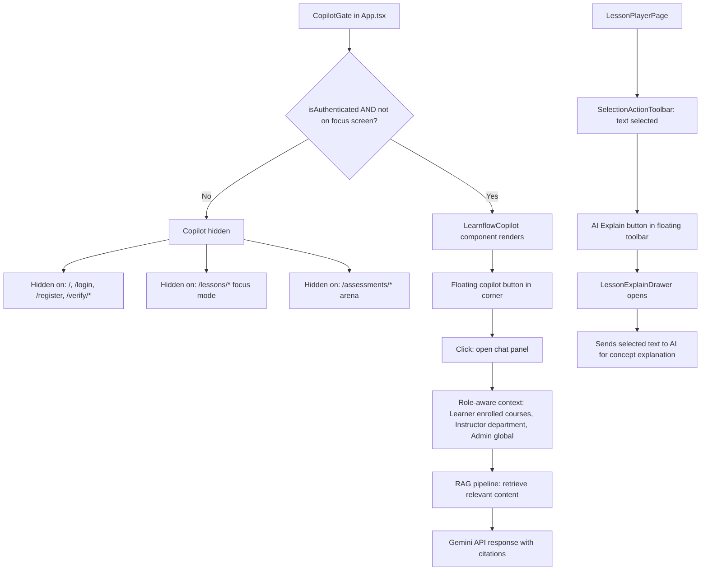

---

## 15. Adaptive Learning Flow

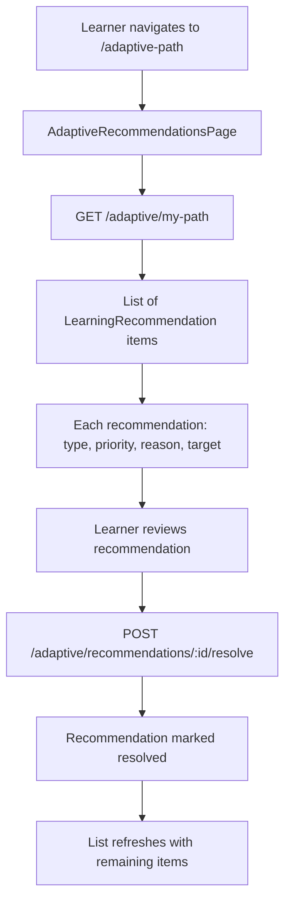

---

## 16. Notification Flow

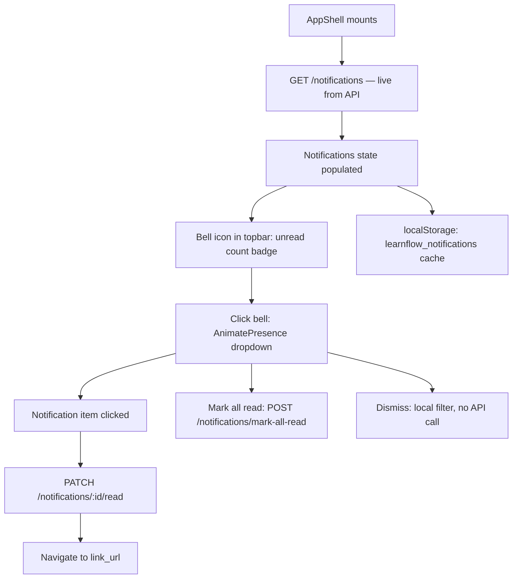

---

## 17. Lazy Loading & Performance

- **Eagerly loaded (fast FCP):** `LandingPage`, `LoginPage`, `RegisterPage`
- **Code-split (lazy):** All 19 workspace/dashboard pages via `React.lazy` + `Suspense`
- **Preloading:** `preloadWorkspaceRoutes()` called on `isAuthenticated` change to warm the browser chunk cache proactively
- **Fallback:** `WorkspaceFallback` — spinning border animation + "Loading workspace..." text
- **Data cache:** `dataCache` utility in `frontend/src/utils/dataCache.ts` avoids redundant API calls on page revisit

---

## 18. Session Expiration Handling

| Scenario | Behavior |
|---|---|
| `401` on any API call | Axios interceptor: single-flight `POST /auth/refresh` |
| Refresh token expired | Redirect to `/login?expired=1`, clear all storage |
| Tab-to-tab logout | `BroadcastChannel AUTH_REVOKED` message, all tabs clear state |
| Assessment tab + logout in another tab | `StorageEvent` listener preserves draft answers before `sessionExpired=true` |
| `learnflow_logging_out` flag | Prevents redundant restore attempts on session unload |

---

## 19. Public Routes (No Auth Required)

| Route | Page | Purpose |
|---|---|---|
| `/` | LandingPage (or RootRedirect) | Marketing entry point |
| `/login` | LoginPage | Authentication |
| `/register`, `/signup` | RegisterPage | Account creation |
| `/courses` | CourseCatalogPage | Browse catalog (ShellRouteWrapper) |
| `/courses/:id` | CourseDetailPage | View course (enrollment requires auth) |
| `/verify` | PublicVerifyCertificatePage | Verify by code or document upload |
| `/verify/:code` | PublicVerifyCertificatePage | Direct verification URL |

`ShellRouteWrapper` provides a nav shell for public browsing without requiring authentication.
