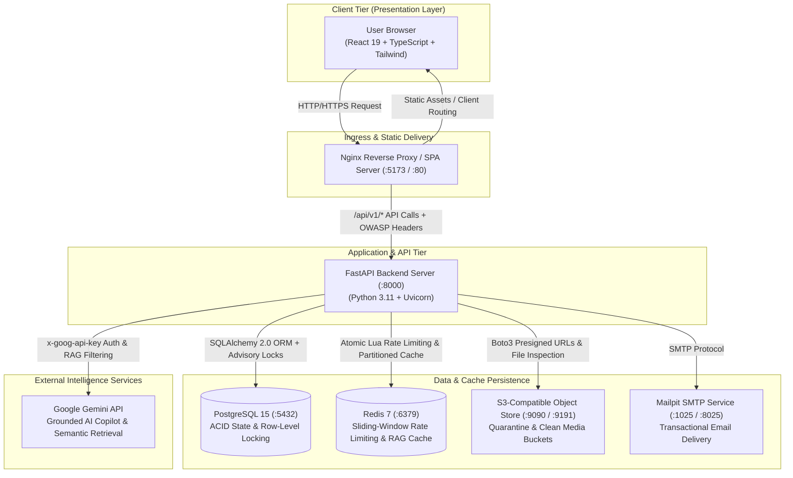
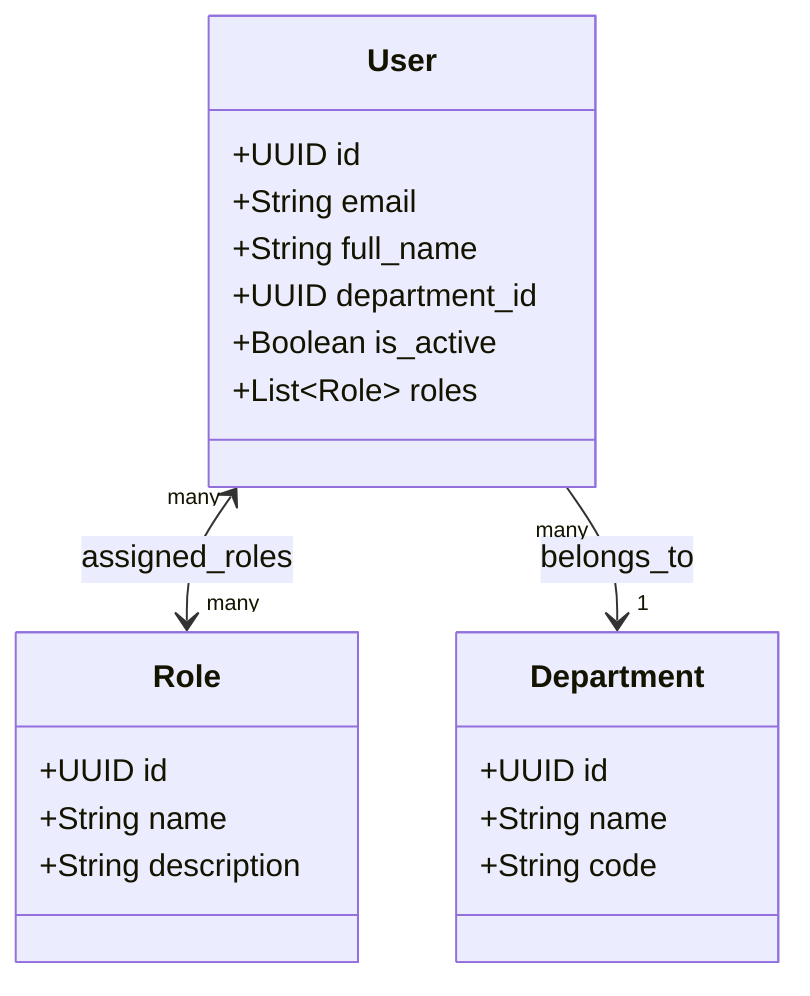
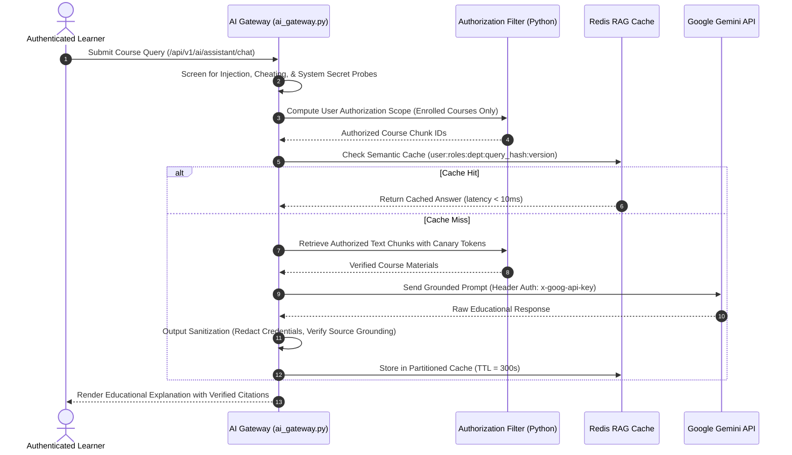

# Learnflow LMS — System Architecture Guide

## 1. System Topology & Container Networking

Learnflow LMS is designed as a modular, containerized application with strict separation between client presentation, API gateway services, relational persistent storage, distributed caching, and object storage.

---

## 2. 4-Tier Institutional RBAC Model

The application enforces server-authoritative role-based access control across four distinct institutional personas:

### Role Scopes & Privileges

| Institutional Role | Portal Route | Security & Scoping Boundary | Primary Responsibilities |
| :--- | :--- | :--- | :--- |
| **Learner / Student** | `/my-learning` | Self (`user_id == current_user.id`) & Active Enrollments | Explore courses, complete sequential lessons, attempt timed assessments, submit quarantined assignments, view grades, claim cryptographic certificates, and interact with the authorized AI copilot. |
| **Staff / Instructor** | `/instructor/courses` | Assigned Courses (`course.instructor_id == current_user.id`) | Course authoring, module & lesson sequencing, prerequisite DAG configuration, assessment question authoring, assignment rubric grading queue, and student cohort performance analytics. |
| **HOD / Academic Lead** | `/hod` | Assigned Department (`user.department_id`) | Department-wide academic KPIs, faculty workload tracking (faculty emails scrubbed for data minimization), grading SLA oversight, and curriculum audits. **Requires assigned department; unassigned leads receive HTTP 403 Forbidden.** |
| **Administrator** | `/admin` | Global Institutional Scope | System user management, role elevation, platform-wide telemetry, tamper-evident audit ledger inspection, certificate revocation, and production configuration validation. |

---

## 3. Educational AI Copilot Architecture

The AI Learning Assistant is built with a production-style RAG (Retrieval-Augmented Generation) pipeline designed to prevent hallucination, prompt injection, and unauthorized data exfiltration:

### Key AI Safety Invariants
1. **Python-Enforced Authorization:** The LLM is never trusted to enforce access boundaries. Retrieval filtering occurs entirely in Python before documents enter prompt context.
2. **Multi-Instance Distributed Invalidation:** Cache keys are versioned (`user_ver`, `dept_ver`, `global_ver`). Updating a course or changing user enrollment immediately increments version counters in Redis, globally invalidating stale responses across all backend pods.
3. **Delimiter & Canary Defenses:** Retrieved curriculum chunks are wrapped in XML-style structural delimiters and tagged with unique canary tokens to detect indirect prompt injections embedded in course materials.

