# Learnflow LMS — Backend Schema Reference

> **Document Version:** 1.0.0 (Final Release)  
> **Generated:** 2026-11-14 from live source: `backend/app/models/`, `backend/alembic/versions/`, `backend/app/api/v1/`  
> **Stack:** FastAPI · SQLAlchemy 2.0 · PostgreSQL · Alembic · Dual Storage (S3 / Local Filesystem) · Dual Rate Limiting (Redis / In-Memory Deque)  

---

## Table of Contents

1. [Entity Inventory](#1-entity-inventory)
2. [Table Definitions](#2-table-definitions)
3. [Mermaid ER Diagram](#3-mermaid-er-diagram)
4. [API Endpoint Inventory](#4-api-endpoint-inventory)
5. [Authentication & Dependency System](#5-authentication--dependency-system)
6. [Business Logic Relationships](#6-business-logic-relationships)
7. [Database Initialization & Seed Data](#7-database-initialization--seed-data)
8. [Migration History](#8-migration-history)
9. [File Storage Structure](#9-file-storage-structure)
10. [Known Discrepancies](#10-known-discrepancies)

---

## 1. Entity Inventory

| # | Table | Model Class | File | Purpose |
|---|-------|-------------|------|---------|
| 1 | `departments` | `Department` | `models/user.py` | Academic departments grouping users and courses |
| 2 | `roles` | `Role` | `models/user.py` | Platform RBAC roles (admin, instructor, learner, hod) |
| 3 | `user_roles` | `UserRole` | `models/user.py` | M2M join: users ↔ roles |
| 4 | `users` | `User` | `models/user.py` | Learners, instructors, admins — central identity |
| 5 | `refresh_tokens` | `RefreshToken` | `models/user.py` | RFC 6819 token-family session management |
| 6 | `password_reset_tokens` | `PasswordResetToken` | `models/user.py` | Single-use email password reset flow |
| 7 | `courses` | `Course` | `models/course.py` | Course catalog with status lifecycle |
| 8 | `course_feedback` | `CourseFeedback` | `models/course.py` | Learner ratings/evaluations per course |
| 9 | `course_prerequisites` | `CoursePrerequisite` | `models/course.py` | DAG prerequisite graph between courses |
| 10 | `course_concepts` | `CourseConcept` | `models/course.py` | Diagnostic concept taxonomy per course |
| 11 | `modules` | `Module` | `models/curriculum.py` | Sequential course sections |
| 12 | `lessons` | `Lesson` | `models/curriculum.py` | Individual content units within a module |
| 13 | `lesson_prerequisites` | `LessonPrerequisite` | `models/curriculum.py` | Lesson-level unlock dependencies |
| 14 | `learning_resources` | `LearningResource` | `models/curriculum.py` | Supplementary files attached to lessons |
| 15 | `enrollments` | `Enrollment` | `models/enrollment.py` | Learner ↔ course relationship with progress |
| 16 | `lesson_progress` | `LessonProgress` | `models/enrollment.py` | Per-lesson completion tracking per enrollment |
| 17 | `assessments` | `Assessment` | `models/assessment.py` | Timed quizzes per course |
| 18 | `questions` | `Question` | `models/assessment.py` | Assessment questions mapped to concepts |
| 19 | `answer_options` | `AnswerOption` | `models/assessment.py` | Multiple-choice/T-F options per question |
| 20 | `assessment_attempts` | `AssessmentAttempt` | `models/assessment.py` | Per-user timed attempt session |
| 21 | `attempt_answers` | `AttemptAnswer` | `models/assessment.py` | Per-question answer within an attempt |
| 22 | `assignments` | `Assignment` | `models/assignment.py` | File-submission coursework tasks |
| 23 | `assignment_submissions` | `AssignmentSubmission` | `models/assignment.py` | Versioned learner file submissions |
| 24 | `instructor_feedback` | `InstructorFeedback` | `models/assignment.py` | Graded feedback on a submission |
| 25 | `completion_criteria` | `CompletionCriteria` | `models/certificate.py` | Configurable course completion rules |
| 26 | `criteria_assessments` | `CriteriaAssessment` | `models/certificate.py` | Required assessments in completion criteria |
| 27 | `criteria_assignments` | `CriteriaAssignment` | `models/certificate.py` | Required assignments in completion criteria |
| 28 | `certificates` | `Certificate` | `models/certificate.py` | Issued course completion certificates |
| 29 | `certificate_verifications` | `CertificateVerification` | `models/certificate.py` | Public verification audit log |
| 30 | `learning_recommendations` | `LearningRecommendation` | `models/adaptive.py` | AI-generated remedial lesson suggestions |
| 31 | `stored_files` | `StoredFile` | `models/system.py` | S3 file metadata with quarantine lifecycle |
| 32 | `idempotency_keys` | `IdempotencyKey` | `models/system.py` | Duplicate-submission guard |
| 33 | `audit_logs` | `AuditLog` | `models/system.py` | Tamper-evident append-only event log |
| 34 | `notifications` | `Notification` | `models/system.py` | In-app user notification messages |

**Mixins (from `models/base.py`):**
- `UUIDMixin` — adds `id UUID PRIMARY KEY DEFAULT uuid4()`
- `TimestampMixin` — adds `created_at`, `updated_at` (timezone-aware, auto-set/updated)

---

## 2. Table Definitions

### 2.1 departments

| Column | Type | Nullable | Constraints |
|--------|------|----------|-------------|
| `id` | UUID | NOT NULL | PK, INDEX |
| `name` | VARCHAR(100) | NOT NULL | UNIQUE, INDEX |
| `code` | VARCHAR(20) | NOT NULL | UNIQUE, INDEX |
| `description` | VARCHAR(255) | YES | — |
| `created_at` | TIMESTAMPTZ | NOT NULL | auto |
| `updated_at` | TIMESTAMPTZ | NOT NULL | auto |

---

### 2.2 roles

| Column | Type | Nullable | Constraints |
|--------|------|----------|-------------|
| `id` | INTEGER | NOT NULL | PK, autoincrement |
| `name` | VARCHAR(50) | NOT NULL | UNIQUE, INDEX |
| `description` | VARCHAR(255) | YES | — |

> **Note:** `roles` does not use `UUIDMixin`. PK is Integer, not UUID.

---

### 2.3 user_roles (join table)

| Column | Type | Nullable | Constraints |
|--------|------|----------|-------------|
| `user_id` | UUID | NOT NULL | PK, FK→users(id) CASCADE |
| `role_id` | INTEGER | NOT NULL | PK, FK→roles(id) CASCADE |

> Composite primary key. No timestamps.

---

### 2.4 users

| Column | Type | Nullable | Constraints |
|--------|------|----------|-------------|
| `id` | UUID | NOT NULL | PK, INDEX |
| `email` | VARCHAR(255) | NOT NULL | UNIQUE, INDEX |
| `hashed_password` | VARCHAR(255) | NOT NULL | Argon2id hash |
| `first_name` | VARCHAR(100) | NOT NULL | — |
| `last_name` | VARCHAR(100) | NOT NULL | — |
| `is_active` | BOOLEAN | NOT NULL | DEFAULT true |
| `avatar_gender` | VARCHAR(20) | YES | DEFAULT 'auto' |
| `avatar_config` | JSONB | YES | Avatar studio config |
| `bio` | VARCHAR(1000) | YES | — |
| `department_id` | UUID | YES | FK→departments(id) SET NULL, INDEX |
| `created_at` | TIMESTAMPTZ | NOT NULL | auto |
| `updated_at` | TIMESTAMPTZ | NOT NULL | auto |

---

### 2.5 refresh_tokens

| Column | Type | Nullable | Constraints |
|--------|------|----------|-------------|
| `id` | UUID | NOT NULL | PK, INDEX |
| `user_id` | UUID | NOT NULL | FK→users(id) CASCADE, INDEX |
| `family_id` | UUID | YES | INDEX (token-family revocation) |
| `token_hash` | VARCHAR(64) | NOT NULL | UNIQUE, INDEX — SHA-256 of raw token |
| `expires_at` | TIMESTAMPTZ | NOT NULL | INDEX |
| `revoked_at` | TIMESTAMPTZ | YES | NULL = active |
| `replaced_by` | VARCHAR(64) | YES | SHA-256 of replacement token |
| `ip_address` | VARCHAR(45) | YES | — |
| `user_agent` | VARCHAR(255) | YES | — |
| `created_at` | TIMESTAMPTZ | NOT NULL | auto |
| `updated_at` | TIMESTAMPTZ | NOT NULL | auto |

---

### 2.6 password_reset_tokens

| Column | Type | Nullable | Constraints |
|--------|------|----------|-------------|
| `id` | UUID | NOT NULL | PK, INDEX |
| `user_id` | UUID | NOT NULL | FK→users(id) CASCADE, INDEX |
| `token_hash` | VARCHAR(64) | NOT NULL | UNIQUE, INDEX — SHA-256 |
| `expires_at` | TIMESTAMPTZ | NOT NULL | INDEX |
| `used_at` | TIMESTAMPTZ | YES | NULL = unused |
| `created_at` | TIMESTAMPTZ | NOT NULL | auto |
| `updated_at` | TIMESTAMPTZ | NOT NULL | auto |

---

### 2.7 courses

| Column | Type | Nullable | Constraints |
|--------|------|----------|-------------|
| `id` | UUID | NOT NULL | PK, INDEX |
| `title` | VARCHAR(200) | NOT NULL | — |
| `slug` | VARCHAR(220) | NOT NULL | UNIQUE, INDEX |
| `description` | TEXT | YES | — |
| `difficulty` | VARCHAR(20) | NOT NULL | DEFAULT 'beginner'; CHECK IN ('beginner','intermediate','advanced') |
| `status` | VARCHAR(20) | NOT NULL | DEFAULT 'draft', INDEX; CHECK IN ('draft','published','archived') |
| `thumbnail_url` | TEXT | YES | — |
| `sequential_modules` | BOOLEAN | NOT NULL | DEFAULT true |
| `instructor_id` | UUID | NOT NULL | FK→users(id) RESTRICT, INDEX |
| `department_id` | UUID | YES | FK→departments(id) SET NULL, INDEX |
| `created_at` | TIMESTAMPTZ | NOT NULL | auto |
| `updated_at` | TIMESTAMPTZ | NOT NULL | auto |

---

### 2.8 course_feedback

| Column | Type | Nullable | Constraints |
|--------|------|----------|-------------|
| `id` | UUID | NOT NULL | PK |
| `course_id` | UUID | NOT NULL | FK→courses(id) CASCADE, INDEX |
| `user_id` | UUID | NOT NULL | FK→users(id) CASCADE, INDEX |
| `rating` | INTEGER | NOT NULL | CHECK (1–5) |
| `difficulty_rating` | VARCHAR(20) | YES | 'too_easy','just_right','challenging','too_hard' |
| `pace_rating` | VARCHAR(20) | YES | 'slow','balanced','fast' |
| `feedback_text` | TEXT | NOT NULL | — |
| `is_anonymous` | BOOLEAN | NOT NULL | DEFAULT false |
| `created_at` | TIMESTAMPTZ | NOT NULL | auto |
| `updated_at` | TIMESTAMPTZ | NOT NULL | auto |

**Constraints:** `uq_course_user_feedback UNIQUE(course_id, user_id)`

---

### 2.9 course_prerequisites (join table)

| Column | Type | Nullable | Constraints |
|--------|------|----------|-------------|
| `course_id` | UUID | NOT NULL | PK, FK→courses(id) CASCADE |
| `prerequisite_course_id` | UUID | NOT NULL | PK, FK→courses(id) CASCADE |

**Constraints:** `chk_course_prereq_not_self: course_id != prerequisite_course_id`

---

### 2.10 course_concepts

| Column | Type | Nullable | Constraints |
|--------|------|----------|-------------|
| `id` | UUID | NOT NULL | PK, INDEX |
| `course_id` | UUID | NOT NULL | FK→courses(id) CASCADE, INDEX |
| `name` | VARCHAR(100) | NOT NULL | — |
| `description` | TEXT | YES | — |
| `order_index` | INTEGER | NOT NULL | DEFAULT 1 |
| `created_at` | TIMESTAMPTZ | NOT NULL | auto |
| `updated_at` | TIMESTAMPTZ | NOT NULL | auto |

**Constraints:** `uq_course_concept_name UNIQUE(course_id, name)`, `uq_course_concept_composite UNIQUE(course_id, id)`

---

### 2.11 modules

| Column | Type | Nullable | Constraints |
|--------|------|----------|-------------|
| `id` | UUID | NOT NULL | PK |
| `course_id` | UUID | NOT NULL | FK→courses(id) CASCADE, INDEX |
| `title` | VARCHAR(200) | NOT NULL | — |
| `order_index` | INTEGER | NOT NULL | — |
| `created_at` | TIMESTAMPTZ | NOT NULL | auto |
| `updated_at` | TIMESTAMPTZ | NOT NULL | auto |

**Constraints:** `uq_course_module_composite UNIQUE(course_id, id)`, `uq_course_module_order UNIQUE(course_id, order_index)`

---

### 2.12 lessons

| Column | Type | Nullable | Constraints |
|--------|------|----------|-------------|
| `id` | UUID | NOT NULL | PK |
| `course_id` | UUID | NOT NULL | INDEX (part of composite FK) |
| `module_id` | UUID | NOT NULL | INDEX (part of composite FK) |
| `concept_id` | UUID | YES | INDEX (part of composite FK) |
| `title` | VARCHAR(200) | NOT NULL | — |
| `content_type` | VARCHAR(20) | NOT NULL | DEFAULT 'text'; CHECK IN ('video','text','pdf') |
| `content_body` | TEXT | YES | Inline text or URL |
| `duration_minutes` | INTEGER | NOT NULL | DEFAULT 10; CHECK ≥ 0 |
| `order_index` | INTEGER | NOT NULL | — |
| `created_at` | TIMESTAMPTZ | NOT NULL | auto |
| `updated_at` | TIMESTAMPTZ | NOT NULL | auto |

**Composite FKs:**
- `(course_id, module_id)` → `modules(course_id, id)` CASCADE
- `(course_id, concept_id)` → `course_concepts(course_id, id)` RESTRICT

**Constraints:** `uq_course_lesson_composite UNIQUE(course_id, id)`, `uq_module_lesson_order UNIQUE(module_id, order_index)`

---

### 2.13 lesson_prerequisites (join table)

| Column | Type | Nullable | Constraints |
|--------|------|----------|-------------|
| `lesson_id_pk` | INTEGER | NOT NULL | PK, autoincrement |
| `course_id` | UUID | NOT NULL | INDEX |
| `lesson_id` | UUID | NOT NULL | (composite FK target) |
| `prerequisite_lesson_id` | UUID | NOT NULL | (composite FK source) |

**Constraints:** `chk_lesson_prereq_not_self: lesson_id != prerequisite_lesson_id`

---

### 2.14 learning_resources

| Column | Type | Nullable | Constraints |
|--------|------|----------|-------------|
| `id` | UUID | NOT NULL | PK |
| `lesson_id` | UUID | NOT NULL | FK→lessons(id) CASCADE, INDEX |
| `title` | VARCHAR(200) | NOT NULL | — |
| `file_url` | TEXT | NOT NULL | S3 URL |
| `file_type` | VARCHAR(50) | YES | — |
| `file_size_bytes` | BIGINT | YES | — |
| `created_at` | TIMESTAMPTZ | NOT NULL | auto |
| `updated_at` | TIMESTAMPTZ | NOT NULL | auto |

---

### 2.15 enrollments

| Column | Type | Nullable | Constraints |
|--------|------|----------|-------------|
| `id` | UUID | NOT NULL | PK |
| `user_id` | UUID | NOT NULL | FK→users(id) CASCADE, INDEX |
| `course_id` | UUID | NOT NULL | FK→courses(id) RESTRICT, INDEX |
| `status` | VARCHAR(20) | NOT NULL | DEFAULT 'active', INDEX; CHECK IN ('active','completed','dropped') |
| `enrolled_at` | TIMESTAMPTZ | NOT NULL | auto |
| `completed_at` | TIMESTAMPTZ | YES | — |
| `progress_percentage` | NUMERIC(5,2) | NOT NULL | DEFAULT 0.00; CHECK 0–100 |
| `created_at` | TIMESTAMPTZ | NOT NULL | auto |
| `updated_at` | TIMESTAMPTZ | NOT NULL | auto |

**Constraints:** `uq_user_course_enrollment UNIQUE(user_id, course_id)`

---

### 2.16 lesson_progress

| Column | Type | Nullable | Constraints |
|--------|------|----------|-------------|
| `id` | UUID | NOT NULL | PK |
| `enrollment_id` | UUID | NOT NULL | FK→enrollments(id) CASCADE, INDEX |
| `lesson_id` | UUID | NOT NULL | FK→lessons(id) CASCADE, INDEX |
| `is_completed` | BOOLEAN | NOT NULL | DEFAULT false |
| `completed_at` | TIMESTAMPTZ | YES | — |
| `created_at` | TIMESTAMPTZ | NOT NULL | auto |
| `updated_at` | TIMESTAMPTZ | NOT NULL | auto |

**Constraints:** `uq_enrollment_lesson_progress UNIQUE(enrollment_id, lesson_id)`

---

### 2.17 assessments

| Column | Type | Nullable | Constraints |
|--------|------|----------|-------------|
| `id` | UUID | NOT NULL | PK |
| `course_id` | UUID | NOT NULL | FK→courses(id) CASCADE, INDEX |
| `title` | VARCHAR(200) | NOT NULL | — |
| `time_limit_minutes` | INTEGER | NOT NULL | DEFAULT 30; CHECK > 0 |
| `passing_score_percentage` | NUMERIC(5,2) | NOT NULL | DEFAULT 70.00; CHECK 0–100 |
| `max_attempts` | INTEGER | NOT NULL | DEFAULT 3; CHECK > 0 |
| `created_at` | TIMESTAMPTZ | NOT NULL | auto |
| `updated_at` | TIMESTAMPTZ | NOT NULL | auto |

**Constraints:** `uq_course_assessment_composite UNIQUE(course_id, id)`

---

### 2.18 questions

| Column | Type | Nullable | Constraints |
|--------|------|----------|-------------|
| `id` | UUID | NOT NULL | PK |
| `course_id` | UUID | NOT NULL | INDEX |
| `assessment_id` | UUID | NOT NULL | INDEX |
| `concept_id` | UUID | NOT NULL | INDEX |
| `prompt` | TEXT | NOT NULL | — |
| `question_type` | VARCHAR(30) | NOT NULL | CHECK IN ('single_choice','multiple_choice','true_false','short_answer') |
| `points` | NUMERIC(5,2) | NOT NULL | DEFAULT 1.0; CHECK > 0 |
| `case_sensitive` | BOOLEAN | NOT NULL | DEFAULT false |
| `accepted_answers` | JSONB | NOT NULL | DEFAULT [] — for short_answer |
| `allow_manual_appeal` | BOOLEAN | NOT NULL | DEFAULT false |
| `order_index` | INTEGER | NOT NULL | DEFAULT 1 |
| `created_at` | TIMESTAMPTZ | NOT NULL | auto |
| `updated_at` | TIMESTAMPTZ | NOT NULL | auto |

**Composite FKs:**
- `(course_id, assessment_id)` → `assessments(course_id, id)` CASCADE
- `(course_id, concept_id)` → `course_concepts(course_id, id)` RESTRICT

**Constraints:** `uq_assessment_question_composite UNIQUE(assessment_id, id)`

---

### 2.19 answer_options

| Column | Type | Nullable | Constraints |
|--------|------|----------|-------------|
| `id` | UUID | NOT NULL | PK |
| `assessment_id` | UUID | NOT NULL | INDEX |
| `question_id` | UUID | NOT NULL | INDEX |
| `option_text` | TEXT | NOT NULL | — |
| `is_correct` | BOOLEAN | NOT NULL | DEFAULT false |
| `order_index` | INTEGER | NOT NULL | DEFAULT 1 |
| `created_at` | TIMESTAMPTZ | NOT NULL | auto |
| `updated_at` | TIMESTAMPTZ | NOT NULL | auto |

**Composite FK:** `(assessment_id, question_id)` → `questions(assessment_id, id)` CASCADE

---

### 2.20 assessment_attempts

| Column | Type | Nullable | Constraints |
|--------|------|----------|-------------|
| `id` | UUID | NOT NULL | PK |
| `assessment_id` | UUID | NOT NULL | FK→assessments(id) RESTRICT, INDEX |
| `user_id` | UUID | NOT NULL | FK→users(id) CASCADE, INDEX |
| `attempt_number` | INTEGER | NOT NULL | DEFAULT 1 |
| `started_at` | TIMESTAMPTZ | NOT NULL | auto |
| `expires_at` | TIMESTAMPTZ | NOT NULL | Computed from time_limit |
| `submitted_at` | TIMESTAMPTZ | YES | NULL = in progress |
| `status` | VARCHAR(20) | NOT NULL | DEFAULT 'in_progress', INDEX; CHECK IN ('in_progress','submitted','graded','expired') |
| `total_score` | NUMERIC(5,2) | YES | — |
| `score_percentage` | NUMERIC(5,2) | YES | — |
| `is_passed` | BOOLEAN | YES | — |
| `question_order` | JSONB | NOT NULL | Shuffled question sequence |
| `option_order` | JSONB | NOT NULL | Shuffled option sequence per question |
| `instructor_feedback` | TEXT | YES | Instructor review note |
| `reviewed_by` | UUID | YES | FK→users(id) SET NULL |
| `reviewed_at` | TIMESTAMPTZ | YES | — |
| `created_at` | TIMESTAMPTZ | NOT NULL | auto |
| `updated_at` | TIMESTAMPTZ | NOT NULL | auto |

**Partial unique index:** `uq_single_active_attempt(assessment_id, user_id) WHERE status = 'in_progress'`

---

### 2.21 attempt_answers

| Column | Type | Nullable | Constraints |
|--------|------|----------|-------------|
| `id` | UUID | NOT NULL | PK |
| `attempt_id` | UUID | NOT NULL | FK→assessment_attempts(id) CASCADE, INDEX |
| `question_id` | UUID | NOT NULL | FK→questions(id) RESTRICT, INDEX |
| `selected_option_ids` | JSONB | YES | List of answer_option IDs selected |
| `text_response` | TEXT | YES | For short_answer type |
| `score_awarded` | NUMERIC(5,2) | NOT NULL | DEFAULT 0.0 |
| `is_correct` | BOOLEAN | YES | NULL = pending manual review |
| `is_manual_review_needed` | BOOLEAN | NOT NULL | DEFAULT false |
| `created_at` | TIMESTAMPTZ | NOT NULL | auto |
| `updated_at` | TIMESTAMPTZ | NOT NULL | auto |

**Constraints:** `uq_attempt_question_answer UNIQUE(attempt_id, question_id)`

---

### 2.22 assignments

| Column | Type | Nullable | Constraints |
|--------|------|----------|-------------|
| `id` | UUID | NOT NULL | PK |
| `course_id` | UUID | NOT NULL | FK→courses(id) CASCADE, INDEX |
| `title` | VARCHAR(200) | NOT NULL | — |
| `description` | TEXT | NOT NULL | — |
| `max_points` | NUMERIC(5,2) | NOT NULL | DEFAULT 100.0; CHECK > 0 |
| `due_date` | TIMESTAMPTZ | YES | — |
| `allowed_extensions` | VARCHAR(100) | NOT NULL | DEFAULT 'pdf,zip,docx' |
| `created_at` | TIMESTAMPTZ | NOT NULL | auto |
| `updated_at` | TIMESTAMPTZ | NOT NULL | auto |

**Constraints:** `uq_course_assignment_composite UNIQUE(course_id, id)`

---

### 2.23 assignment_submissions

| Column | Type | Nullable | Constraints |
|--------|------|----------|-------------|
| `id` | UUID | NOT NULL | PK |
| `assignment_id` | UUID | NOT NULL | FK→assignments(id) CASCADE, INDEX |
| `user_id` | UUID | NOT NULL | FK→users(id) CASCADE, INDEX |
| `file_id` | UUID | NOT NULL | FK→stored_files(id) RESTRICT, INDEX |
| `version` | INTEGER | NOT NULL | DEFAULT 1 |
| `notes` | TEXT | YES | — |
| `status` | VARCHAR(30) | NOT NULL | DEFAULT 'submitted', INDEX; CHECK IN ('submitted','under_review','graded','resubmission_required') |
| `submitted_at` | TIMESTAMPTZ | NOT NULL | auto |
| `created_at` | TIMESTAMPTZ | NOT NULL | auto |
| `updated_at` | TIMESTAMPTZ | NOT NULL | auto |

**Constraints:** `uq_assignment_user_version UNIQUE(assignment_id, user_id, version)`

> This is the **5-stage submission quarantine pipeline**: submitted → under_review → (validated/rejected in S3) → graded / resubmission_required

---

### 2.24 instructor_feedback

| Column | Type | Nullable | Constraints |
|--------|------|----------|-------------|
| `id` | UUID | NOT NULL | PK |
| `submission_id` | UUID | NOT NULL | FK→assignment_submissions(id) CASCADE, UNIQUE |
| `instructor_id` | UUID | NOT NULL | FK→users(id) RESTRICT, INDEX |
| `grade_points` | NUMERIC(5,2) | NOT NULL | CHECK ≥ 0 |
| `feedback_text` | TEXT | NOT NULL | — |
| `graded_at` | TIMESTAMPTZ | NOT NULL | auto |
| `created_at` | TIMESTAMPTZ | NOT NULL | auto |
| `updated_at` | TIMESTAMPTZ | NOT NULL | auto |

---

### 2.25 completion_criteria

| Column | Type | Nullable | Constraints |
|--------|------|----------|-------------|
| `id` | UUID | NOT NULL | PK |
| `course_id` | UUID | NOT NULL | FK→courses(id) CASCADE, UNIQUE |
| `min_lesson_completion_pct` | NUMERIC(5,2) | NOT NULL | DEFAULT 100.0; CHECK 0–100 |
| `require_all_assignments` | BOOLEAN | NOT NULL | DEFAULT true |
| `version` | INTEGER | NOT NULL | DEFAULT 1 |
| `created_at` | TIMESTAMPTZ | NOT NULL | auto |
| `updated_at` | TIMESTAMPTZ | NOT NULL | auto |

**Constraints:** `uq_course_criteria_composite UNIQUE(course_id, id)`

---

### 2.26 criteria_assessments

| Column | Type | Nullable | Constraints |
|--------|------|----------|-------------|
| `id_pk` | INTEGER | NOT NULL | PK, autoincrement |
| `course_id` | UUID | NOT NULL | (composite FK) |
| `criteria_id` | UUID | NOT NULL | (composite FK) |
| `assessment_id` | UUID | NOT NULL | (composite FK) |
| `min_score_pct` | NUMERIC(5,2) | NOT NULL | DEFAULT 70.0; CHECK 0–100 |

**Composite FKs:**
- `(course_id, criteria_id)` → `completion_criteria(course_id, id)` CASCADE
- `(course_id, assessment_id)` → `assessments(course_id, id)` CASCADE

---

### 2.27 criteria_assignments

| Column | Type | Nullable | Constraints |
|--------|------|----------|-------------|
| `id_pk` | INTEGER | NOT NULL | PK, autoincrement |
| `course_id` | UUID | NOT NULL | (composite FK) |
| `criteria_id` | UUID | NOT NULL | (composite FK) |
| `assignment_id` | UUID | NOT NULL | (composite FK) |
| `min_score_pct` | NUMERIC(5,2) | NOT NULL | DEFAULT 50.0; CHECK 0–100 |

---

### 2.28 certificates

| Column | Type | Nullable | Constraints |
|--------|------|----------|-------------|
| `id` | UUID | NOT NULL | PK |
| `user_id` | UUID | NOT NULL | FK→users(id) RESTRICT, INDEX |
| `course_id` | UUID | NOT NULL | FK→courses(id) RESTRICT, INDEX |
| `verification_code` | VARCHAR(64) | NOT NULL | UNIQUE, INDEX |
| `status` | VARCHAR(20) | NOT NULL | DEFAULT 'valid', INDEX; CHECK IN ('valid','revoked','expired') |
| `signing_key_id` | VARCHAR(20) | NOT NULL | DEFAULT 'k1' |
| `signature` | VARCHAR(64) | NOT NULL | HMAC-SHA256 |
| `criteria_snapshot` | JSONB | NOT NULL | Snapshot of criteria at issuance |
| `pdf_storage_url` | TEXT | YES | S3 URL to PDF |
| `issued_at` | TIMESTAMPTZ | NOT NULL | auto |
| `revoked_at` | TIMESTAMPTZ | YES | — |
| `revoked_by` | UUID | YES | FK→users(id) SET NULL |
| `revocation_reason` | TEXT | YES | — |
| `created_at` | TIMESTAMPTZ | NOT NULL | auto |
| `updated_at` | TIMESTAMPTZ | NOT NULL | auto |

**Constraints:** `uq_user_course_certificate UNIQUE(user_id, course_id)`

---

### 2.29 certificate_verifications

| Column | Type | Nullable | Constraints |
|--------|------|----------|-------------|
| `id` | BIGINT | NOT NULL | PK, autoincrement |
| `certificate_id` | UUID | NOT NULL | FK→certificates(id) CASCADE, INDEX |
| `verified_at` | TIMESTAMPTZ | NOT NULL | auto |
| `ip_address` | VARCHAR(45) | YES | — |
| `user_agent` | TEXT | YES | — |

> No timestamps from mixins — uses `verified_at` only.

---

### 2.30 learning_recommendations

| Column | Type | Nullable | Constraints |
|--------|------|----------|-------------|
| `id` | UUID | NOT NULL | PK |
| `user_id` | UUID | NOT NULL | FK→users(id) CASCADE, INDEX |
| `source_attempt_id` | UUID | NOT NULL | FK→assessment_attempts(id) CASCADE, INDEX |
| `target_lesson_id` | UUID | NOT NULL | FK→lessons(id) CASCADE, INDEX |
| `rationale` | TEXT | NOT NULL | Human-readable explanation |
| `priority` | INTEGER | NOT NULL | DEFAULT 1 |
| `status` | VARCHAR(20) | NOT NULL | DEFAULT 'active', INDEX; CHECK IN ('active','completed','dismissed') |
| `created_at` | TIMESTAMPTZ | NOT NULL | auto |
| `updated_at` | TIMESTAMPTZ | NOT NULL | auto |

**Constraints:** `uq_user_attempt_lesson_rec UNIQUE(user_id, source_attempt_id, target_lesson_id)`

---

### 2.31 stored_files

| Column | Type | Nullable | Constraints |
|--------|------|----------|-------------|
| `id` | UUID | NOT NULL | PK |
| `uploader_id` | UUID | YES | FK→users(id) SET NULL, INDEX |
| `bucket_name` | VARCHAR(100) | NOT NULL | — |
| `storage_key` | VARCHAR(500) | NOT NULL | UNIQUE, INDEX |
| `original_filename` | VARCHAR(255) | NOT NULL | — |
| `mime_type` | VARCHAR(100) | NOT NULL | — |
| `file_size_bytes` | BIGINT | NOT NULL | — |
| `file_hash` | VARCHAR(64) | YES | SHA-256 |
| `status` | VARCHAR(20) | NOT NULL | DEFAULT 'pending_upload', INDEX; CHECK IN ('pending_upload','quarantined','validated','rejected') |
| `validation_errors` | TEXT | YES | — |
| `created_at` | TIMESTAMPTZ | NOT NULL | auto |
| `updated_at` | TIMESTAMPTZ | NOT NULL | auto |

---

### 2.32 idempotency_keys

| Column | Type | Nullable | Constraints |
|--------|------|----------|-------------|
| `id` | UUID | NOT NULL | PK |
| `idempotency_key` | VARCHAR(128) | NOT NULL | INDEX |
| `user_id` | UUID | NOT NULL | FK→users(id) CASCADE, INDEX |
| `operation` | VARCHAR(50) | NOT NULL | INDEX |
| `request_hash` | VARCHAR(64) | NOT NULL | — |
| `status` | VARCHAR(20) | NOT NULL | DEFAULT 'processing', INDEX; CHECK IN ('processing','completed','failed') |
| `response_code` | INTEGER | YES | — |
| `response_body` | JSONB | YES | Cached response |
| `expires_at` | TIMESTAMPTZ | NOT NULL | — |
| `created_at` | TIMESTAMPTZ | NOT NULL | auto |
| `updated_at` | TIMESTAMPTZ | NOT NULL | auto |

**Constraints:** `uq_user_op_idempotency_key UNIQUE(user_id, operation, idempotency_key)`

---

### 2.33 audit_logs

| Column | Type | Nullable | Constraints |
|--------|------|----------|-------------|
| `id` | BIGINT | NOT NULL | PK, autoincrement |
| `actor_id` | UUID | YES | FK→users(id) SET NULL, INDEX |
| `action` | VARCHAR(100) | NOT NULL | INDEX |
| `entity_type` | VARCHAR(50) | NOT NULL | INDEX |
| `entity_id` | VARCHAR(64) | NOT NULL | INDEX |
| `ip_address` | VARCHAR(45) | YES | — |
| `previous_hash` | VARCHAR(64) | NOT NULL | Hash chain link |
| `current_hash` | VARCHAR(64) | NOT NULL | — |
| `event_metadata` | JSONB | NOT NULL | DEFAULT {} |
| `created_at` | TIMESTAMPTZ | NOT NULL | auto |

> No `updated_at` — append-only by design. No `UUIDMixin`.

---

### 2.34 notifications

| Column | Type | Nullable | Constraints |
|--------|------|----------|-------------|
| `id` | UUID | NOT NULL | PK |
| `user_id` | UUID | NOT NULL | FK→users(id) CASCADE, INDEX |
| `title` | VARCHAR(150) | NOT NULL | — |
| `message` | TEXT | NOT NULL | — |
| `link_url` | TEXT | YES | — |
| `is_read` | BOOLEAN | NOT NULL | DEFAULT false, INDEX |
| `created_at` | TIMESTAMPTZ | NOT NULL | auto |
| `updated_at` | TIMESTAMPTZ | NOT NULL | auto |

---

## 3. Mermaid ER Diagram

```mermaid
erDiagram
    departments {
        UUID id PK
        string name
        string code
        string description
    }
    roles {
        int id PK
        string name
        string description
    }
    users {
        UUID id PK
        string email
        string hashed_password
        string first_name
        string last_name
        bool is_active
        string avatar_gender
        JSONB avatar_config
        string bio
        UUID department_id FK
    }
    user_roles {
        UUID user_id FK
        int role_id FK
    }
    refresh_tokens {
        UUID id PK
        UUID user_id FK
        UUID family_id
        string token_hash
        timestamp expires_at
        timestamp revoked_at
    }
    password_reset_tokens {
        UUID id PK
        UUID user_id FK
        string token_hash
        timestamp expires_at
        timestamp used_at
    }
    courses {
        UUID id PK
        string title
        string slug
        string difficulty
        string status
        bool sequential_modules
        UUID instructor_id FK
        UUID department_id FK
    }
    course_prerequisites {
        UUID course_id FK
        UUID prerequisite_course_id FK
    }
    course_concepts {
        UUID id PK
        UUID course_id FK
        string name
        int order_index
    }
    course_feedback {
        UUID id PK
        UUID course_id FK
        UUID user_id FK
        int rating
        string difficulty_rating
        bool is_anonymous
    }
    modules {
        UUID id PK
        UUID course_id FK
        string title
        int order_index
    }
    lessons {
        UUID id PK
        UUID course_id FK
        UUID module_id FK
        UUID concept_id FK
        string content_type
        int duration_minutes
        int order_index
    }
    learning_resources {
        UUID id PK
        UUID lesson_id FK
        string title
        string file_url
    }
    enrollments {
        UUID id PK
        UUID user_id FK
        UUID course_id FK
        string status
        decimal progress_percentage
    }
    lesson_progress {
        UUID id PK
        UUID enrollment_id FK
        UUID lesson_id FK
        bool is_completed
        timestamp completed_at
    }
    assessments {
        UUID id PK
        UUID course_id FK
        string title
        int time_limit_minutes
        decimal passing_score_percentage
        int max_attempts
    }
    questions {
        UUID id PK
        UUID course_id FK
        UUID assessment_id FK
        UUID concept_id FK
        string question_type
        decimal points
    }
    answer_options {
        UUID id PK
        UUID assessment_id FK
        UUID question_id FK
        string option_text
        bool is_correct
    }
    assessment_attempts {
        UUID id PK
        UUID assessment_id FK
        UUID user_id FK
        int attempt_number
        string status
        decimal score_percentage
        bool is_passed
    }
    attempt_answers {
        UUID id PK
        UUID attempt_id FK
        UUID question_id FK
        JSONB selected_option_ids
        decimal score_awarded
    }
    assignments {
        UUID id PK
        UUID course_id FK
        string title
        decimal max_points
        timestamp due_date
    }
    assignment_submissions {
        UUID id PK
        UUID assignment_id FK
        UUID user_id FK
        UUID file_id FK
        int version
        string status
    }
    instructor_feedback {
        UUID id PK
        UUID submission_id FK
        UUID instructor_id FK
        decimal grade_points
        timestamp graded_at
    }
    completion_criteria {
        UUID id PK
        UUID course_id FK
        decimal min_lesson_completion_pct
        bool require_all_assignments
        int version
    }
    criteria_assessments {
        int id_pk PK
        UUID course_id FK
        UUID criteria_id FK
        UUID assessment_id FK
        decimal min_score_pct
    }
    criteria_assignments {
        int id_pk PK
        UUID course_id FK
        UUID criteria_id FK
        UUID assignment_id FK
        decimal min_score_pct
    }
    certificates {
        UUID id PK
        UUID user_id FK
        UUID course_id FK
        string verification_code
        string status
        string signature
        JSONB criteria_snapshot
    }
    certificate_verifications {
        bigint id PK
        UUID certificate_id FK
        timestamp verified_at
        string ip_address
    }
    learning_recommendations {
        UUID id PK
        UUID user_id FK
        UUID source_attempt_id FK
        UUID target_lesson_id FK
        string rationale
        string status
    }
    stored_files {
        UUID id PK
        UUID uploader_id FK
        string bucket_name
        string storage_key
        string status
    }
    audit_logs {
        bigint id PK
        UUID actor_id FK
        string action
        string entity_type
        string entity_id
    }
    notifications {
        UUID id PK
        UUID user_id FK
        string title
        bool is_read
    }

    departments ||--o{ users : "employs"
    departments ||--o{ courses : "owns"
    users ||--o{ user_roles : "has"
    roles ||--o{ user_roles : "assigned_to"
    users ||--o{ refresh_tokens : "sessions"
    users ||--o{ password_reset_tokens : "resets"
    users ||--o{ enrollments : "enrolled"
    users ||--o{ assessment_attempts : "attempts"
    users ||--o{ assignment_submissions : "submits"
    users ||--o{ certificates : "earns"
    users ||--o{ learning_recommendations : "receives"
    users ||--o{ notifications : "notified"
    courses ||--o{ course_prerequisites : "requires"
    courses ||--o{ course_feedback : "rated_by"
    courses ||--o{ course_concepts : "defines"
    courses ||--o{ modules : "contains"
    courses ||--o{ enrollments : "has"
    courses ||--o{ assessments : "tests_via"
    courses ||--o{ assignments : "assigns"
    courses ||--o| completion_criteria : "governed_by"
    courses ||--o{ certificates : "grants"
    modules ||--o{ lessons : "contains"
    lessons ||--o{ learning_resources : "has"
    lessons ||--o{ lesson_progress : "tracked_in"
    lessons ||--o{ learning_recommendations : "recommended_by"
    enrollments ||--o{ lesson_progress : "tracks"
    assessments ||--o{ questions : "contains"
    assessments ||--o{ assessment_attempts : "attempted_in"
    questions ||--o{ answer_options : "has"
    questions ||--o{ attempt_answers : "answered_in"
    assessment_attempts ||--o{ attempt_answers : "records"
    assessment_attempts ||--o{ learning_recommendations : "triggers"
    assignments ||--o{ assignment_submissions : "submitted_via"
    assignment_submissions ||--o| instructor_feedback : "graded_by"
    assignment_submissions ||--|| stored_files : "references"
    completion_criteria ||--o{ criteria_assessments : "requires"
    completion_criteria ||--o{ criteria_assignments : "requires"
    certificates ||--o{ certificate_verifications : "verified_via"
```



---

## 4. API Endpoint Inventory

Base path: `/api/v1`

### 4.1 Authentication — `/auth`

| Method | Path | Auth | Roles | Description |
|--------|------|------|-------|-------------|
| POST | `/auth/register` | No | — | Public registration (always provisioned as `learner`) |
| POST | `/auth/login` | No | — | Email/password login; returns access token + sets HttpOnly cookie |
| POST | `/auth/refresh` | Cookie | — | Silent token rotation with PostgreSQL row-level lock |
| POST | `/auth/logout` | Cookie | — | Revoke session; clears cookie |
| POST | `/auth/password-reset/request` | No | — | Constant-time password reset email dispatch |
| POST | `/auth/password-reset/confirm` | No | — | Confirm reset token; revokes all refresh sessions |
| POST | `/auth/password/change` | Bearer | Any | Change password; revokes existing refresh sessions |
| GET  | `/auth/me` | Bearer | Any | Get current user profile |
| PATCH/PUT | `/auth/me` | Bearer | Any | Update profile (name, avatar gender, bio, avatar_config) |

**Key request/response structures:**

```
POST /auth/login
  Request:  { email: str, password: str }
  Response: { access_token: str, token_type: "bearer", user: UserResponse }
  Cookie:   refresh_token (HttpOnly, SameSite, path=/api/v1/auth)

POST /auth/refresh
  Cookie:   refresh_token required
  Response: { access_token: str, token_type: "bearer" }

UserResponse: { id, email, first_name, last_name, is_active, roles: [str],
               department_id, avatar_gender, avatar_config, bio, created_at }
```

---

### 4.2 Users & Admin — `/users`

| Method | Path | Auth | Roles | Description |
|--------|------|------|-------|-------------|
| GET | `/users` | Bearer | admin | List users with optional role/search filter |
| GET | `/users/me/avatar` | Bearer | Any | Get caller's avatar config |
| PUT | `/users/me/avatar` | Bearer | Any | Save avatar config |
| PATCH/POST | `/users/{id}/role` or `/users/{id}/roles` | Bearer | admin | Promote/demote user role (1-admin invariant) |
| PATCH | `/users/{id}/status` | Bearer | admin | Activate/deactivate user account |
| GET | `/users/{id}/avatar` | Bearer | Any | Get any user's public avatar config |

---

### 4.3 Courses — `/courses`

| Method | Path | Auth | Roles | Description |
|--------|------|------|-------|-------------|
| GET | `/courses` | No | — | List published courses (filter: difficulty, search) |
| GET | `/courses/managed` | Bearer | instructor, admin | View all courses incl. drafts |
| POST | `/courses` | Bearer | instructor, admin | Create course draft |
| GET | `/courses/{id}` | Optional | — | Full syllabus; supports UUID or slug |
| PUT | `/courses/{id}` | Bearer | instructor (owner), admin | Update course metadata |
| POST | `/courses/{id}/concepts` | Bearer | instructor (owner), admin | Add concept to course |
| POST | `/courses/{id}/modules` | Bearer | instructor (owner), admin | Add module |
| POST | `/courses/{id}/prerequisites` | Bearer | instructor (owner), admin | Set prerequisite courses (DFS cycle check) |
| POST | `/courses/{id}/feedback` | Bearer | Any enrolled | Submit/update course evaluation |
| GET | `/courses/{id}/feedback` | No | — | Aggregated feedback summary |

---

### 4.4 Curriculum (Modules & Lessons) — no prefix

| Method | Path | Auth | Roles | Description |
|--------|------|------|-------|-------------|
| POST | `/modules/{id}/lessons` | Bearer | instructor, admin | Create lesson in module |
| GET | `/lessons/{id}` | Bearer | Any | Retrieve lesson content (enrollment check) |
| PUT | `/lessons/{id}` | Bearer | instructor (owner), admin | Update lesson |
| DELETE | `/lessons/{id}` | Bearer | instructor (owner), admin | Delete lesson |
| PATCH | `/modules/{id}` | Bearer | instructor (owner), admin | Update module metadata |
| DELETE | `/modules/{id}` | Bearer | instructor (owner), admin | Delete module |
| POST | `/lessons/{id}/complete` | Bearer | learner enrolled | Mark lesson as completed; recalculates progress |
| POST | `/lessons/{id}/resources` | Bearer | instructor, admin | Upload resource (presigned URL flow) |
| GET | `/lessons/{id}/resources/{rid}` | Bearer | Any | Retrieve resource redirect |

---

### 4.5 Enrollments — `/enrollments`

| Method | Path | Auth | Roles | Description |
|--------|------|------|-------|-------------|
| POST | `/enrollments/courses/{id}/enroll` | Bearer | Any | Enroll in published course (prereq check) |
| GET | `/enrollments/my` | Bearer | Any | List learner's enrolled courses |
| GET | `/enrollments/my-courses` | Bearer | Any | Alias for `/my` |
| GET | `/enrollments/courses/{id}/roster` | Bearer | instructor (owner), admin | View enrollment roster |

---

### 4.6 Assessments — no prefix (nested under courses)

| Method | Path | Auth | Roles | Description |
|--------|------|------|-------|-------------|
| POST | `/courses/{id}/assessments` | Bearer | instructor (owner), admin | Create assessment |
| GET | `/courses/{id}/assessments` | Bearer | enrolled/owner/admin | List assessments with attempt status |
| GET | `/assessments/{id}` | Bearer | enrolled/owner/admin | Get assessment (no answer keys exposed) |
| PUT | `/assessments/{id}` | Bearer | instructor (owner), admin | Update assessment |
| DELETE | `/assessments/{id}` | Bearer | instructor (owner), admin | Delete assessment |
| POST | `/assessments/{id}/questions` | Bearer | instructor (owner), admin | Add question |
| PUT | `/assessments/{id}/questions/{qid}` | Bearer | instructor (owner), admin | Update question |
| DELETE | `/assessments/{id}/questions/{qid}` | Bearer | instructor (owner), admin | Delete question |
| POST | `/assessments/{id}/start` | Bearer | enrolled learner | Start timed attempt (advisory lock) |
| POST | `/attempts/{id}/submit` | Bearer | attempt owner | Submit answers for grading |
| GET | `/attempts/{id}/result` | Bearer | attempt owner/instructor | View graded result |
| POST | `/attempts/{id}/feedback` | Bearer | instructor | Add instructor feedback on attempt |
| GET | `/courses/{id}/attempts` | Bearer | instructor/admin | List all attempts for course (grading queue) |

---

### 4.7 Assignments — no prefix (nested under courses)

| Method | Path | Auth | Roles | Description |
|--------|------|------|-------|-------------|
| POST | `/courses/{id}/assignments` | Bearer | instructor (owner), admin | Create assignment |
| PATCH | `/assignments/{id}` | Bearer | instructor (owner), admin | Update assignment |
| DELETE | `/assignments/{id}` | Bearer | instructor (owner), admin | Delete assignment |
| GET | `/courses/{id}/assignments` | Bearer | enrolled/owner/admin | List assignments |
| POST | `/assignments/{id}/upload-url` | Bearer | enrolled learner | Get presigned S3 upload URL |
| POST | `/assignments/{id}/submissions` | Bearer | enrolled learner | Submit assignment (links stored_file) |
| GET | `/assignments/{id}/submissions` | Bearer | instructor (owner), admin | View all submissions |
| GET | `/assignments/{id}/my-submission` | Bearer | learner | View own submission |
| POST | `/submissions/{id}/grade` | Bearer | instructor (owner), admin | Grade submission |
| GET | `/submissions/{id}` | Bearer | submitter/instructor/admin | View submission detail |

---

### 4.8 Certificates — no prefix

| Method | Path | Auth | Roles | Description |
|--------|------|------|-------|-------------|
| GET | `/courses/{id}/completion-criteria` | Bearer | instructor (owner), admin | Get completion criteria |
| POST | `/courses/{id}/completion-criteria` | Bearer | instructor (owner), admin | Set/update completion criteria |
| GET | `/courses/{id}/completion-status` | Bearer | learner enrolled | Check completion eligibility |
| POST | `/courses/{id}/claim-certificate` | Bearer | learner enrolled | Claim certificate (criteria validation) |
| GET | `/certificates/my` | Bearer | Any | List user's certificates |
| GET | `/certificates/{id}` | Bearer | owner/admin | View certificate detail |
| GET | `/certificates/verify/{code}` | No | — | Public verification by code |
| POST | `/certificates/{id}/revoke` | Bearer | admin | Revoke certificate |
| GET | `/certificates/{id}/pdf` | Bearer | owner/admin | Download PDF |

---

### 4.9 Adaptive Learning — `/adaptive`

| Method | Path | Auth | Roles | Description |
|--------|------|------|-------|-------------|
| GET | `/adaptive/recommendations` | Bearer | Any | Get active remedial recommendations |
| GET | `/adaptive/my-path` | Bearer | Any | Alias for recommendations |
| PATCH | `/adaptive/recommendations/{id}/action` | Bearer | owner | Mark completed/dismissed |
| POST | `/adaptive/recommendations/{id}/resolve` | Bearer | owner | Mark resolved |

---

### 4.10 Analytics — `/analytics`

| Method | Path | Auth | Roles | Description |
|--------|------|------|-------|-------------|
| GET | `/analytics/admin/overview` | Bearer | admin | Platform KPIs: users, enrollment velocity, pass rate |
| GET | `/analytics/overview` | Bearer | admin | Alias for admin overview |
| GET | `/analytics/instructor/courses/{id}` | Bearer | instructor (owner), admin | Course dropout funnel, concept mastery |
| GET | `/analytics/learner` | Bearer | learner | Personal progress summary |
| GET | `/analytics/hod/department` | Bearer | hod, admin | Department-scoped overview |
| GET | `/analytics/courses/{id}/at-risk` | Bearer | instructor (owner), admin | At-risk learner identification |

---

### 4.11 System & Notifications — no prefix / `/system`

| Method | Path | Auth | Roles | Description |
|--------|------|------|-------|-------------|
| GET | `/notifications` | Bearer | Any | List user notifications (last 30) |
| GET | `/system/notifications` | Bearer | Any | Alias |
| PATCH | `/notifications/{id}/read` | Bearer | owner | Mark notification read |
| PATCH | `/system/notifications/{id}/read` | Bearer | owner | Alias |
| POST | `/notifications/mark-all-read` | Bearer | Any | Mark all read |
| POST | `/system/notifications/trigger-reminders` | Bearer | Any | Trigger notification engine |
| GET | `/system/audit-logs` | Bearer | admin | Paginated audit log viewer |
| GET | `/system/health` | No | — | Health check |

---

### 4.12 AI Assistant — `/ai/assistant`

| Method | Path | Auth | Roles | Description |
|--------|------|------|-------|-------------|
| GET | `/ai/assistant/briefing` | Optional | — | Context-aware page briefing |
| POST | `/ai/assistant/ask` | Optional | — | Natural language Q&A with RAG |
| POST | `/ai/assistant/explain` | Optional | — | Concept explanation from selected lesson text |

**AI Response structure:**
```
{ answer, classification, suggested_actions, provenance,
  confidence, cached, tokens_used: {input, output, total},
  latency_ms, sources: [{title, source_type, citation_ref}] }
```

---

### 4.13 Learner Journey — `/learners`

| Method | Path | Auth | Roles | Description |
|--------|------|------|-------|-------------|
| GET | `/learners/me/journey` | Bearer | learner | Full chronological learning journey with module locks and assessment summaries |

---

### 4.14 Direct Uploads & File Streaming — `/uploads`

| Method | Path | Auth | Roles | Description |
|--------|------|------|-------|-------------|
| PUT | `/uploads/direct/{file_id}` | Bearer | Any authenticated | Direct file upload route for prototype/local storage backend or direct client uploads; performs magic-byte validation and moves file to safe storage |
| GET | `/uploads/stream` | Token / Signed Query | Public / Signed | Authenticated or HMAC-signed file streaming endpoint with expiry (`expires`), signature (`sig`), and disposition (`&disposition=attachment`); strictly guarded against path traversal |

---

## 5. Authentication & Dependency System

### `deps.py` dependency hierarchy

| Dependency | Mechanism | Behavior |
|-----------|-----------|----------|
| `get_current_user` | Bearer JWT → `sub` (user UUID) | 401 if invalid/expired |
| `get_current_user_optional` | Same as above | Returns `None` if no token |
| `require_role(roles)` | `get_current_user` + role check | 403 if insufficient role |
| `verify_course_ownership` | `get_current_user` + course query | 403 if not owner; admin bypasses |

### CSRF Protection
Applied to all cookie-auth state-changing endpoints (`/refresh`, `/logout`):
- Checks `Origin` header first; falls back to `Referer` parse
- Allows `CORS_ORIGINS`, `FRONTEND_URL`, `*.vercel.app`
- 403 if missing/unrecognized in production

### Token Flow
```
Login → access_token (short-lived JWT) + refresh_token cookie (HttpOnly)
       ↓
Refresh → PostgreSQL FOR UPDATE lock → rotate token → new cookie
       ↓
Replay detected → revoke entire family (RFC 6819)
```

### Rate Limiting (Dual Backend Architecture)
Configured via `RATE_LIMIT_BACKEND`:
- **`RATE_LIMIT_BACKEND=redis` (Production Distributed Mode):**
  - Distributed Redis sliding-window rate limiter utilizing atomic sorted sets (`ZADD`, `ZREMRANGEBYSCORE`).
  - Applied to authentication and credential endpoints: `register:{ip}`, `login:ip:{ip}`, `login:acc:{email}`, `pwreset:ip:{ip}`, `pwreset_confirm:ip:{ip}`.
  - Fails closed in production if Redis is unreachable.
- **`RATE_LIMIT_BACKEND=memory` (Prototype Zero-Budget Mode):**
  - Thread-safe in-memory sliding-window timestamp deque guarded by an `asyncio.Lock` / threading mutex.
  - Enables zero-cost, single-instance deployments on platforms like Render without requiring a paid Redis instance.

---

## 6. Business Logic Relationships

### Course Prerequisite Graph
- DFS cycle detection on `POST /courses/{id}/prerequisites`
- Self-referential FK prevented via `chk_course_prereq_not_self`
- Enrollment validates all prereqs are status=`completed`
- Instructor cannot self-enroll in their own course

### Sequential Module Locking
- `courses.sequential_modules = true` → modules unlock one at a time
- A module is unlocked when all lessons in the **previous** module have `lesson_progress.is_completed = true`
- `is_module_unlocked()` service function drives both course detail view and journey view

### Assessment Integrity Engine
- One active attempt enforced by partial unique index on `(assessment_id, user_id) WHERE status='in_progress'`
- Advisory lock (`pg_advisory_xact_lock`) prevents concurrent attempt starts
- Questions and option order randomized per attempt (stored in `question_order`, `option_order` JSONB)
- `max_attempts` checked before starting; expired attempts auto-detected via `expires_at`
- Short-answer questions flagged for manual review (`is_manual_review_needed = true`)

### Assignment Submission Quarantine Pipeline
```
Step 1: POST /upload-url → stored_file (status=pending_upload)
Step 2: Learner uploads directly to S3 quarantine bucket
Step 3: POST /submissions → links file (status=submitted)
Step 4: Background validation → file moves to validated bucket (status=validated/rejected)
Step 5: Instructor grades → submission status=graded; instructor_feedback created
```
Allowed: `.pdf`, `.zip`, `.docx`; max 10MB; magic-byte validated

### Adaptive Learning Path (USP)
- Triggered automatically post-assessment grading
- `adaptive_service` reads failed questions → maps to `concept_id` → finds remedial lessons
- Creates `learning_recommendations` rows with deterministic rationale text
- Deduped by `uq_user_attempt_lesson_rec` unique constraint
- Learner views via `/adaptive/recommendations` ordered by priority

### Certificate Issuance
- `completion_criteria` stores minimum thresholds per course
- `criteria_snapshot` JSONB captures the exact criteria at time of issuance (audit-safe)
- Signature = HMAC-SHA256 (`verification_code`; `signing_key_id = 'k1'`)
- One certificate per user+course (`uq_user_course_certificate`)
- Public verification at `/certificates/verify/{code}` logged in `certificate_verifications`

---

## 7. Database Initialization & Seed Data

**Entry point:** `backend/app/db/init_db.py::init_db()`
Called at application startup via `lifespan` in `main.py`.

### Startup sequence
1. Run Alembic migrations to `head` (falls back to `Base.metadata.create_all`)
2. Seed **system roles** (idempotent upsert):
   - `admin` — Platform administrator with full privileges
   - `instructor` — Course instructor with authoring and grading permissions
   - `learner` — Enrolled student with course learning access
   - `hod` — Head of Department with academic quality oversight
3. Seed **default department** (idempotent):
   - name: "Department of Computer Science & Engineering", code: "CSE"
4. Associate orphaned courses with default department
5. Conditionally seed demo data

### Environment-conditional seeding

| Condition | Behavior |
|-----------|----------|
| `ENVIRONMENT=production` + no `SEED_DEMO_DATA` | No demo accounts; bootstrap admin if `BOOTSTRAP_ADMIN_EMAIL`/`BOOTSTRAP_ADMIN_PASSWORD` env vars present |
| `ENVIRONMENT=development` or `ENVIRONMENT=staging` | Runs `scripts/seed_demo.seed_demo_data()` for demo personas and curriculum |
| `SEED_DEMO_DATA=true` | Force demo seeding in any environment |
| `ENVIRONMENT=testing` | Skips demo seeding |

### Demo seed (`scripts/seed_demo.py`)
Creates demo personas: an admin user, one instructor, one learner (and likely hod), plus a sample course with modules/lessons/assessments.

---

## 8. Migration History

**Migration chain (oldest → newest):**

| Revision | Revises | Date | Description |
|----------|---------|------|-------------|
| `842eed5b01f0` | _(root)_ | 2026-11-07 | **Baseline schema** — creates all core tables |
| `2eceb097932c` | `842eed5b01f0` | 2026-11-07 | Add `family_id UUID` + index to `refresh_tokens` |
| `c73d9e184fa2` | `2eceb097932c` | 2026-11-08 | Add `sequential_modules BOOLEAN DEFAULT true` to `courses` |
| `d4e8a1f93b70` | `c73d9e184fa2` | 2026-11-09 | Add `avatar_gender VARCHAR(20)` and `bio VARCHAR(1000)` to `users` |
| `e5f1a2b3c4d5` | `d4e8a1f93b70` | 2026-11-10 | Add `instructor_feedback`, `reviewed_by`, `reviewed_at` to `assessment_attempts`; create `course_feedback` table |
| `f6a7b8c9d0e1` | `e5f1a2b3c4d5` | 2026-11-10 | Add `avatar_config JSONB` to `users` |

**Current head:** `f6a7b8c9d0e1`

**Baseline scope (`842eed5b01f0`):** departments, roles, users, courses, course_prerequisites, course_concepts, modules, lessons, lesson_prerequisites, learning_resources, enrollments, lesson_progress, assessments, questions, answer_options, assessment_attempts, attempt_answers, assignments, assignment_submissions, instructor_feedback, completion_criteria, criteria_assessments, criteria_assignments, certificates, certificate_verifications, learning_recommendations, stored_files, idempotency_keys, audit_logs, notifications, refresh_tokens, password_reset_tokens, user_roles.

---

## 9. File Storage Structure (Dual Storage Architecture)

Learnflow supports two storage backends via `storage_service.py`:
1. **`STORAGE_BACKEND=s3` (Enterprise / Distributed Cloud Mode):**
   - Targets AWS S3, MinIO, or S3Mock via `boto3`.
   - Uses presigned PUT URLs for direct client-to-quarantine uploads.
   - Preserves strict quarantine separation between staging and clean validated objects.
2. **`STORAGE_BACKEND=local` (Prototype Zero-Budget Mode):**
   - Targets local host filesystem under `LOCAL_STORAGE_DIR` (e.g. `/opt/render/project/src/media` or `./media`).
   - Generates `/api/v1/uploads/direct/{file_id}` direct PUT endpoints.
   - Serves files through authenticated HMAC-signed streaming endpoints: `/api/v1/uploads/stream?key=...&expires=...&sig=...&disposition=attachment`.
   - **Path Traversal Guard:** `get_safe_local_path()` verifies that the canonical resolved path strictly resides within `LOCAL_STORAGE_DIR`, rejecting any `..` or relative directory escapes.
   - **Production Non-Repudiation Invariant:** Production environments strictly refuse silent fallback from S3 to local storage (`test_production_storage_s3_refuses_silent_local_fallback`). Non-production/test environments permit local quarantine fallback when S3 Mock services are offline.

### Configuration Settings:
- `STORAGE_BACKEND` — `s3` or `local` (default: `s3`)
- `LOCAL_STORAGE_DIR` — Root directory for local storage (default: `./media`)
- `S3_ENDPOINT_URL` — S3 service endpoint (e.g. `http://s3mock:9090` or AWS endpoint)
- `S3_BUCKET_NAME` — Primary validated bucket name
- `S3_QUARANTINE_BUCKET` — Staging bucket for unvalidated uploads
- `S3_ACCESS_KEY`, `S3_SECRET_KEY`, `S3_REGION`

### Local Directory Structure:
```
media/
├── quarantine/        # Inbound unvalidated files pending magic-byte inspection
├── clean/             # Validated safe files (assignments, resources, thumbnails)
└── certs/             # Cryptographically signed completion certificate PDFs
```

### Storage key patterns

| Use case | S3 Bucket / Local Subdirectory | Key pattern |
|----------|-------------------------------|-------------|
| Assignment submission | quarantine → clean | `assignments/{assignment_id}/{user_id}/{uuid}.{ext}` |
| Certificate PDF | clean | `certificates/{certificate_id}/{uuid}.pdf` |
| Lesson resource | clean | `lessons/{lesson_id}/resources/{uuid}.{ext}` |
| Course thumbnail | clean | `courses/{course_id}/thumbnail/{uuid}.{ext}` |

### File lifecycle (assignment submissions)
1. `StoredFile` row created with `status=pending_upload`, `bucket_name=quarantine_bucket` (or local quarantine)
2. Presigned PUT URL (S3) or `/api/v1/uploads/direct/{id}` (Local) returned to client
3. Client uploads file to quarantine destination
4. Background worker/service: magic-byte validates MIME, checks extension, file size ≤10MB
5. If valid: copy/move to clean destination → `status=validated`
6. If invalid: delete/quarantine file; `status=rejected`; `validation_errors` populated
7. `assignment_submissions.file_id` FK prevents submission with non-validated file

**Allowed MIME types:** `application/pdf`, `application/zip`, `application/vnd.openxmlformats-officedocument.wordprocessingml.document`  
**Max file size:** 10MB  

---

## 10. Known Discrepancies

| # | Location | Issue |
|---|----------|-------|
| 1 | `assessment_attempts` model | `Index("uq_single_active_attempt", ...)` uses `postgresql_where=(status == 'in_progress')` as a Python expression — this evaluates the Column object, not a string literal. The actual SQL partial index string should be `"status = 'in_progress'"`. Works in practice but is a SQLAlchemy idiom risk. |
| 2 | `course_feedback` migration `e5f1a2b3c4d5` | Table created via raw `op.execute(CREATE TABLE IF NOT EXISTS ...)` instead of Alembic op DDL. Downgrades use `DROP TABLE IF EXISTS CASCADE` which silently succeeds even if the table is absent. |
| 3 | `roles` table | Does not use `UUIDMixin` or `TimestampMixin`. PK is an auto-increment Integer, inconsistent with all other entity tables that use UUID PKs. |
| 4 | `audit_logs` table | No `updated_at` column (by design, append-only). No `UUIDMixin` — PK is BigInteger sequence. This is intentional but diverges from the rest of the schema. |
| 5 | `criteria_assessments` / `criteria_assignments` | PKs are `id_pk INTEGER` autoincrement columns, not UUID. No `TimestampMixin`. Inconsistent with other entity tables. |
| 6 | `learning_recommendations` | The adaptive service uses `status = "resolved"` in the resolve endpoint but the model `CHECK` constraint only allows `('active','completed','dismissed')`. `"resolved"` will violate the DB constraint at commit time. |
| 7 | `hod` role | Seeded in `init_db.py` and referenced in `analytics.py` HOD department endpoint, but `users.py` role assignment endpoint only accepts `("admin", "instructor", "learner")` — `hod` cannot be assigned via the API. |
| 8 | `lesson_prerequisites` | `lesson_id_pk INTEGER` PK added but no `TimestampMixin`. Table exists in model but no dedicated API endpoint exposes prerequisite management for lessons. |
| 9 | `certificate_verifications` | No `updated_at` or `UUIDMixin` (BigInteger PK). Intentional (append-only log) but different from cert model style. |
| 10 | `CourseFeedback` | `difficulty_rating` VARCHAR(20) in model but migration creates `VARCHAR(30)`. Minor length mismatch. |
