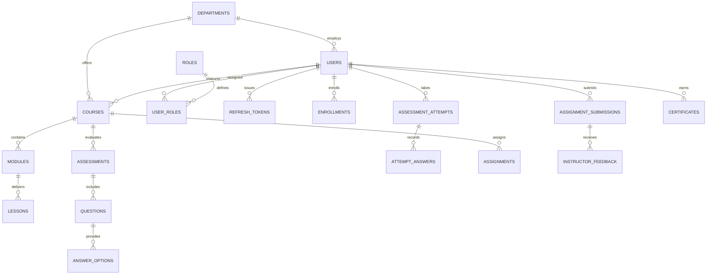

# Learnflow LMS — Database & Caching Model

## 1. PostgreSQL Relational Schemas & Entity Relationships

Learnflow LMS uses **PostgreSQL 15** with SQLAlchemy 2.0 ORM. All primary keys are UUIDs (`UUIDMixin`), and timestamp tracking is standardized across all tables (`TimestampMixin` with timezone-aware `created_at` and `updated_at`).

---

## 2. Relational Table Specifications

### 2.1 Identity, RBAC & Authentication
- `departments`: Academic units (`id`, `name`, `code`, `description`).
- `users`: Core identity table (`id`, `email`, `hashed_password`, `full_name`, `department_id`, `is_active`). Indexed on `email`.
- `roles`: Institutional role catalog (`id`, `name`, `description`). Standard values: `learner`, `instructor`, `hod`, `admin`.
- `user_roles`: Many-to-many relationship mapping users to roles (`user_id`, `role_id`).
- `refresh_tokens`: Cryptographic session ledger (`id`, `user_id`, `family_id`, `token_hash`, `replaced_by`, `expires_at`, `revoked_at`, `ip_address`, `user_agent`). Indexed on `token_hash`, `user_id`, and `family_id`.
- `password_reset_tokens`: Transient recovery tokens stored exclusively as SHA-256 digests (`token_hash`).
- `audit_logs`: Append-only security and administration event stream (`id`, `user_id`, `action`, `resource_type`, `resource_id`, `previous_hash`, `current_hash`, `payload`, `created_at`). The audit log is hash-chained and tamper-evident against casual edits; a database administrator could recompute the chain.

### 2.2 Course Delivery & Curriculum
- `courses`: Instructional course catalog (`id`, `title`, `slug`, `description`, `difficulty`, `status`, `department_id`, `instructor_id`). Unique index on `slug`.
- `course_prerequisites`: Directed acyclic graph edges (`course_id`, `prerequisite_course_id`).
- `modules`: Ordered instructional units within a course (`id`, `course_id`, `title`, `order_index`).
- `lessons`: Atomic lesson nodes (`id`, `module_id`, `title`, `content_text`, `duration_minutes`, `order_index`, `concept_id`).
- `course_concepts`: Diagnostic concept taxonomy for adaptive remediation (`id`, `course_id`, `name`, `code`, `description`).

### 2.3 Assessment Engine & Grading
- `assessments`: Timed evaluation specifications (`id`, `course_id`, `title`, `time_limit_minutes`, `passing_score_percentage`, `max_attempts`).
- `questions`: Individual evaluation items (`id`, `assessment_id`, `question_type`, `prompt_text`, `points`, `concept_id`). Types: `single_choice`, `multiple_choice`, `true_false`, `short_answer`.
- `answer_options`: Predefined response options with encrypted score credit flags (`id`, `question_id`, `option_text`, `is_correct`, `partial_credit_weight`).
- `assessment_attempts`: Lifecycle tracking of student attempts (`id`, `assessment_id`, `user_id`, `status`, `started_at`, `submitted_at`, `expires_at`, `total_score`, `score_percentage`, `is_passed`).
- `attempt_answers`: Student answers and rubric scores awarded per question (`attempt_id`, `question_id`, `selected_option_ids`, `text_answer`, `score_awarded`, `is_correct`).

### 2.4 Quarantined Storage & Certification
- `stored_files`: Metadata for user-uploaded media (`id`, `original_filename`, `storage_key`, `file_size_bytes`, `mime_type`, `status`, `uploader_id`). Status values: `pending_upload`, `quarantined`, `validated`, `rejected`.
- `assignment_submissions`: Student work linked to `stored_files` (`id`, `assignment_id`, `student_id`, `file_id`, `status`).
- `certificates`: Earned credentials (`id`, `user_id`, `course_id`, `verification_code`, `hmac_signature`, `issued_at`, `pdf_storage_key`). Indexed on `verification_code`.

---

## 3. Redis Key Architecture & Cache Versioning

Learnflow uses Redis 7 for high-performance distributed operations:

| Key Pattern | Data Structure | TTL | Purpose |
| :--- | :---: | :---: | :--- |
| `learnflow:rl:{hash(key)}` | Sorted Set (`ZSET`) | Window + 10s | Distributed sliding-window rate limiting. Uses atomic Lua scripts (`SLIDING_WINDOW_LUA`). Hashes raw identifiers with SHA-256 for privacy. |
| `learnflow:ai_ver:global` | String (`INCR`) | Permanent | Global AI cache generation version. Increments when platform-wide curriculum updates occur. |
| `learnflow:ai_ver:user:{user_id}` | String (`INCR`) | Permanent | User-level cache version. Increments when user enrollments or course access changes. |
| `learnflow:ai_ver:dept:{dept_id}` | String (`INCR`) | Permanent | Department-level cache version. Increments when department curriculum changes. |
| `learnflow:ai_cache:{composite_key}` | String (JSON) | 300s (5 min) | Semantic response cache keyed by `(user_id, u_ver, roles, dept_id, d_ver, query_hash, g_ver)`. |

---

## 4. Alembic Database Migrations

Schema evolution is governed by Alembic with declarative, reversible migration versions in `backend/alembic/versions/`:

- **Baseline Migration (`842eed5b01f0_baseline_schema.py`):** Establishes all 33 relational tables, foreign key constraints, and performance indexes.
- **Token Family Revision (`2eceb097932c_add_family_id_to_refresh_tokens.py`):** Adds the `family_id` UUID column and index to `refresh_tokens` for RFC 6819 multi-device token-family rotation.
- **Automated Boot Execution:** Container startup (`backend/entrypoint.sh`) executes `alembic upgrade head` before booting the API server, ensuring zero-drift migrations.

