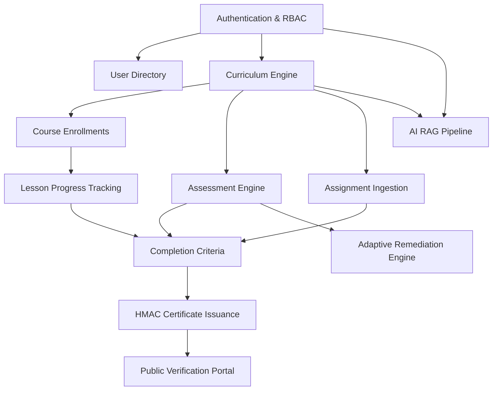

# Learnflow LMS — Product Requirements Document (PRD)

> **Document Version:** 1.0.0  
> **Product Stage:** Production Release Candidate (Version 1.0 Finalized)  
> **System Architecture:** Cloud-Native Monorepo (FastAPI + React 19 + PostgreSQL 15 + Redis + S3-Compatible Storage)  
> **Document Status:** Authoritative Product Specification  

---

## 1. Product Overview

**Learnflow LMS** is an enterprise-grade, server-authoritative Learning Management and Assessment Platform engineered specifically for higher education engineering departments, technical academies, and high-stakes coding certifications. 

Unlike traditional open-source LMS platforms that function primarily as static file repositories or unmonitored content players, Learnflow bridges the gap between structured pedagogical curriculum delivery, rigorous academic assessment integrity, cryptographic credential verification, and personalized AI-assisted tutoring.

Learnflow enforces an institutional **3-tier Role-Based Access Control (RBAC)** model (Learner, Instructor/Faculty, and Institutional Administrator), server-side validation of prerequisite directed acyclic graphs (DAGs), multi-stage quarantine file ingestion, automated multi-format assessment grading, and role-scoped retrieval-augmented generation (RAG) powered by Google Gemini.

---

## 2. Problem Statement

Contemporary digital learning systems face four critical structural failures:

1. **Assessment & Academic Integrity Compromise:** Most commercial and open-source LMS platforms perform client-side quiz scoring or allow uncontrolled browser concurrency, allowing learners to open simultaneous attempts, share answer keys, or bypass time limits.
2. **Insecure File Ingestion (Malware & IDOR):** Assignment submission pipelines often expose raw file upload endpoints directly to web servers or public buckets without mime-type magic-byte verification, antivirus quarantine scanning, or author ownership validation, exposing institutions to malware injection and Insecure Direct Object References (IDOR).
3. **Fraudulent Credentialing & Diploma Mills:** Completion certificates are commonly generated as static client-side PDFs or unverifiable images without cryptographic provenance, making credential tampering and forging trivial.
4. **Superficial & Hallucinatory AI Tools:** Generic chatbot integrations lack department scoping, curriculum grounding, and role-aware boundary controls, often answering quiz questions during live tests or hallucinating curriculum content.

---

## 3. Product Vision

Learnflow aims to become the definitive open-architecture technical learning operating system for accredited institutions. The platform pairs rigorous server-authoritative state machines with modern, responsive, accessible web engineering. Every course milestone, assessment score, assignment submission, and certificate is deterministically validated and cryptographically verifiable.

---

## 4. Objectives and Expected Outcomes

| Objective | Target Metric | Expected Outcome |
| :--- | :--- | :--- |
| **Server-Authoritative Evaluation** | 0% Client-Side Scoring | All assessment grading is executed server-side under database transaction locks. |
| **Assessment Concurrency Control** | 0 Duplicate Active Attempts | Advisory and partial unique database locks restrict each learner to exactly one active attempt session. |
| **Zero-Trust File Upload Pipeline** | 100% Ingestion Isolation | Submissions are uploaded exclusively to quarantined S3 storage, scanned, and promoted only upon verified integrity. |
| **Cryptographic Credentialing** | 100% HMAC Verifiability | Every issued certificate carries an HMAC-SHA256 digital signature verifiable via public lookup or PDF binary hash. |
| **Role-Aware AI Tutoring** | 0% In-Assessment Leakage | AI Copilot dynamically hides during active exams and grounds all queries in the learner's enrolled syllabus. |
| **Accessibility & Performance** | WCAG 2.1 AA / <200kB Route Bundles | Accessible contrast, keyboard navigation, and code-split frontend bundles for low-bandwidth mobile reliability. |

---

## 5. Target Users and Stakeholders

- **Accredited Universities & Colleges:** Computer science, software engineering, and technical departments requiring verifiable assignment delivery and proctored grading.
- **Enterprise Technical Academies:** Internal employee upskilling programs needing strict prerequisite sequencing and verifiable completion badges.
- **Instructors & Teaching Assistants:** Faculty requiring streamlined curriculum authoring, automated quiz grading, rubric-based coursework evaluation, and cohort performance telemetry.
- **Learners & Students:** Technical students seeking distraction-free lesson reading, interactive coding challenges, structured alpine journey visualization, and tamper-proof portfolio diplomas.
- **Institutional Administrators & Auditors:** Compliance officers monitoring user lifecycle events, privilege escalations, system integrity, and audit event velocities.

---

## 6. User Personas

### 6.1 Learner Persona: Marcus Vance (Sophomore Engineering Student)
- **Background:** 20-year-old computer engineering major balancing heavy coursework across multiple labs.
- **Goals:** Progress through sequential technical modules, take timed quizzes on mobile or laptop, track progress toward degree milestones, and download verifiable certificates for LinkedIn.
- **Pain Points:** Cluttered interfaces, broken mobile views, loss of quiz progress on connection drop, unhelpful generic chatbots that don't know the course syllabus.

### 6.2 Instructor Persona: Dr. Elena Rostova (Associate Professor & Course Director)
- **Background:** Teaches Distributed Systems and Data Structures to cohorts of 250+ students.
- **Goals:** Construct modular multi-week syllabi with lesson prerequisites, author varied question types (single choice, multi-select, regex short answers), review student assignment submissions in a streamlined grading queue, and identify struggling students before drop deadlines.
- **Pain Points:** Tedious manual grading of code submissions, students bypassing prerequisites, lack of visibility into concept-level cohort failure rates.

### 6.3 Administrator Persona: Sarah Chen (University IT Systems & Compliance Officer)
- **Background:** Manages academic enterprise IT, user directory synchronizations, and compliance auditing.
- **Goals:** Maintain high platform availability, enforce single transferable administrator seat governance, monitor tamper-evident audit ledgers, verify certificate authenticity requests from third-party employers, and isolate departments.
- **Pain Points:** Privilege creep, untracked administrative modifications, unverified certificate claims, vulnerable file upload infrastructure.

---

## 7. Functional Requirements

### 7.1 Authentication & Session Management
- **FR-AUTH-001:** Registration with strict field validation (name, institutional email, strong password).
- **FR-AUTH-002:** Email/password login with secure JWT access tokens issued strictly in memory and long-lived refresh tokens issued in `HttpOnly`, `SameSite=Lax`, `Secure` cookies.
- **FR-AUTH-003:** RFC 6819 refresh token rotation with immediate token-family revocation upon replay detection.
- **FR-AUTH-004:** Single-flight background refresh interceptor preventing token refresh stampedes across concurrent requests.
- **FR-AUTH-005:** Cross-tab auth synchronization via `BroadcastChannel('learnflow_auth_sync')` reflecting logins and logouts across all browser windows.
- **FR-AUTH-006:** Single transferable administrator seat policy preventing rogue administrative account proliferation.

### 7.2 Course Management & Curriculum Authoring
- **FR-CURR-001:** Course creation with metadata (title, slug, description, difficulty level, cover image, department assignment).
- **FR-CURR-002:** Hierarchical syllabus structure: Course → Modules → Lessons.
- **FR-CURR-003:** Directed Acyclic Graph (DAG) prerequisite engine preventing circular course dependencies.
- **FR-CURR-004:** Sequential module progression enforcing prerequisite completion before unlocking subsequent units.
- **FR-CURR-005:** Multi-format lesson content authoring supporting sanitized Markdown, KaTeX mathematical notation, and downloadable supplementary resources.

### 7.3 Server-Authoritative Assessments & Quizzes
- **FR-TEST-001:** Timed assessments with configurable duration, passing score percentage, and maximum attempt ceilings.
- **FR-TEST-002:** Server-side attempt session initialization with dynamic question and option order shuffling.
- **FR-TEST-003:** Strict concurrency locks ensuring a learner can have at most one `in_progress` attempt per assessment.
- **FR-TEST-004:** Automated grading pipeline supporting:
  - Single Choice (radio).
  - Multiple Choice (checkboxes with partial credit algorithm).
  - True / False.
  - Short Answer (case-sensitive or normalized alphanumeric variant matching with symbol preservation for `C++`, `.NET`, `HTTP/2`).
- **FR-TEST-005:** Client-side draft autosaving to `localStorage` paired with periodic backend draft synchronizations.
- **FR-TEST-006:** Server-side sweeper expiring abandoned attempts past deadline + grace period.

### 7.4 Assignment Coursework & Multi-Stage Quarantine Pipeline
- **FR-ASGN-001:** Assignment creation with instructions, due date, maximum point weights, and allowed file extension white-lists.
- **FR-ASGN-002:** Presigned ticket generation for direct-to-S3 uploads isolating incoming files in a private quarantine bucket.
- **FR-ASGN-003:** Quarantine verification service validating magic bytes, payload size, and file extension parity before promoting to clean storage.
- **FR-ASGN-004:** Versioned submission tracking preventing file collisions and maintaining complete submission audit logs.
- **FR-ASGN-005:** Instructor grading queue supporting rubric scoring, constructive feedback commentary, and automated grade publication.

### 7.5 Cryptographic Certificates & Public Verification
- **FR-CERT-001:** Automated completion criteria evaluation (minimum lesson completion rate, mandatory assessment passing, required assignment submissions).
- **FR-CERT-002:** Server-side certificate issuance generating a cryptographically secure 12-character verification code and HMAC-SHA256 signature hash.
- **FR-CERT-003:** High-fidelity diploma rendering in browser with instant vector PDF streaming and raster PNG downloads.
- **FR-CERT-004:** Public zero-auth verification portal (`/verify` and `/verify/:code`) displaying recipient, issuing institution, course syllabus, and grade honors.
- **FR-CERT-005:** Multi-factor PDF document verification extracting embedded metadata and checking digital provenance against database records.

### 7.6 Learning Journey & Personalization
- **FR-PERS-001:** Interactive Alpine Mountain Trail visualization mapping curriculum modules to topographic elevation stations.
- **FR-PERS-002:** Vector Avatar Studio providing multilayer SVG customization (face shape, skin tone, hair, clothing, atmosphere).
- **FR-PERS-003:** Deterministic adaptive remediation engine generating concept-targeted study recommendations upon assessment failure.
- **FR-PERS-004:** Student study companion with floating selection toolbar (highlight, copy, instant AI concept explainer).

### 7.7 AI Copilot & Grounded RAG Gateway
- **FR-AI-001:** Floating multimodal chat assistant docked in application shell.
- **FR-AI-002:** Strict academic integrity gate hiding copilot on unauthenticated pages, during timed assessment attempts, and in focused reading modes.
- **FR-AI-003:** Role-scoped context grounding:
  - Learner: restricted strictly to enrolled course materials.
  - Instructor: scoped to department curricula and grading rubrics.
  - Admin: global institutional scope.
- **FR-AI-004:** Prompt injection defense with system delimiters, role boundary assertions, and sanitized Markdown output.

### 7.8 Institutional Administration & Telemetry
- **FR-ADM-001:** Comprehensive user directory with search, role filters, status toggling (active/deactivated), and role elevation.
- **FR-ADM-002:** Visual intelligence deck displaying platform enrollment distributions, role demographics, and certificate issuance velocity.
- **FR-ADM-003:** Append-only tamper-evident audit ledger recording critical operational events with previous-hash chain integrity.

---

## 8. Non-Functional Requirements

### 8.1 Security & Compliance
- **NFR-SEC-001:** OWASP Top 10 compliance: zero raw SQL string interpolation, parameterized SQLAlchemy queries throughout.
- **NFR-SEC-002:** Cross-Site Scripting (XSS) prevention: markdown rendering sanitized via `rehype-sanitize` with strict tag white-lists.
- **NFR-SEC-003:** Cross-Site Request Forgery (CSRF) mitigation: strict `Origin` and `Referer` validation on all state-mutating endpoints.
- **NFR-SEC-004:** Insecure Direct Object Reference (IDOR) prevention: all resource queries explicitly validate `user_id == current_user.id` or institutional permissions.
- **NFR-SEC-005:** DDoS and payload limiting: HTTP request body limiter middleware enforcing a 15MB hard limit.

### 8.2 Reliability & Availability
- **NFR-REL-001:** Database transactions must adhere strictly to ACID semantics with explicit `commit()` and `rollback()` handling.
- **NFR-REL-002:** Idempotent submission APIs: assessment submissions accept an `Idempotency-Key` UUID preventing double-billing or multiple submissions under network retries.

### 8.3 Performance & Responsiveness
- **NFR-PERF-001:** Core Web Vitals: First Contentful Paint (FCP) < 1.2s on desktop, < 1.8s on 3G mobile connections.
- **NFR-PERF-002:** Client-side route bundle splitting ensuring all asynchronous route chunks remain under 200kB minified/gzipped.
- **NFR-PERF-003:** In-memory caching for repetitive metadata lookups (`dataCache.ts` 3-minute TTL).

### 8.4 Usability & Accessibility
- **NFR-ACC-001:** Strict adherence to WCAG 2.1 AA standards: minimum 4.5:1 text contrast ratios, visible keyboard focus rings, semantic landmark tags.
- **NFR-ACC-002:** Fully responsive viewport adaptation supporting 390px mobile screens, 768px tablet rail, and 1440px+ desktop widescreen displays.

---

## 9. User Roles and Permissions Matrix

| Module / Operation | Learner | Instructor (Faculty) | Administrator | Public (Unauthenticated) |
| :--- | :---: | :---: | :---: | :---: |
| **Browse Course Catalog** | ✅ | ✅ | ✅ | ✅ |
| **View Course Syllabus** | ✅ | ✅ | ✅ | ✅ |
| **Enroll in Course** | ✅ | ❌ | ❌ | ❌ |
| **Read Lessons & Resources** | ✅ (Enrolled) | ✅ (Own/Dept) | ✅ | ❌ |
| **Take Quizzes & Assessments** | ✅ (Enrolled) | ❌ | ❌ | ❌ |
| **Submit Coursework Assignments** | ✅ (Enrolled) | ❌ | ❌ | ❌ |
| **Claim / Download Certificate** | ✅ (Completed) | ❌ | ✅ | ❌ |
| **Public Certificate Verification** | ✅ | ✅ | ✅ | ✅ |
| **Create / Edit Courses** | ❌ | ✅ (Assigned) | ✅ | ❌ |
| **Author Modules & Lessons** | ❌ | ✅ (Assigned) | ✅ | ❌ |
| **Author Quizzes & Questions** | ❌ | ✅ (Assigned) | ✅ | ❌ |
| **Grade Submissions & Feedback** | ❌ | ✅ (Assigned) | ✅ | ❌ |
| **View Cohort Analytics** | ❌ | ✅ (Assigned) | ✅ | ❌ |
| **Manage Users & Role Assignments** | ❌ | ❌ | ✅ | ❌ |
| **Toggle User Account Status** | ❌ | ❌ | ✅ | ❌ |
| **View System Audit Ledger** | ❌ | ❌ | ✅ | ❌ |
| **Revoke Certificates** | ❌ | ❌ | ✅ | ❌ |

---

## 10. Core Product Modules

```
Learnflow LMS Platform Architecture
├── 1. Identity & Session Authority (JWT, RFC 6819 Token Family, 3-Tier RBAC)
├── 2. Curriculum & Course Engine (Modules, Lessons, DAG Prerequisites, Resources)
├── 3. Server-Authoritative Assessment Arena (Timed Attempts, Autograding, Concurrency Locks)
├── 4. Coursework Assignment & File Quarantine Pipeline (Presigned S3, Magic-Byte Scan, Rubrics)
├── 5. Cryptographic Credential Engine (HMAC-SHA256, Vector PDF/PNG Export, Public Registry)
├── 6. Learner Personalization Suite (Avatar Studio, Alpine Journey Map, Adaptive Remediation)
├── 7. Grounded AI Learning Copilot (Google Gemini RAG Gateway, Role-Scoped Grounding, Integrity Gate)
└── 8. Operations & Administrative Intelligence Deck (Audit Trail, Platform Metrics, User Directory)
```

---

## 11. User Stories

### US-01: Learner Prerequisite Progression
- **As a** Learner,  
- **I want to** clearly see locked modules and unmet prerequisites,  
- **So that** I master fundamental concepts before advancing to complex coursework.

### US-02: Server-Authoritative Assessment
- **As a** Learner,  
- **I want my** quiz attempts saved automatically and graded fairly by the server,  
- **So that** transient network disconnections do not forfeit my progress or alter my test results.

### US-03: Instructor Curriculum & Assessment Authoring
- **As an** Instructor,  
- **I want to** configure diverse question types with specific point values and symbol-tolerant short answer variations,  
- **So that** automated grading accurately evaluates programming syntax like `C++` or `HTTP/2`.

### US-04: Secure Assignment Submission
- **As an** Instructor,  
- **I want** student file uploads quarantined and verified before they are available for grading,  
- **So that** the platform and evaluation workstations remain protected from corrupted or malicious payloads.

### US-05: Verifiable Diplomas
- **As a** Graduated Learner,  
- **I want to** share a public verification link and cryptographically signed diploma,  
- **So that** prospective employers can instantly authenticate my academic achievements without contacting the university registrar.

### US-06: Institutional Compliance & Oversight
- **As an** Administrator,  
- **I want to** inspect an append-only cryptographic audit log of administrative actions,  
- **So that** all permission escalations, user status modifications, and certificate issuances remain provably accountable.

---

## 12. Acceptance Criteria

- **AC-01 (Auth Rotation):** When an expired access token is refreshed, the server MUST issue a new access token and rotate the refresh token cookie. If a previously consumed refresh token is presented, all refresh tokens in that family MUST be revoked immediately with a 401 response.
- **AC-02 (Assessment Locking):** When a user initiates an assessment attempt, the backend MUST verify no other attempt for that assessment is currently in `in_progress` status. Concurrent duplicate requests MUST be blocked by PostgreSQL transaction advisory locks.
- **AC-03 (Autograding Precision):** A short answer question configured with accepted answer `C++` MUST award full points for student submission `C++` and 0 points for `Java`. Whitespace trimming MUST preserve symbols.
- **AC-04 (File Quarantine):** A submitted `.pdf` file whose header bytes match an executable binary MUST be flagged and rejected by the quarantine scanner, preventing transition to the clean storage bucket.
- **AC-05 (Certificate Public Verification):** Navigating to `/verify/{valid_code}` without any authentication cookies MUST successfully return the course title, student name, issue date, and validation status with HTTP 200.

---

## 13. Business Rules

1. **Prerequisite DAG Integrity:** A course cannot have itself or any of its downstream dependents as a prerequisite. Cycles are detected and rejected at course creation/update time.
2. **Single Active Assessment Rule:** A learner may only possess one active (`in_progress`) attempt session per assessment at any given moment.
3. **Immutable Graded Submissions:** Once an assessment attempt is submitted or expired, its answers and score records become strictly immutable.
4. **Single Admin Seat:** The platform enforces a single active administrative user seat. Administrator role assignment functions as a transfer rather than an additive grant.
5. **Assessment Copilot Prohibition:** The AI Copilot must remain completely dormant and inaccessible whenever the learner is on an active assessment URL or during an active assessment attempt.

---

## 14. Feature Dependencies



---

## 15. Scope and Limitations

### In Scope for Version 1.0
- Complete 3-tier RBAC (Learner, Instructor, Administrator).
- 22 comprehensive technical engineering courses pre-seeded with complete daily lesson modules.
- Sequential module locking and prerequisite DAG enforcement.
- Automated assessment arena supporting 4 question types with time limits and autosave.
- Direct-to-S3 quarantine file submission pipeline with MIME inspection.
- Vector PDF and PNG certificate generation with HMAC-SHA256 signatures and public `/verify` registry.
- Multilayer SVG Personalized Avatar Studio.
- Alpine Mountain Trail visual learning map.
- Responsive mobile layout (390px viewport parity with bottom dock navigation).
- Grounded Gemini AI Copilot with strict assessment integrity gating.

### Out of Scope / Deferred (Version 1.1+)
- Live video conferencing and WebRTC virtual lecture rooms.
- Real-time peer-to-peer chat between students.
- Plagiarism detection integrating Turnitin or external LLM detector APIs.
- SCORM / xAPI export packages.
- Native mobile applications (iOS/Android) — mobile is currently delivered via progressive responsive web application (PWA).

---

## 16. Current Product Status

| Module / Feature | Implementation Status | Notes |
| :--- | :---: | :--- |
| **Authentication & RBAC** | ✅ Implemented | RFC 6819 token family rotation, memory token, 3 roles verified. |
| **Curriculum & Lessons** | ✅ Implemented | 22 courses, markdown reading player, KaTeX math, resource downloads. |
| **Assessment Arena** | ✅ Implemented | Server-authoritative autograding, drafts, concurrency locking. |
| **Assignment Pipeline** | ✅ Implemented | Presigned S3 quarantine, magic-byte inspection, grading queue. |
| **Certificates & Verification** | ✅ Implemented | HMAC signing, PDF/PNG streaming, public verify portal, document upload check. |
| **AI Copilot** | ✅ Implemented | Role-grounded Gemini RAG, state-based assessment lockout. |
| **Avatar Studio** | ✅ Implemented | Multilayer SVG customization, local/remote profile persistence. |
| **Journey Map** | ✅ Implemented | Panoramic alpine elevation visualization, daylight/night transitions. |
| **Admin Operations** | ✅ Implemented | Visual intelligence deck, user status controls, chained audit ledger. |
| **Mobile Responsiveness** | ✅ Implemented | 390px mobile layout, tablet rail, touch toolbar, bottom navigation dock. |
| **WebRTC Live Classrooms** | ⏳ Planned (v1.1) | Architectural placeholder; not included in v1.0. |
| **External Payment Gateway** | 🚫 Unavailable | All courses currently institutional/open-enrollment; billing deferred. |
