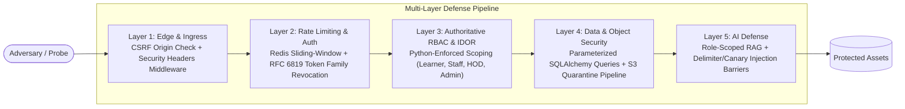
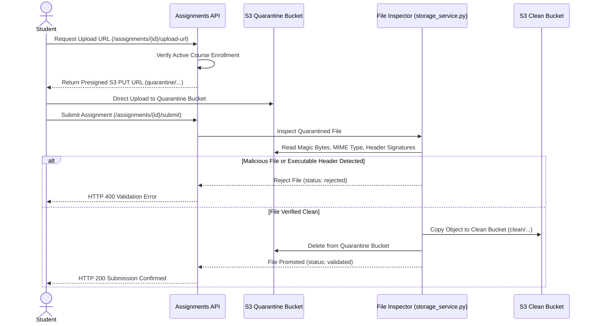

# Learnflow LMS — Production Security Hardening Standards

## 1. Threat Modeling & Core Defense Objectives

Learnflow LMS is engineered to defend against high-impact attack vectors across web, API, database, and AI interaction surfaces. The application implements defense-in-depth across the OWASP Top 10 vulnerabilities.

---

## 2. Authentication Lifecycle Hardening

### 2.1 Cryptographic Password Security
- **Argon2id Hashing:** Passwords hashed with Argon2id using industry-standard work factors (`t=3, m=65536, p=4`).
- **Complexity Enforcement:** Passwords must meet minimum complexity requirements (8+ characters, uppercase, lowercase, numbers, and special symbols).

### 2.2 RFC 6819 Refresh Token Rotation & Replay Revocation
- **One-Time Token Use:** Every call to `/api/v1/auth/refresh` rotates the refresh token. The previous token is marked `revoked_at = now()` and linked to its successor via `replaced_by = new_token_hash`.
- **Atomic Row-Level Locking:** Refresh operations acquire a PostgreSQL row lock (`with_for_update()`) to prevent race conditions during simultaneous refreshes from multiple tabs.
- **Token-Family Revocation on Replay:** If an already-rotated or revoked refresh token is presented, the system detects a replay attack or compromised credential. It **immediately and atomically revokes all active sessions in that family**, invalidates auth cookies, and records a security incident in the audit ledger.

### 2.3 Evaluation Demo Personas & Production Environment Boundaries
- **Default: on for local and evaluation builds. Set `VITE_ENABLE_DEMO_PERSONAS=false` for any real deployment.**
- In evaluation builds, quick-fill login buttons for demo accounts are enabled on the login screen for evaluator convenience.
- The backend never creates demo accounts when `ENVIRONMENT=production`, so the buttons cannot sign in there. In production, initial superadmin access must be provisioned via `BOOTSTRAP_ADMIN_EMAIL` and `BOOTSTRAP_ADMIN_PASSWORD`.

---

## 3. Ingress, Network & CSRF Protections

### 3.1 Strict CSRF Origin Verification
State-changing API endpoints (`POST`, `PUT`, `PATCH`, `DELETE`) enforce strict Origin and Referer verification via `verify_csrf_origin()`. Requests with missing, untrusted, or malformed (`null`) origins are rejected with **HTTP 403 Forbidden**.

### 3.2 Security Headers Middleware
Every HTTP response carries hardened security headers:
- `X-Content-Type-Options: nosniff`
- `X-Frame-Options: DENY`
- `X-XSS-Protection: 1; mode=block`
- `Referrer-Policy: strict-origin-when-cross-origin`
- `Content-Security-Policy: default-src 'self' ...`

### 3.3 Distributed Redis Rate Limiting (Fail-Closed)
Critical authentication and AI endpoints are protected by Redis sliding-window limiters executing atomic Lua scripts:
- **Identifier Privacy:** IP addresses, account emails, and sensitive keys are hashed with SHA-256 before forming Redis cache keys (`learnflow:rl:{digest}`).
- **Production Fail-Closed Policy:** In production (`ENVIRONMENT=production`), if Redis becomes unreachable or uninitialized, rate limiters **fail closed** (returning **HTTP 503 Service Unavailable** with `Retry-After: 30`) rather than silently permitting brute-force attacks.

---

## 4. Multi-Stage File Quarantine Pipeline

All file uploads (assignments, submissions) pass through an isolated multi-stage quarantine pipeline before promotion to public or course storage:

Attempts to generate download URLs for files in `quarantined` or `rejected` status are rejected with **HTTP 403 Forbidden**.

---

## 5. Assessment Integrity: What It Does and Does Not Do

Learnflow enforces transparent, backend-authoritative assessment controls designed for academic coursework while maintaining clear, honest boundaries regarding the limits of web-based testing.

### What Assessment Integrity DOES Do
- **Server-Side Timing:** Assessment initiation records an authoritative start timestamp in PostgreSQL. The remaining time is validated on the backend upon submission against `time_limit_minutes`. Client-side clock manipulation or paused browser timers cannot extend the testing window.
- **Per-Attempt Randomization:** Questions and multiple-choice answer options are shuffled per attempt at generation time, mitigating pattern copying and shoulder surfing.
- **Strict Attempt Limits:** Maximum attempt thresholds (`max_attempts`) are enforced with database transaction locks (`pg_advisory_xact_lock`), preventing race conditions or replay attempts.
- **Append-Only Audit Logging:** Assessment starts, submission timestamps, and autograding outcomes are committed to the SHA-256 hash-chained audit stream with IP addresses and user identifiers.
- **Strict Role & Enrollment Scoping:** Only learners with active course enrollments may initialize attempts. Answer keys are strictly kept server-side and never returned to the browser during active attempts.

### What Assessment Integrity DOES NOT Do
- **No Webcam Surveillance or Eye Tracking:** Learnflow does not capture video, track head movement, monitor eye gaze, or process biometric data.
- **No Lockdown Browser Sandbox:** The application runs inside standard modern web browsers; it does not freeze operating system tasks, restrict dual-monitor configurations, or disable background desktop applications.
- **No Out-of-Band Collusion Prevention:** Learnflow cannot detect or prevent out-of-band collaboration, communication via secondary devices (smartphones, separate laptops), or consulting physical textbooks.
- **No Decentralized Ledger or Public-Key PKI:** Course certificates use HMAC-SHA256 signatures with secret key rotation (`HMAC_KEY_RING`) checked against a central PostgreSQL record with an administrative revocation flag. They do not use a public blockchain, distributed ledger, or asymmetric X.509 PKI certificates.

