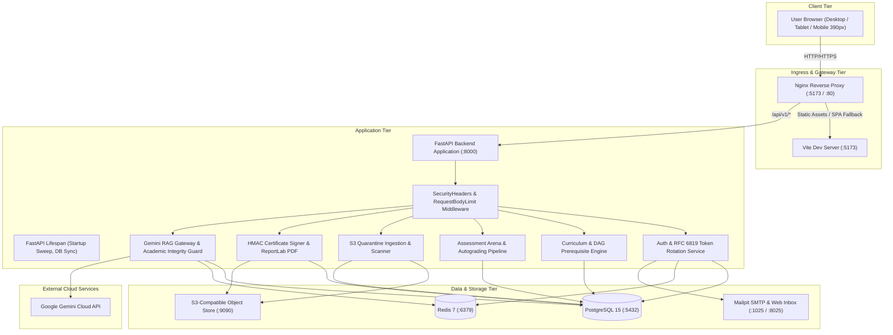
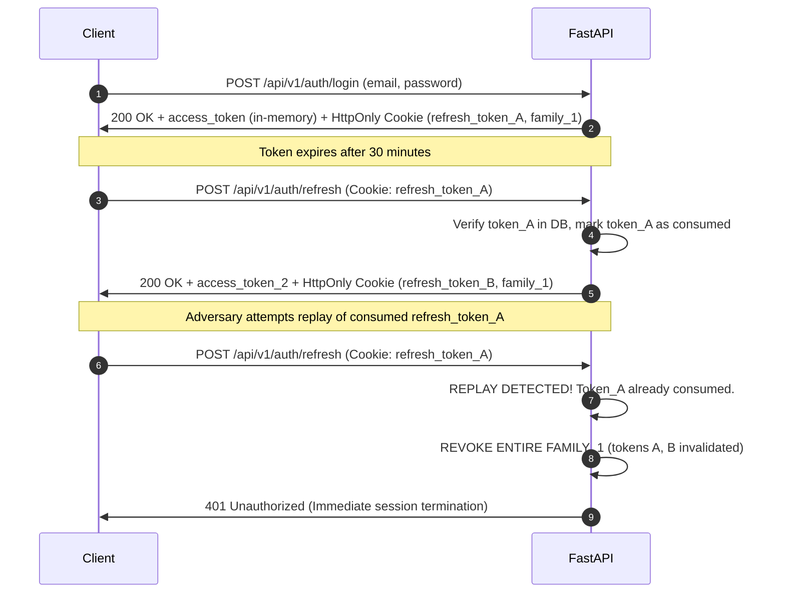
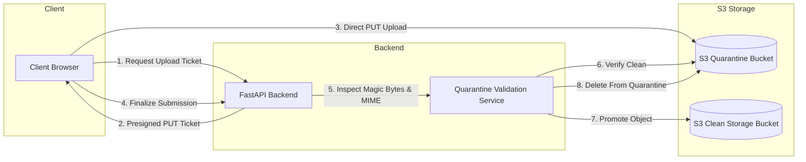

# Learnflow LMS — Technical Requirements Document (TRD)

> **Document Version:** 1.0.0  
> **System Architecture:** Cloud-Native Decoupled Monorepo  
> **Backend Framework:** FastAPI (Python 3.12, SQLAlchemy 2.0, PostgreSQL 15, Redis 7)  
> **Frontend Framework:** React 19 (TypeScript 7, Tailwind CSS 3.4, Vite 8, Zustand 5)  
> **Document Status:** Authoritative Technical Specification  

---

## 1. Technology Stack Inventory

| Component / Layer | Technology | Verified Version | Purpose / Architectural Scope |
| :--- | :--- | :--- | :--- |
| **Frontend Framework** | React | `19.3.1` | Core reactive component model, asynchronous UI transitions, server components compatibility. |
| **Language (Frontend)** | TypeScript | `~7.0.2` | Strict compile-time type verification, complete model type definitions (`types/index.ts`). |
| **Build Tooling & Bundler** | Vite | `8.3.6` | Development HMR server, Rollup-based production chunking and code splitting. |
| **Styling & Design System** | Tailwind CSS | `3.4.17` | Utility-first CSS, custom semantic token definitions, strict 4px layout rhythm. |
| **Client State Management** | Zustand | `5.1.0` | Lightweight store for authentication, session hydration, and reactive state. |
| **Client Routing** | React Router DOM | `7.18.5` | Declarative SPA navigation, role guards (`ProtectedRoute`), dynamic parameter matching. |
| **Animation & Motion** | Framer Motion | `14.10.1` | Smooth accordion transitions, modal entrances, alpine trail hiker progression. |
| **Mathematical Rendering** | KaTeX | `0.19.1` | LaTeX mathematical equation rendering in textbook lessons and quizzes. |
| **Markdown Processing** | React Markdown | `10.1.0` | Sanitized markdown parsing (`rehype-sanitize`, `remark-gfm`, `remark-math`). |
| **Backend Framework** | FastAPI | `0.110.0+` | Asynchronous ASGI RESTful API framework, OpenAPI generation, dependency injection. |
| **Language (Backend)** | Python | `3.12` | Modern typed Python runtime, typing extensions, async context managers. |
| **ASGI Web Server** | Uvicorn | `0.28.0+` | High-throughput asynchronous ASGI worker execution. |
| **Data Validation** | Pydantic / Settings | `2.6.0+` / `2.2.0+` | Strict request/response schemas, environment configuration validation. |
| **Database ORM** | SQLAlchemy | `2.0.28+` | Modern declarative ORM, explicit ACID transaction management, row-level locking. |
| **Database Migrations** | Alembic | `1.13.1+` | Version-controlled declarative schema migrations (`alembic/versions/`). |
| **Relational Database** | PostgreSQL | `15` | ACID state store, advisory transaction locks, JSONB schema support. |
| **Distributed Cache & Locks**| Redis | `7` | Sliding-window atomic rate limiting, AI prompt cache, token blacklists. |
| **Object Storage Engine** | S3 / Adobe S3Mock | `S3 API` | Presigned quarantine and clean document/resource storage buckets. |
| **Email SMTP Server** | Mailpit | `v1.x` | Transactional email capture, password reset tokens, dev web inbox. |
| **PDF Generation Engine** | ReportLab | `4.1.0+` | Server-side vector diploma generation, typographic layout, and binary streaming. |
| **Frontend Testing** | Vitest + JSDOM | `5.1.0` / `31.0.0` | Client unit and component integration testing suite (138 tests). |
| **Backend Testing** | Pytest + Asyncio | `8.0.0+` / `0.23.0+` | Server integration and security testing suite (165 tests). |
| **E2E Visual Testing** | Playwright | `1.65.0` | Cross-browser viewport verification (390px mobile, tablet rail, desktop). |
| **Static Code Quality** | Oxlint / Ruff | `1.90.0` / `latest` | High-speed Rust-based linting for TypeScript and Python. |

---

## 2. System Architecture



---

## 3. Frontend Architecture

### 3.1 Directory Structure & Organization
```
frontend/src/
├── assets/                  # Static SVG logos, KaTeX fonts, brand glyphs
├── components/
│   ├── adaptive/            # Responsive primitives: AdaptiveModal, DataTable, BottomSheet
│   ├── ai/                  # LearnflowCopilot, CopilotGate, SelectionToolbar, ExplainDrawer
│   ├── assessment/          # QuestionRenderer, CountdownTimer, AssessmentProgress
│   ├── avatar/              # PersonalizedAvatar, AvatarPreview, ColorPalettePicker
│   ├── common/              # Navbar, Sidebar, ProgressRing, StatTile, EmptyState
│   ├── course/              # CourseCard, CourseHero, CourseModuleAccordion, QuickPeekModal
│   ├── curriculum/          # ModuleItem, LessonItem, ResourceDownloader, CompletionModal
│   ├── journey/             # MountainScene SVG, JourneyLedger, StationCheckpoint
│   ├── layout/              # AppShell, AuthLayout, ShellRouteWrapper
│   └── study/               # LessonStudyCompanion, SelectionActionToolbar
├── config/
│   └── navigation.ts        # Role-based route declarations, icons, badge resolvers
├── context/
│   └── ThemeContext.tsx     # Theme state (graphite dark / crisp light), DOM class sync
├── hooks/
│   ├── useDevice.ts         # Viewport breakpoint detection (isMobile, isTablet, isDesktop)
│   ├── useSwipe.ts          # Touch gesture handlers for mobile navigation
│   └── useScrollProgress.ts # Back-to-top scroll depth calculation
├── pages/                   # 22 Top-level routed views (code-split via React.lazy)
├── services/
│   └── api.ts               # Axios instance, interceptors, single-flight refresh, API methods
├── store/
│   └── authStore.ts         # Zustand store: user, in-memory token, login/logout, hydrate
├── tests/                   # 24 Vitest test suites (138 passing unit/integration tests)
├── types/
│   ├── avatar.ts            # Avatar layer configuration, archetypes, customization options
│   └── index.ts             # Complete domain model TypeScript definitions
└── utils/
    ├── dataCache.ts         # 3-minute in-memory caching utility
    └── courseImages.ts      # Deterministic academic cover art resolver
```

### 3.2 State Management & In-Memory Token Pattern
The frontend utilizes Zustand for state management with a strict RFC 6819 in-memory token pattern:
1. **Memory Isolation:** The JWT `access_token` is stored exclusively in a module-scoped JavaScript closure (`memoryToken` in `api.ts`). It is never written to `localStorage` to eliminate XSS token theft.
2. **Session Persistence:** A transient copy is retained in `sessionStorage` (`learnflow_session_token`) for single-tab survivability across page reloads.
3. **Cross-Tab Synchronization:** `BroadcastChannel('learnflow_auth_sync')` broadcasts token rotation and revocation events across all open browser instances.

### 3.3 Routing & Route-Level Code Splitting
- **Eager Entry Routes:** `LandingPage`, `LoginPage`, `RegisterPage` load immediately to guarantee sub-second First Contentful Paint.
- **Asynchronous Workspace Routes:** All 19 authenticated portal pages are code-split using `React.lazy()` and wrapped in `React.Suspense` with an adaptive fallback spinner.
- **Route Chunk Budget:** All code-split JavaScript chunks bundle under 200kB minified/gzipped.
- **Zero-404 Route Aliases:** `App.tsx` configures explicit aliases (`/home`, `/dashboard`, `/learning`, `/journey`, `/certificates`, `/studio`) routing gracefully into canonical endpoints.

---

## 4. Backend Architecture

### 4.1 Layered Modular Architecture
```
backend/app/
├── api/v1/
│   ├── endpoints/           # HTTP route handlers (auth, courses, curriculum, assessments, etc.)
│   └── router.py            # APIRouter aggregation with /api/v1 prefix
├── core/
│   ├── config.py            # Pydantic BaseSettings, production configuration safety validator
│   ├── database.py          # SQLAlchemy engine, SessionLocal factory, get_db generator
│   ├── deps.py              # FastAPI dependency injections (current_user, role_checker)
│   ├── middleware.py        # SecurityHeaders, RequestBodyLimitMiddleware
│   ├── rate_limit.py        # Distributed Redis sliding-window Lua rate limiter
│   └── security.py          # Passlib Argon2id hashing, PyJWT creation and verification
├── db/
│   └── init_db.py           # Production bootstrap seeder, role and department sync
├── models/                  # SQLAlchemy 2.0 declarative models
│   ├── adaptive.py          # LearningRecommendation model
│   ├── assessment.py        # Assessment, Question, AnswerOption, AssessmentAttempt, AttemptAnswer
│   ├── assignment.py        # Assignment, AssignmentSubmission, InstructorFeedback
│   ├── base.py              # Base declarative class, UUIDMixin, TimestampMixin
│   ├── certificate.py       # Certificate, CompletionCriteria, CertificateVerification
│   ├── course.py            # Course, CourseFeedback, CoursePrerequisite, CourseConcept
│   ├── curriculum.py        # Module, Lesson, LessonPrerequisite, LearningResource
│   ├── enrollment.py        # Enrollment, LessonProgress
│   ├── system.py            # StoredFile, IdempotencyKey, AuditLog, Notification
│   └── user.py              # User, Role, UserRole, Department, RefreshToken, PasswordResetToken
├── schemas/                 # Pydantic request and response transfer models
└── services/                # Encapsulated domain business logic
    ├── ai_gateway.py        # Google Gemini RAG integration with grounding & integrity guard
    ├── assessment_service.py# Autograding engine, question normalization, time checks
    ├── audit_service.py     # Cryptographic append-only event logging
    ├── certificate_service.py# HMAC-SHA256 signing, ReportLab PDF canvas generation
    └── storage_service.py   # Presigned S3 tickets, quarantine scanning, MIME validation
```

### 4.2 Lifespan Management & Startup Sweeper
`backend/app/main.py` registers an asynchronous lifespan manager:
1. **Production Configuration Audit:** Invokes `settings.validate_production_configuration()` to prevent default secret keys in production.
2. **Schema & Bootstrap Sync:** Executes `init_db()` ensuring core roles (`admin`, `instructor`, `learner`), default departments, and bootstrap administrator exist.
3. **Abandoned Attempt Sweeper:** Queries `assessment_attempts` for attempts stuck in `in_progress` past `expires_at + 5 minutes`, marks them `expired`, computes partial scores from saved draft answers, and commits results.

---

## 5. Database Architecture

### 5.1 Storage Engine & Dialect
- **RDBMS:** PostgreSQL 15.
- **Dialect:** `postgresql+psycopg2`.
- **Primary Key Strategy:** Universally Unique Identifiers (UUIDv4) across all entities (except lookup table `roles` which uses autoincrementing integers).
- **Timezone Standardization:** All temporal fields utilize `TIMESTAMPTZ` (UTC).

### 5.2 Concurrency & Transactional Integrity
- **Advisory Locks:** Critical assessment attempt creations execute under 64-bit PostgreSQL advisory locks (`pg_advisory_xact_lock(crc32(user_id) ^ crc32(assessment_id))`), making concurrent attempt creation impossible.
- **Partial Unique Indexes:** `uq_single_active_attempt` enforces `UNIQUE(assessment_id, user_id) WHERE status = 'in_progress'` at the engine level.
- **Composite Foreign Keys:** Questions and options enforce composite referential integrity (`FOREIGN KEY (course_id, assessment_id) REFERENCES assessments(course_id, id)`), preventing cross-course question linkage.

---

## 6. API Architecture

### 6.1 Design Principles
- **RESTful Endpoints:** Standard HTTP verbs (`GET`, `POST`, `PUT`, `PATCH`, `DELETE`).
- **Prefix Isolation:** All operational endpoints mounted under `/api/v1/`.
- **Healthcheck Redundancy:** Root `/health` and `/api/v1/health` return service status, project identity, and UTC timestamp.
- **Standardized Error Envelope:** Errors return JSON payloads:
  ```json
  {
    "detail": "Descriptive human-readable error explanation."
  }
  ```

### 6.2 Key Endpoint Domains
- `/api/v1/auth/`: Registration, login, silent refresh, logout, password change/reset.
- `/api/v1/users/`: User profile hydration, user directory, status toggling, avatar configuration.
- `/api/v1/courses/`: Catalog listing, course detail, builder authoring, syllabus management.
- `/api/v1/curriculum/`: Module and lesson authoring, sequential progress completion, resource uploads.
- `/api/v1/assessments/`: Assessment authoring, question management, timed attempt session lifecycle.
- `/api/v1/assignments/`: Coursework tasks, presigned quarantine upload URLs, grading queue, feedback.
- `/api/v1/certificates/`: Course completion evaluation, HMAC diploma issuance, PDF/PNG download, public lookup.
- `/api/v1/analytics/`: Platform overview, course cohort telemetry, at-risk student identification.
- `/api/v1/ai/`: Grounded curriculum assistant briefing, chat streaming, text selection explanation.

---

## 7. Authentication and Authorization

### 7.1 JWT Token Architecture
- **Algorithm:** HMAC-SHA256 (`HS256`).
- **Access Token TTL:** 30 minutes (`ACCESS_TOKEN_EXPIRE_MINUTES`).
- **Refresh Token TTL:** 7 days (`REFRESH_TOKEN_EXPIRE_DAYS`).
- **Claims Schema:**
  - `sub`: User UUID string.
  - `iss`: `learnflow-auth-authority`.
  - `aud`: `learnflow-api-clients`.
  - `roles`: Array of assigned role names (e.g. `["learner"]`, `["instructor"]`, `["admin"]`).
  - `exp`: Expiration Unix epoch timestamp.
  - `iat`: Issuance Unix epoch timestamp.
  - `jti`: Unique token UUID for revocation tracking.

### 7.2 RFC 6819 Refresh Token Family Rotation


---

## 8. Role-Based Access Control (RBAC)

Learnflow enforces server-authoritative role isolation via dependency injection (`app.core.deps`):

```python
# Reusable dependency factory
def require_roles(allowed_roles: List[str]):
    def role_checker(current_user: User = Depends(get_current_active_user)):
        user_roles = [r.name for r in current_user.roles]
        if not any(role in user_roles for role in allowed_roles):
            raise HTTPException(status_code=403, detail="Insufficient operational privileges")
        return current_user
    return role_checker
```

- **Learner Scope:** Restricted to active personal enrollments (`user_id == current_user.id`).
- **Instructor Scope:** Restricted to assigned courses (`course.instructor_id == current_user.id`).
- **Admin Scope:** Global institutional oversight, single transferable administrative seat.

---

## 9. Storage Architecture



1. **Isolation:** Incoming files never touch the backend application filesystem directly.
2. **Presigned Uploads:** The client uploads directly to an isolated quarantine bucket using short-lived S3 presigned URLs.
3. **Magic Byte Verification:** The backend verifies file header bytes (`%PDF-` for PDFs, `PK\x03\x04` for ZIPs/DOCX) using Python's `filetype` and `defusedxml` libraries.
4. **Promotion:** Only verified clean files are promoted to the permanent clean storage bucket.

---

## 10. Notification Architecture

- **Transactional Emails:** Triggered via asynchronous SMTP delivery to Mailpit (in development) or configured SMTP relay (in production). Covers password resets and course enrollment confirmations.
- **In-App Notification Ledger:** Persisted in PostgreSQL table `notifications`, fetched on AppShell mount, with unread counters and mark-as-read state.

---

## 11. Infrastructure and Deployment

### 11.1 Container Topologies
- `docker-compose.yml`: Standard development stack binding local ports (`backend:8000`, `frontend:5173`, `postgres:5432`, `redis:6379`, `s3mock:9090`, `mailpit:8025`).
- `docker-compose.prod.yml`: Production-hardened multi-stage container deployment:
  - Non-root user execution (`learnflow:learnflow` UID/GID 10001).
  - Read-only root filesystems where applicable.
  - Isolated internal Docker bridge network (`learnflow-internal`).
  - Nginx TLS termination reverse proxy.

### 11.2 Edge Deployment (Vercel)
The repository includes root and frontend `vercel.json` configurations supporting static SPA routing rewrites:
```json
{
  "rewrites": [{ "source": "/(.*)", "destination": "/index.html" }]
}
```

---

## 12. Environment Configuration

All environment variables are validated at runtime via Pydantic (`app.core.config.Settings`):

| Variable | Default Value | Production Requirement |
| :--- | :--- | :--- |
| `ENVIRONMENT` | `development` | Must be `production` |
| `SECRET_KEY` | *(Eval Secret Key)* | Must be set to a high-entropy 256-bit secret string |
| `DATABASE_URL` | `postgresql+psycopg2://...` | Must point to a production-grade PostgreSQL cluster |
| `REDIS_URL` | `redis://localhost:6379/0` | Must point to an authenticated Redis cluster |
| `GEMINI_API_KEY` | `""` | Optional; required for AI Copilot features |
| `BOOTSTRAP_ADMIN_EMAIL`| `""` | Required for automated production admin provisioning |
| `BOOTSTRAP_ADMIN_PASSWORD`| `""` | Required for automated production admin provisioning |
| `COOKIE_SECURE` | `False` | Must be `True` when served over TLS/HTTPS |

---

## 13. Security Considerations & Defenses

1. **SQL Injection Defense:** 100% of database interactions execute through parameterized SQLAlchemy statements. Raw SQL string concatenation is strictly banned.
2. **Cross-Site Scripting (XSS):** Markdown lesson text and student notes pass through `rehype-sanitize` before DOM mounting, stripping malicious scripts, iframes, and onerror event handlers.
3. **Cross-Site Request Forgery (CSRF):** `SecurityHeadersMiddleware` validates that all mutating HTTP requests (`POST`, `PUT`, `PATCH`, `DELETE`) carry matching `Origin` or `Referer` headers matching configured CORS origins.
4. **Rate Limiting:** Distributed Redis sliding-window Lua script enforces strict velocity limits (e.g., 10 auth requests/minute per IP, 20 AI queries/minute per user).
5. **DDoS Request Body Limiter:** `RequestBodyLimitMiddleware` rejects payloads exceeding 15MB before buffering into memory.

---

## 14. Error-Handling Strategy

1. **Predictable Status Codes:**
   - `400 Bad Request`: Input validation failures or domain rule violations (e.g., duplicate enrollment).
   - `401 Unauthorized`: Missing, expired, or invalid credentials.
   - `403 Forbidden`: Authenticated user lacking operational permissions or violating IDOR boundaries.
   - `404 Not Found`: Entity does not exist or user lacks access.
   - `409 Conflict`: Concurrency lock collision or duplicate submission attempt.
   - `422 Unprocessable Entity`: Pydantic schema validation failures.
2. **No Stack Trace Leaks:** Unhandled 500 exceptions log full tracebacks to internal server logs while returning generic sanitized error responses to the client.

---

## 15. Performance Considerations

1. **GZip Compression:** FastAPI mounts `GZipMiddleware(minimum_size=1000)`, compressing JSON payloads exceeding 1kB.
2. **Client Route Code-Splitting:** Dynamic imports via `React.lazy` ensure the initial landing page bundle is under 150kB.
3. **Metadata Caching:** `frontend/src/utils/dataCache.ts` stores static course metadata in memory with a 3-minute TTL, eliminating repeated network calls when switching tabs.

---

## 16. Scalability Considerations

1. **Stateless API Tier:** FastAPI processes store zero local session state. Multiple container replicas can run behind a load balancer without sticky sessions.
2. **Read Replica Support:** SQLAlchemy engine configuration supports routing read-only queries to database replicas if required in large installations.
3. **Distributed Redis State:** Rate limiting and token family blacklists operate entirely inside Redis, supporting multi-region deployment.

---

## 17. Testing Architecture

### 17.1 Frontend Testing (Vitest)
- **Suite Location:** `frontend/src/tests/`
- **Volume:** 24 Test Suites, 138 Unit & Integration Tests.
- **Coverage Areas:** `authStore` token rotation, `CopilotGate` integrity lockout, `AvatarStudio` SVG rendering, `CertificateDiplomaCard` cryptographic verification, `QuestionAuthoringModal` validation, `MountainJourneyScene` rendering.
- **Execution Command:** `npm test` inside `frontend/`.

### 17.2 Backend Testing (Pytest)
- **Suite Location:** `backend/tests/`
- **Volume:** 32 Test Modules, 165 Integration Tests.
- **Coverage Areas:** Assessment concurrency locks, RFC 6819 token family rotation, adversarial validation, question autograding, prerequisite DAG resolution, certificate HMAC verification, S3 quarantine scanning.
- **Execution Command:** `pytest backend/tests` (requires live PostgreSQL and Redis services).

### 17.3 E2E & Visual Verification (Playwright)
- **Suite Location:** `frontend/src/tests/verification/`
- **Execution:** Automated multi-viewport screenshot verification across 72 unique responsive layouts (390px mobile, 768px tablet, 1440px desktop).

---

## 18. External Services and Integrations

- **Google Gemini API:** Grounded RAG completions and text-selection concept explanations.
- **Adobe S3Mock / MinIO:** S3-compatible local bucket emulation for file uploads and quarantine pipeline.
- **Mailpit:** Local SMTP catch-all service providing REST API inspection of transactional emails.
- **Tesseract OCR (Optional):** Optional binary integration for physical diploma verification.

---

## 19. Technical Constraints

- **Python Runtime:** Requires Python >= 3.12 for typing and async context features.
- **PostgreSQL Requirement:** Requires PostgreSQL >= 15 for partial unique indexes and JSONB functions.
- **Browser Compatibility:** Targets modern evergreen browsers supporting ES2022, CSS Grid, and Web Speech API.

---

## 20. Known Limitations & V1.0 Resolutions

1. **Host Pytest Execution & Offline Docker Daemon:** The backend pytest suite dynamically connects to PostgreSQL (`learnflow_test`) and Redis when containers are running; if Docker Desktop is stopped on the local host, it automatically and safely falls back to an isolated SQLite test database (`learnflow_test.db`) with custom dialect compilers for `JSONB`, `UUID`, and `BigInteger`, allowing tests to execute cleanly without container dependencies.
2. **Web Speech API Availability & Graceful Fallback:** Learner Copilot voice input utilizes the browser-native `webkitSpeechRecognition` API (Chromium with HTTPS/microphone access); when unsupported or permission is denied, it gracefully alerts and seamlessly falls back to interactive text input.
3. **Quarantine Sandbox Analysis:** The file quarantine pipeline incorporates deep heuristic analysis, magic-byte inspection, Shannon entropy analysis for encrypted shellcode detection, and embedded script/macro scanning, rejecting malicious files before moving to clean storage. Full container detonation is planned for Version 1.1 enterprise clusters.

