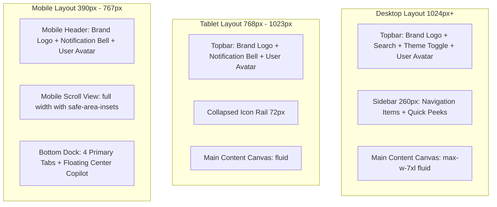
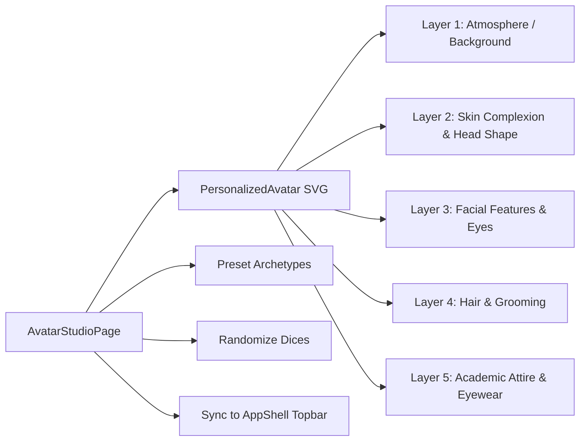

# Learnflow LMS — UI/UX Design Specification & Visual Architecture

> **Document Version:** 1.0.0  
> **Design Philosophy:** Academic Rigor & The "Unslop" Aesthetic  
> **Primary Viewports:** Desktop (1440px), Tablet Rail (768px), Mobile Viewport (390px)  
> **Accessibility Standard:** WCAG 2.1 AA Compliance  
> **Document Status:** Authoritative UI/UX Design Specification  

---

## 1. Design Philosophy

Learnflow LMS is designed as a focused, scholarly, and dependable academic platform rather than a generic SaaS or flashy cryptocurrency interface. The visual and interaction design is guided by three core philosophies:

1. **Quiet Chrome, Rich Content:** Navigation, sidebars, borders, and buttons remain quiet with neutral ramps and purposeful accents. The cognitive focus is directed exclusively to the learning material: textbook-grade reading canvas, interactive code blocks, high-contrast assessment arenas, and verified academic diplomas.
2. **The "Unslop" Mandate:** Artificial visual tropes—such as gratuitous purple-to-pink gradient text, glowing neon card borders, pulsating decorative orbs, floating 3D blobs, and frivolous "New ✨" badges—are eliminated. Depth is created through subtle surface steps and crisp hairline borders rather than heavy colored drop shadows.
3. **Structured Academic Metaphor:** The learning journey is expressed through tangible physical metaphors: the sequential chapter progression of an engineering textbook, the topographical stations of an Alpine mountain trail, and the formal engraving of an accredited university diploma.

---

## 2. Visual Identity & Brand Geometry

### 2.1 Brand Mark & Geometry
The Learnflow brand identity is defined by clean, mathematical geometric line art:
- **Logo Component:** `frontend/src/components/common/LearnflowBrandLogo.tsx`
- **Iconography:** A stylized continuous graduation-cap/open-book polyline icon rendered in crisp monochrome ink or single-accent blue/forest green.
- **Logotype:** Set in `Geist Sans` Medium (weight 500) paired with a subtle monospace version pill (`v1.0`).

### 2.2 Brand Tone & Atmosphere
- **World:** Structured curriculum, lecture halls, engineering notebooks, clean ink, high-contrast data tables, and alpine trails.
- **Character:** Calm, exact, dependable, scholarly, and uncluttered.
- **Signature Detail:** High-precision progress metrics (ProgressRing SVG) and tamper-evident certificate ribbons.

---

## 3. Color Palette & Token System

### 3.1 Dark Mode ("Forest Ink, Deep Teal & Citrus Yellow")
The refreshed academic workspace theme for technical users and late-night study sessions:
- **Canvas Base (`--theme-bg` / `bg-forest-ink`):** `#04100C` (Forest Ink - deep, fatigue-free botanical dark canvas)
- **Primary Surface (`--surface`):** `#0a1f19` (Deep Pine reading card surface)
- **Raised Surface (`--surface-raised` / `bg-deep-teal`):** `#163E44` (Deep Teal - elevated modals, active toolbars, inspector drawers)
- **Hairline Border (`--border`):** `rgba(22, 62, 68, 0.6)` (Deep Teal border structure)
- **Primary Accent (`--accent` / `--color-accent-gold` / `text-citrus-yellow`):** `#E4F455` (Citrus Yellow - fresh, high-contrast academic signature)
- **Primary Ink (`--ink`):** `#f0f7f4` (Crisp mint chalk, 97% contrast ratio)
- **Muted Ink (`--ink-muted`):** `#9cb3ad` (Sage slate secondary text)

### 3.2 Light Mode ("Academic Paper & Sage Comfort")
Designed for daylit classroom reading and documentation study:
- **Canvas Base (`--theme-bg`):** `#F8FAFC` (Cool slate paper)
- **Primary Surface (`--surface`):** `#FFFFFF` (Crisp book white)
- **Raised Surface (`--surface-raised`):** `#F1F5F9` (Subtle off-white elevation)
- **Hairline Border (`--border`):** `#E2E8F0` (Hairline rule)
- **Primary Ink (`--ink`):** `#0F172A` (Midnight ink, 4.5:1+ contrast)
- **Muted Ink (`--ink-muted`):** `#64748B` (Slate graphite text)

### 3.3 Semantic & Functional Accents
- **Primary Action Accent:** `#0082FB` (Academic Electric Blue) / `#0284C7` (Sky 600)
- **Academic Forest Green:** `#059669` (Success, completed lessons, verified diplomas)
- **Academic Amber:** `#D97706` (In-progress warnings, upcoming deadlines, passing thresholds)
- **Integrity Red:** `#DC2626` (Failed assessments, overdue submissions, revoked certificates)

---

## 4. Typography System

The typography relies on self-hosted webfonts with zero external Google Fonts network calls:

| Role | Font Family | Weight | Size (Desktop / Mobile) | Tracking | Tabular Nums |
| :--- | :--- | :---: | :---: | :---: | :---: |
| **Page Display Title** | `Geist Sans` | 600 (SemiBold) | 28px / 22px | `-0.02em` | No |
| **Section Header (H2)**| `Geist Sans` | 600 (SemiBold) | 20px / 18px | `-0.01em` | No |
| **Card / Subsection (H3)**| `Geist Sans` | 500 (Medium) | 16px / 15px | `0` | No |
| **Body Reading Text** | `Geist Sans` | 400 (Regular) | 14px / 14px | `0` | No |
| **Small Label / Pill** | `Geist Sans` | 500 (Medium) | 11px / 11px | `+0.01em` | No |
| **Micro Metadata** | `Geist Sans` | 400 (Regular) | 10px / 10px | `0` | No |
| **Code & Formulae** | `Geist Mono` | 400 / 500 | 13px / 12px | `0` | Yes |
| **Timers & Scores** | `Geist Mono` | 600 (SemiBold) | 18px / 16px | `0` | **Yes (`tabular-nums`)** |

---

## 5. Spacing System & Layout Grid

- **Base Unit:** Strict 4px spacing rhythm (`4px`, `8px`, `12px`, `16px`, `20px`, `24px`, `32px`, `48px`, `64px`).
- **One-Off Nudges Prohibited:** Arbitrary spacing values like `mt-[13px]` are banned.
- **Nested Radii Hierarchy:**
  - Outer Card Radius: `12px` (`rounded-lg`)
  - Inner Child Elements (buttons, inputs): `8px` (`rounded`)
  - Small Controls & Badges: `4px` (`rounded-xs`)
  - Strict Rule: `inner_radius = outer_radius - padding` (always >= 4px).

---

## 6. Layout Principles & Adaptive AppShell

The application layout is orchestrated by `frontend/src/components/layout/AppShell.tsx`:
- **Desktop (>=1024px):** Fixed 260px sidebar navigation with collapsible sections, topbar utility header, and fluid content stage.
- **Tablet (768px–1023px):** Compact 72px icon rail expanding on hover, maximizing horizontal canvas for data tables.
- **Mobile (390px–767px):** Bottom navigation dock housing the 4 primary tabs (`Catalog`, `My Learning`, `Journey`, `Certificates`) with the floating Copilot launcher centered in the bottom dock.

---

## 7. Navigation System

### 7.1 Role-Based Route Navigation
Configured centrally in `frontend/src/config/navigation.ts`:
- **Learner Navigation:**
  1. `My Learning` (`/my-learning`) — Active enrollments, progress rings, lesson resumption.
  2. `Course Catalog` (`/courses`) — Comprehensive curriculum catalog with search and filters.
  3. `My Journey` (`/my-journey`) — Alpine mountain trail visualization.
  4. `Certificates` (`/my-certificates`) — Claimed diplomas and verification codes.
  5. `Adaptive Path` (`/adaptive-path`) — Concept remediation recommendations.
- **Instructor Navigation:**
  1. `Course Studio` (`/instructor/courses`) — Course creation and management.
  2. `Course Builder` (`/instructor/courses/:id/builder`) — Curriculum, quiz, and assignment authoring.
  3. `Grading Queue` (`/instructor/grading`) — Student coursework evaluation and rubric scoring.
  4. `Cohort Analytics` (`/instructor/courses/:id/analytics`) — Performance drop-off telemetry.
- **Admin Navigation:**
  1. `Operations Center` (`/admin`) — Institutional KPIs, user directory, status toggling.
  2. `Course Oversight` (`/admin?tab=courses`) — Global syllabus inspection.
  3. `Audit Ledger` (`/admin?tab=audit`) — Chained cryptographic event logs.

---

## 8. Component Design System

### 8.1 Shared Primitive Components (`components/adaptive/`)
- `AdaptiveModal`: Dialog that automatically morphs into a bottom sheet on mobile viewports (<768px).
- `DataTable`: Responsive table featuring column sorting, search filtering, and horizontal scroll guards.
- `ProgressRing`: SVG-based circular progress indicator with animated stroke-dashoffset transitions.
- `StatTile`: Compact numeric KPI metric tile displaying trend comparison indicators.
- `EmptyState`: Scholarly placeholder featuring purposeful iconography and actionable CTA buttons.

---

## 9. Buttons and Interactive Elements

- **Primary Button:** High-contrast solid button (`bg-accent text-white hover:bg-accent-hover`), subtle 2px press transform (`active:scale-[0.98]`), with zero neon glow.
- **Secondary / Outline Button:** Hairline bordered control (`border border-border text-ink hover:bg-surface-raised`).
- **Ghost Button:** Text-only button for tertiary actions (`text-ink-muted hover:text-ink hover:bg-surface-raised`).
- **Focus Rings:** Visible, high-contrast 2px focus ring (`focus-visible:ring-2 focus-visible:ring-accent focus-visible:ring-offset-2`).

---

## 10. Forms and Input Patterns

- **Inputs & Textareas:** Calm background (`bg-surface`), hairline boundary (`border-border`), clear typography, and accessible placeholder labels.
- **Validation Feedback:** Instant inline error strings rendered below inputs with error-red status dots.
- **Search Inputs:** Integrated magnifying glass icon with clear button and keyboard shortcut indicator (`Cmd+K` / `Ctrl+K`).

---

## 11. Cards and Dashboards

- **Course Card (`components/course/CourseCard.tsx`):**
  - High-resolution cover artwork derived from academic category.
  - Difficulty pill (`Beginner`, `Intermediate`, `Advanced`).
  - Progress bar or enrolled student badge.
  - Title in Geist Sans Medium (2-line clamp).
  - Quick Peek modal launcher button.
- **Visual Intelligence Deck (`pages/AdminDashboardPage.tsx`):**
  - Demographic distribution split (Learners, Faculty, Administrators).
  - Audit event velocity bar chart.
  - Live cryptographic chained hash block cards.

---

## 12. Tables and Data Visualization

- **Gradebook & Submission Tables:** Alternating subtle row backgrounds, right-aligned tabular scores, status pills (`Pending`, `Graded`, `Late`).
- **Alpine Mountain Scene (`components/journey/MountainScene.tsx`):**
  - Procedural panoramic SVG mountain landscape.
  - Daylight, sunset, and night theme transitions.
  - Checkpoint stations mapped to curriculum modules.
  - Animated hiker traveler avatar indicating current milestone.

---

## 13. Modals and Dialogs

- **Question Authoring Modal:** Multi-tab authoring dialog for MCQ, Multi-Select, True/False, and Short Answer with instant client-side validation.
- **Completion Criteria Modal:** Configure required assessment scores and lesson thresholds before certificates can be claimed.
- **Course Quick Peek Modal:** Lightweight preview drawer allowing learners to inspect course syllabi without triggering a full page navigation.

---

## 14. Notifications and Feedback

- **Toast Notifications:** Fixed non-intrusive notification toasts (top-right desktop, top-center mobile) with progress auto-dismiss.
- **In-App Bell Dropdown:** Topbar popover displaying unread notifications with direct routing links.
- **Sound & Voice Indicators:** Optional subtle audio feedback during assessment submission and speech recognition activation.

---

## 15. Loading and Empty States

- **Skeleton Placeholders:** Content-shaped pulse skeletons preventing layout shift during asynchronous data fetching.
- **Workspace Fallback:** Minimalist spinner accompanied by calm "Loading workspace..." typography.
- **Zero-Data States:** Clear academic messaging (e.g. "No submissions awaiting grading") paired with an actionable next step button.

---

## 16. Responsive Behavior & Breakpoint Grid

| Breakpoint | Target Devices | Layout Adaptations |
| :--- | :--- | :--- |
| **Mobile (`<768px`)** | iPhone 15 Pro, Pixel (390px) | Sidebar collapses into 4-item bottom navigation dock; modals become bottom sheets; single-column card grids. |
| **Tablet (`768px - 1023px`)** | iPad Mini / Air (768px - 820px) | Sidebar collapses to 72px icon rail; assessment questions stack beside sidebar; 2-column card grids. |
| **Desktop (`>=1024px`)** | Laptops & Desktops (1440px) | 260px expanded sidebar; multi-column layout; split-screen lesson player with floating study companion. |

---

## 17. Accessibility (WCAG 2.1 AA Compliance)

- **Contrast Ratios:** All body text maintains minimum 4.5:1 contrast against surface backgrounds; headings exceed 7:1.
- **Keyboard Navigation:** Full keyboard navigation support (Tab, Enter, Escape, Arrow keys) across all menus, modals, and assessment quizzes.
- **ARIA Semantics:** Proper `aria-label`, `aria-expanded`, `aria-haspopup`, and `role="dialog"` attributes across all dynamic controls.

---

## 18. Animation and Motion Tokens

- **Engine:** Framer Motion (`framer-motion`).
- **Duration Scale:**
  - Micro-interactions (hover, press): `150ms` (`ease-out`).
  - Drawer / Modal entrances: `260ms` (`cubic-bezier(0.22, 0.61, 0.36, 1)`).
  - Page transitions: `200ms` fade.
- **Banned Motion:** Infinite bouncing cards, glowing neon pulsations, and parallax distractions are strictly forbidden.

---

## 19. User Profile & Avatar Customization Suite

- **Location:** `frontend/src/pages/AvatarStudioPage.tsx`
- **SVG Layer Engine:** `frontend/src/components/avatar/PersonalizedAvatar.tsx`
- **Categories:**
  1. *Face & Skin:* Oval, square, heart shapes with realistic skin tones.
  2. *Eyes & Eyebrows:* Shape, iris pigment, brow thickness.
  3. *Nose, Mouth & Beard:* Expression, lip tone, stubble/beard styles.
  4. *Hairstyle:* Short crew, curls, dreadlocks, slicked, wavy styles with natural and studio dye palettes.
  5. *Attire & Eyewear:* Academic hoodies, collared shirts, lab coats, spectacles.
  6. *Atmosphere:* Studio twilight, academic campus, forest morning, library interior.
- **Platform Sync:** Instantly syncs across topbar navigation, student journey hiker avatar, and forum author cards.

---

## 20. Role-Specific Interface Differences

| Interface Feature | Learner View | Instructor View | Administrator View |
| :--- | :--- | :--- | :--- |
| **Topbar Identity** | Student badge + Enrolled course count | Faculty badge + Department name | Institutional Admin badge |
| **Dashboard Landing** | `/my-learning`: Progress rings, course cards, resume learning | `/instructor/courses`: Course studio, grading queue badge, student count | `/admin`: User directory, operational metrics, audit blocks |
| **Course Details** | Start learning, submit assignments, claim certificate | Open course builder, inspect student roster, edit syllabus | System-wide course status toggle, curriculum audit |
| **Assessment View** | Timed assessment arena with autosave and submission | Question editor, point allocator, answer key manager | Assessment security review and attempt logs |
| **Copilot Context** | Scoped strictly to enrolled course lessons | Scoped to department materials and course rubrics | Global institutional policy scope |

